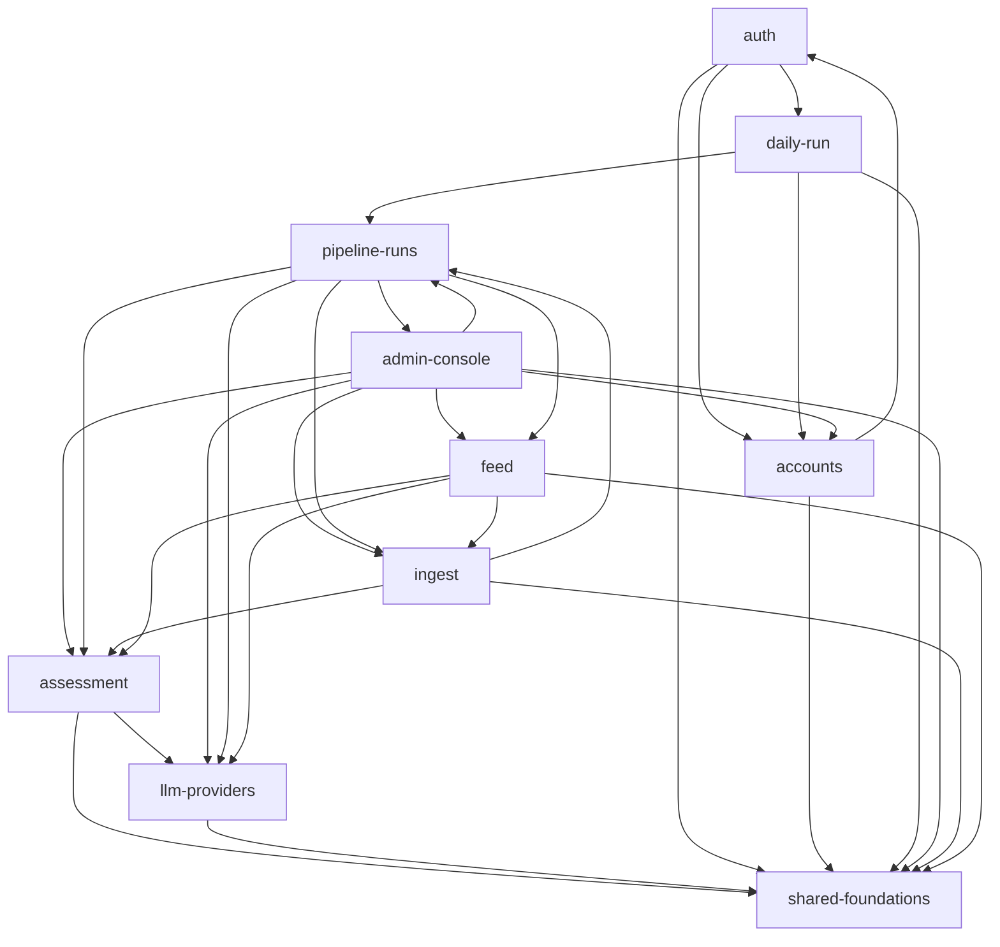
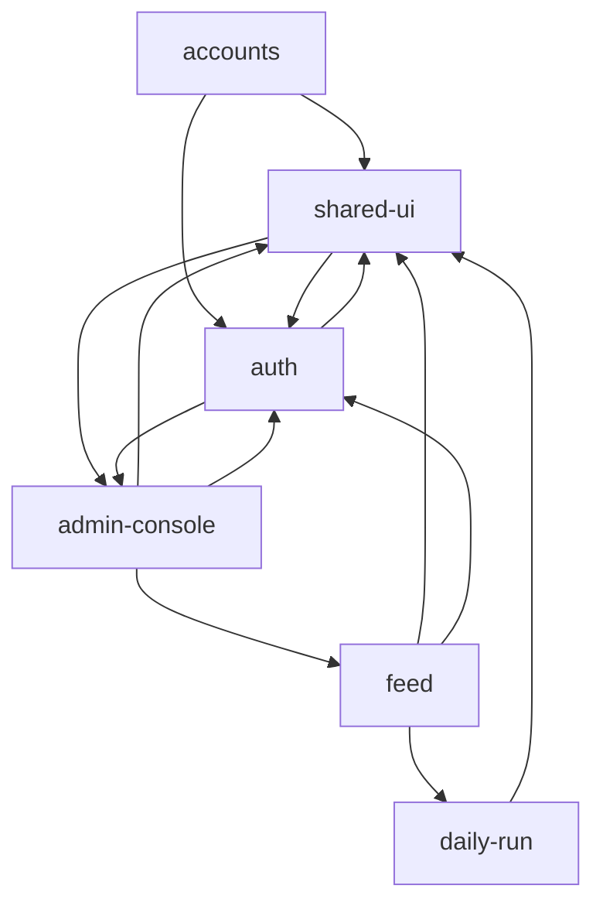

# Dowody: struktura

Statyczny graf zależności z HEAD `5b6eabb`, złożony do możliwości z `context/map/.work/capabilities.tsv` przez wspólne `attribute.py` (`capability(path)`; mapowanie plik → możliwość w `.work/structure-modules.tsv`, 0 plików nieprzypisanych). Graf wyjaśnia możliwości, nie szereguje ich. Oznaczenia: **evidence** (wynik polecenia), **inference** (interpretacja), **unknown** (ślepa plamka).

## Graph sources

| Język / moduł | Źródło | Poziom | Pokrycie | Confidence | Ślepe plamki |
|---|---|---|---|---|---|
| Java — `szczur-radar-api/src/main/java` | `javac -proc:none` źródeł z HEAD do scratchpada (classpath z `./mvnw -o dependency:build-classpath`, tylko lokalne `~/.m2`, nic nie pobrano) + `jdeps -verbose:class` → klasa → plik źródłowy (klasy zagnieżdżone i pomocnicze przez `javap SourceFile`) | 2 (toolchain) | 222 z 225 plików `.java` w krawędziach; poza grafem: `config/ClockConfig`, `config/SessionConfig`, `health/HealthController` (brak zależności wewnętrznych) | high dla krawędzi kodu | `target/classes` w repo był nieaktualny (9.10, bez `notifications`, `internal`) — dlatego kompilacja od nowa; stałe wkompilowane (`static final` String/prymitywy) i argumenty generyczne mogą zniknąć z bajtkodu; Java nie odróżnia krawędzi type-only (wszystkie liczone jako `runtime`); wstrzykiwanie Spring/Embabel niewidoczne |
| TypeScript/Vue — `szczur-radar-web/src`, `dev/` | regex importów w `.ts`/`.vue` (bez `*.test.ts`), ścieżki względne rozwiązane do plików; aliasów brak (`tsconfig`/`vite.config` bez `paths`/`alias`) | 4 (fallback) | 35 z 36 plików; poza grafem `dev/mock-api.js` (samodzielny serwer atrapy) | medium | 11 krawędzi `import type` oddzielone; 1 dynamiczny `import()` (router → `KitchenSinkView`) liczony jako runtime; brak rozwiązywania re-eksportów; `node_modules` jest, ale bez dependency-cruiser/madge |
| TS — `.railway/railway.ts` (IaC) | `git grep` referencji `*.env.*` | 4 | 1 plik, brak grafu wewnętrznego | low | referencje między serwisami to konfiguracja, nie importy |
| Shell — `tools/db-backup`, `tools/pipeline-trigger` | `git grep` ścieżek HTTP i nazw tabel | 4 | brak grafu plików (skrypty samodzielne) | low | zależności tylko przez sieć i schemat bazy |
| Między językami | `git grep` URL-i w `web/src/api/*.ts`, `@*Mapping` w kontrolerach, `trigger.sh`, `Caddyfile` | 4 | wszystkie trasy | inference | kontrakt JSON (kształt pól) nie jest sprawdzany przez graf |

Surowe dane: `.work/structure-edges-java.csv` (754 krawędzie), `.work/structure-edges-ts.csv` (113: 102 runtime, 11 type), `.work/structure-metrics*.md`, `.work/structure-pairs.txt`, `.work/structure-2cycles.txt`, `.work/structure-tests.txt`.

## Capability graph

Krawędzie runtime między możliwościami; Ca/Ce = liczba **możliwości** (nie plików). Kolumna „bez mechanicznych” wyklucza konwertery enumów (`persistence/converters/`), `SzczurRadarApiApplication`↔`cli` i `config/ContractValueBinding` (Java) oraz `router/index.ts`, `KitchenSinkView`, `main.ts` (TS) — patrz Mechanical signals. **evidence**

### Backend (Java)

| Capability | Ca | Ce | Instability | Ca / Ce / I bez mechanicznych |
|---|--:|--:|--:|---|
| shared-foundations | 8 | 7 | 0.47 | 8 / 0 / **0.00** |
| assessment | 5 | 2 | 0.29 | 4 / 2 / 0.33 |
| llm-providers | 5 | 1 | 0.17 | 4 / 1 / 0.20 |
| pipeline-runs | 4 | 5 | 0.56 | 3 / 5 / 0.63 |
| ingest | 4 | 3 | 0.43 | 3 / 3 / 0.50 |
| accounts | 4 | 2 | 0.33 | 3 / 2 / 0.40 |
| feed | 3 | 4 | 0.57 | 2 / 4 / 0.67 |
| admin-console | 2 | 7 | 0.78 | 1 / 7 / 0.88 |
| auth | 1 | 3 | 0.75 | 1 / 3 / 0.75 |
| daily-run | 1 | 3 | 0.75 | 1 / 3 / 0.75 |
| platform (`health`) | 0 | 0 | — | poza grafem |

Najgrubsze krawędzie (liczba krawędzi plik→plik): `assessment→llm-providers` 13, `feed→assessment` 20, `admin-console→pipeline-runs` 20, `pipeline-runs→feed` 17, `pipeline-runs→ingest` 15, `daily-run→pipeline-runs` 11, `auth→accounts` 10, `ingest→assessment` 9.

### Frontend (Vue/TS)

| Capability | Ca | Ce | Instability | bez mechanicznych |
|---|--:|--:|--:|---|
| shared-ui | 5 | 3 | 0.38 | 5 / 2 / 0.29 |
| auth | 4 | 4 | 0.50 | 4 / 2 / 0.33 |
| feed | 3 | 3 | 0.50 | 1 / 3 / 0.75 |
| admin-console | 2 | 3 | 0.60 | 2 / 3 / 0.60 |
| accounts | 1 | 2 | 0.67 | 0 / 2 / 1.00 |
| daily-run | 1 | 1 | 0.50 | 1 / 1 / 0.50 |

### Krawędzie między językami i serwisami (inference z `git grep`)

| Od | Do | Przez |
|---|---|---|
| web `api/auth.ts` (auth) | `AuthController` `/api/auth/*` | HTTP przez Caddy `/api/*` |
| web `api/activation.ts` (accounts) | `ActivationController` `/api/auth/activation[/lookup]` | HTTP |
| web `api/posts.ts` (feed) | `PostController` `/api/posts[/{id}[/raw]]`; także `FailedPostController` `/api/admin/posts/failed` (admin-console) | HTTP — klient feedu obsługuje też trasę admina |
| web `api/pipeline.ts`, `api/notifications.ts` (admin-console) | `PipelineRunController`, `NotificationController` `/api/admin/*` | HTTP |
| web `api/freshness.ts` (daily-run) | `FreshnessController` `/api/freshness` | HTTP |
| `tools/pipeline-trigger/trigger.sh` (daily-run) | `InternalPipelineRunController` `/internal/pipeline-runs/*` | HTTP sieć prywatna, poza Caddy |
| `szczur-radar-web/Caddyfile` (platform) | API `{$API_PRIVATE_DOMAIN}:{$API_PORT}` | reverse proxy |
| `tools/db-backup/*.sh` (db-backup) | schemat: `COUNTED_TABLES=(users pipeline_runs posts assessments raw_payloads)`, `REQUIRED_TABLES` (9 tabel), `flyway_schema_history`, `spring_session*` | SQL po nazwach tabel |
| `.railway/railway.ts` (platform) | `db.env.PG*` ×5, `api.env.RAILWAY_PRIVATE_DOMAIN` ×2, `api.env.PIPELINE_TRIGGER_TOKEN`, `${{szczur-radar-web.RAILWAY_PUBLIC_DOMAIN}}` | referencje zmiennych Railway |
| `llm/api/LlmCheckController` `/api/admin/llm/check` (llm-providers) | brak konsumenta w SPA | **unknown (external)** — wg dokumentacji wołany ręcznie w przeglądarce |

## Blast radius per capability

Dla możliwości o krytyczności high (+ daily-run, admin-console). Liczby = krawędzie plik→plik. **evidence** (krawędzie), **inference** (wnioski).

| Capability | Kto zależy (incoming) | Od czego zależy (outgoing) | Kontrakty importowane przez innych |
|---|---|---|---|
| assessment | feed 20, ingest 9, pipeline-runs 7, admin-console 4 (+ konwertery 4, binding 2) | llm-providers 13, shared-foundations 5 (`Whitespace`) | `AssessmentInputV1` (Ca 28 plików), `AssessmentOutputV2` (Ca 24), `Violation` (23), `ValidationRule`, `RuleId` (17), `AssessmentResult` (9), enumy `ItemType`, `Direction`, `TargetKind`, `Provenance` |
| llm-providers | assessment 13, pipeline-runs 7, feed 3, admin-console 1 (+ konwertery 5) | shared-foundations 1 | `config/LlmProviderProperties` (Ca 21, Ce 0 — najczęściej importowany plik konfiguracji), `Channel`, `OutputMode` (8), `LlmClient`, `LlmRequest`, `LlmCallException`, `TransportRetry` |
| pipeline-runs | admin-console 20, daily-run 11, ingest 2 (+ konwertery 5) | feed 17, ingest 15, llm-providers 7, assessment 7, admin-console 2 | `PipelineRunService` (Ce 18 — hub orkiestracji), `PipelineRun`, `PipelineRunRepository`, enumy `RunStatus` (Ca 12), `RunKind` (11), `InterruptionCause`, `RunStep` |
| feed (`posts`) | pipeline-runs 17, admin-console 5 (+ konwerter 1) | assessment 20, shared-foundations 7, ingest 5, llm-providers 3 | encje `Post` (Ca 8), `PostRepository`, `PostStage` (9), `Assessment` — **tabele postów są zapisywane przez silnik, nie przez feed** (inference) |
| ingest | pipeline-runs 15, feed 5, admin-console 2 (+ konwertery 3) | assessment 9, shared-foundations 3, pipeline-runs 2 | `sources/Source` (Ca 19, Ce 0), `SourcePost`, `RawPayloadStore`, `RawPayloadRef` (6), `RawInputMapper` |
| accounts | auth 10, admin-console 2, daily-run 1 | shared-foundations 7, auth 2 (`Passwords`) | `User`, `UserRepository`, `Role` (Ca 12), `Emails`, `SystemAccount` |
| auth | accounts 2 | accounts 10, shared-foundations 8, daily-run 2 | `auth/Passwords` (argon2) |
| daily-run | auth 2 (`SecurityConfig` → filtr tokenu); `trigger.sh` przez HTTP | pipeline-runs 11, shared-foundations 2, accounts 1 | `PipelineTriggerToken`, `PipelineTriggerTokenFilter`; trasy `/internal/pipeline-runs/*` |
| admin-console | pipeline-runs 2 (`RunNotifications`) | pipeline-runs 20, shared-foundations 6, feed 5, assessment 4, accounts 2, ingest 2, llm-providers 1 | `RunNotifications` |
| db-backup | — | schemat bazy przez nazwy tabel (5 liczonych, 9 wymaganych) | — |
| platform | wszystko pośrednio (CI, IaC, obrazy) | — | trasy `/api/health`, `/api/ready` (healthcheck Railway) |

Wnioski (inference):
- **assessment i llm-providers to stabilne centrum backendu**: niska niestabilność (0.29 / 0.17), duże Ca plikowe. Zmiana kontraktu `AssessmentInputV1/OutputV2` sięga do feed, ingest, pipeline-runs i admin-console (4 możliwości + konwertery).
- **pipeline-runs to orkiestrator**: zależy od 5 możliwości, zależą od niego admin-console i daily-run (oba tylko przez kontrolery). Zmiana `PipelineRunService` dotyka obu punktów wejścia.
- **feed jest „właścicielem” encji, które pisze kto inny**: `pipeline-runs → feed` 17 krawędzi (`Post`, `PostRepository`, `PostStage`). Zmiana encji posta to zmiana silnika.

## Cycles

Tylko runtime. **evidence** z `graph-metrics.mjs` na poziomie plików.

| Cykl (plikowy) | Rozmiar | Możliwość | Ocena |
|---|--:|---|---|
| `SzczurRadarApiApplication` → `cli/CommandLine` → `Create*/Migrate/ResetPassword/LinkCommand` → `SzczurRadarApiApplication` | 7 plików; najmniejsza pętla 3 pliki (`Application → CommandLine → MigrateCommand → Application`) | shared-foundations ↔ accounts | inference: dyspozytor CLI w klasie `main`, komendy startują kontekst z tą klasą — bootstrap z założenia, nie ukryty kontrakt |
| `contract/Anchor` → `Evidence` → `Quote` | 3 | assessment | rekordy modelu kontraktu V2 odwołujące się wzajemnie; wewnątrz jednej możliwości |
| `contract/Item` → `Parent` → `TextFields` | 3 | assessment | j.w. |
| `activation/IssueOutcome` ↔ `IssuedLink` | 2 | accounts | typy wyniku wydania linku; wewnątrz możliwości |
| TS: brak cykli plikowych | 0 | — | evidence |

**Pętle między możliwościami bez cyklu plikowego** (artefakt podziału footprintu, nie pętla w kodzie) — `.work/structure-2cycles.txt`:
- `auth ↔ accounts`: `auth/*` → `user/*` (10), a `auth/activation/ActivationLinks`, `cli/AdminBootstrap` → `auth/Passwords` (2). Pakiet `auth/activation` należy do accounts.
- `pipeline-runs ↔ admin-console`: `PipelineRunService`, `PipelineStartupRecovery` → `notifications/RunNotifications` (2), a kontrolery admina i `RunNotifications` → `pipeline/run/*` (20).
- `pipeline-runs ↔ ingest`: `pipeline/step/SourceIngest` (ingest) → `pipeline/flow/RunFlow`, `SourceNotConfiguredException` (2).
- web `auth ↔ admin-console`: `auth/session.ts → notificationsStore.ts` i `NotificationBell.vue → auth/session.ts`.
- web `auth ↔ shared-ui`: `AppHeader.vue → api/auth.ts, auth/session.ts` i widoki auth → `api/client.ts`.
- SCC 7 możliwości backendu (po usunięciu mechanicznych) i 5 możliwości frontu powstaje z tych krawędzi; żaden cykl plikowy poza tabelą wyżej.

## Broken boundaries

Zamierzone warstwy (**inference** z REPOSITORY_GUIDELINES i pakietów): `text`/`persistence`/enumy → kontrakty (`agents/assessor/contract`) → klienci (`llm`, `sources`, `raw`) → encje (`posts`, `user`, `pipeline/run`) → silnik (`pipeline`) → kontrolery/API (`*/api`, `auth`, `internal`) → CLI. Web: `api/client.ts` → `api/*.ts` → komponenty → widoki → router/`main.ts`.

| Krawędź runtime | Pliki | Wobec czego | Status |
|---|---|---|---|
| encja → konfiguracja dostawcy | `posts/Assessment` → `config/LlmProviderProperties`, `llm/Channel`, `llm/OutputMode`; też 3 konwertery → `LlmProviderProperties` | encja trwałości zależy od klasy właściwości konfiguracji (enumy `ServiceTier`/`ReasoningEffort`/`Provider` trzymane w klasie konfiguracji) | inference |
| admin → stan silnika | `pipeline/api/PipelineRunController` → `pipeline/state/RunRecorder` | kontroler sięga do warstwy warunkowych zapisów stanu obok `PipelineRunService` | inference (cel wywołania niezweryfikowany) |
| silnik → funkcja admina | `PipelineRunService`, `PipelineStartupRecovery` → `notifications/RunNotifications` | rdzeń woła możliwość admina; powiadomienia są w praktyce częścią silnika | inference |
| źródło → przepływ silnika | `pipeline/step/SourceIngest` → `pipeline/flow/RunFlow` | guideline: „nowe źródło zmienia tylko pozyskanie i mapowanie” — punkt wpięcia źródła zna typy przepływu | inference |
| auth → daily-run | `config/SecurityConfig` → `internal/PipelineTriggerToken*` | konfiguracja łańcuchów filtrów zna filtr crona (config-as-code, zasada 2) | mechaniczne |
| web auth → admin | `auth/session.ts` → `notificationsStore.ts` | sesja czyści magazyn dzwonka przy wylogowaniu (udokumentowane w guidelines) — zależność odwrócona | inference |
| web shell → funkcje | `AppHeader.vue` (shared-ui) → `NotificationBell.vue`, `api/auth.ts`, `auth/session.ts` | wspólny komponent składa funkcje; oczekiwane dla nagłówka aplikacji | inference |
| web feed → auth/router | `FeedView.vue` → `router/scroll.ts` | widok zna pomocnika przewijania routera | niski |
| web feed client ↔ admin | `api/posts.ts` (feed) obsługuje `/api/admin/posts/failed`; `admin-console → feed` 1 runtime + 1 type | klient feedu niesie trasę admina | inference |

## Test risks

`.work/structure-tests.txt`: pliki testów per możliwość, `@SpringBootTest`, mocki, testy importujące ≥3 inne możliwości (import-grep, bez referencji z tego samego pakietu → **low confidence**).

| Capability | Unit `*Test` | `*IT` (Spring + Testcontainers) | Testy szerokie (≥3 inne możliwości) | Ocena (inference) |
|---|--:|--:|--:|---|
| assessment | 11 | 1 | 0 | łatwa izolacja: czysty model + walidator; LLM za `llm/` |
| llm-providers | 7 | 1 | 0 | izolowalne przez fixture'y HTTP |
| ingest | 8 | 0 | 0 | izolowalne (mapper, repozytorium Wykop na fixture'ach) |
| pipeline-runs | 8 | 3 | 5 | trudne: orkiestracja ciągnie feed, ingest, assessment, llm; integracja z Postgresem + Embabel; 5 z 11 testów szerokich |
| feed | 0 | 2 | 3 | tylko integracja; encje zapisuje silnik, więc dane testowe idą przez tabele innych możliwości |
| daily-run | 2 | 3 | 2 | integracja + `tools/pipeline-trigger/test.sh` (Docker, atrapa API); brak testu web dla `api/freshness.ts` |
| admin-console | 0 | 3 | 1 | tylko integracja po stronie API; web: 7 testów Vitest |
| auth | 6 | 4 | 0 | IT z sesją JDBC i Testcontainers |
| accounts | 9 | 4 | 0 | CLI w IT (pełny kontekst Spring) |
| db-backup | — | — | — | tylko `tools/db-backup/test.sh` (Docker, migracje, restore); listy tabel ręczne |
| model-evaluation | 6 | 0 | 2 | tag `measurement`, poza CI |

Wszystkie `*IT` wymagają Dockera (brak Dockera = `verify` czerwony). Web: 25 plików `*.test.ts` (shared-ui 7, admin-console 7, feed 7, auth 3, accounts 1).

## Centres and thin entry points

| Plik | Ca | Ce | I | Rola (inference) |
|---|--:|--:|--:|---|
| `agents/assessor/contract/AssessmentInputV1` | 28 | 6 | 0.18 | kontrakt nośny wejścia oceny |
| `agents/assessor/contract/AssessmentOutputV2` | 24 | 5 | 0.17 | kontrakt nośny wyniku |
| `agents/assessor/validation/Violation` | 23 | 1 | 0.04 | rdzeń walidatora D1–D15 |
| `config/LlmProviderProperties` | 21 | 0 | 0.00 | konfiguracja jako zależność domeny (patrz Broken boundaries) |
| `persistence/EnumValueConverter` | 19 | 0 | 0.00 | fan-in z założenia (zasada 2) — mechaniczne |
| `sources/Source` | 19 | 0 | 0.00 | rejestr źródeł; nowe źródło = nowa stała (guideline) |
| `config/ErrorCode`, `user/Role`, `pipeline/run/RunStatus` | 12 | 0 | 0.00 | zamknięte zbiory wartości |
| web `api/client.ts` | 11 | 0 | 0.00 | jedyny klient API |
| web `labels.ts`, `AppButton.vue`, `StatusMessage.vue` | 10 / 9 / 9 | 0 | 0.00 | system projektowy |

Huby wychodzące (wysokie Ce): `agents/assessor/Assessor` (Ce 22), `pipeline/PipelineRunService` (18), `ContractV2Rules` (16), `PostController`, `PipelineRunController`, `ConcurrentAssessmentDispatcher` (16), `InternalPipelineRunController` (12).

Punkty wejścia (Ca 0): 45 plików Java — kontrolery (`PostController`, `PipelineRunController`, `InternalPipelineRunController`, `NotificationController`, `FailedPostController`, `AuthController`, `ActivationController`, `LlmCheckController`), `PipelineAgent`, `AssessorAgent`, `RunWatchdog`, `PipelineStartupRecovery`, 16 konwerterów. **Uwaga**: `ConcurrentAssessmentDispatcher`, `PostgresRawPayloadStore`, `WykopFetcher` mają Ca 0 tylko dlatego, że są wstrzykiwane przez interfejs/Spring — to nie wejścia, lecz implementacje (unknown dla grafu). Cienkie wejścia: `InternalPipelineRunController` (daily-run) deleguje do `PipelineRunService`; `trigger.sh` deleguje całą pracę do API. Web: jedyne wejście `main.ts`; `router/index.ts` (Ce 10) to tabela tras.

## Mechanical signals

| Sygnał | Liczba | Zasada |
|---|--:|---|
| konwertery enumów `persistence/converters/*` → enumy w 6 możliwościach | 19 krawędzi (16 plików), `EnumValueConverter` Ca 19 | 2 (config as code); `JpaSchemaIT` + `CHECK` w migracjach łapią rozjazd |
| `SzczurRadarApiApplication` ↔ `cli/*` | 2 + 4 krawędzie, cykl 7 plików | bootstrap |
| `config/ContractValueBinding` → `Direction`, `TargetKind` | 2 | 2 |
| `config/SecurityConfig` → filtr i token `internal/` | 2 | 2 |
| web `router/index.ts` → 7 widoków (tabela tras) | 10 krawędzi | 2 |
| web `KitchenSinkView.vue` (dev only) → komponenty feed/admin | 8 krawędzi (6 runtime, 2 type) | narzędzie deweloperskie |
| web `import type` | 11 | 9 |
| Java type-only | nie do odróżnienia | 9 — unknown |

Po wyłączeniu powyższych `shared-foundations` ma Ce 0 (czysty liść, I = 0.00).

## Unknowns

- **Wiązanie w runtime (Java):** Spring DI (wstrzykiwanie przez interfejsy: `LlmClient`, `RawPayloadStore`, dispatcher), Embabel GOAP (`@AchievesGoal` w 2 plikach — kolejność akcji agenta wyznacza planer, nie importy), `@EventListener` (1), `SmartInitializingSingleton` (2), `@ConditionalOn*` (3, np. Wykop bez kluczy). Graf pokazuje typy, nie kto kogo wywołuje.
- **Sprzężenie przez tabele:** SQL w 10 plikach (`JdbcTemplate`/`JdbcClient`/native query: `pipeline/state/PostTransitions`, `RunRecorder`, `PipelineRunService`, `posts/*Repository`, `NotificationRepository`, `ActivationLinks`, `AdminBootstrap`, `HealthController`). Wspólne tabele (`posts`, `assessments`, `pipeline_runs`) łączą możliwości poza grafem.
- **db-backup ↔ schemat:** listy tabel w `backup.sh` (`COUNTED_TABLES`, 5) i `restore-check.sh` (`REQUIRED_TABLES`, 9) są ręczne; `activation_tokens` (V7) i `notifications` (V9) nie ma w żadnej. `pg_dump` i tak zrzuca wszystkie tabele — czy brak w sprawdzeniu jest zamierzony: unknown.
- **Kontrakt JSON SPA ↔ API:** typy w `web/src/api/*.ts` vs rekordy odpowiedzi Java — brak generowanego klienta, brak testu kontraktu wykrytego tym skanem; rozjazd pól wychodzi dopiero w runtime/e2e.
- **Konsumenci zewnętrzni:** `/api/admin/llm/check` bez konsumenta w repo (external/manual); `/internal/**` tylko `trigger.sh`.
- **Języki bez grafu:** shell (`tools/*`), IaC (`.railway/railway.ts`) — tylko referencje z grep.
- **Narzędzia warte instalacji (nie instalowano):** `dependency-cruiser` lub `madge` dla `szczur-radar-web` (parsowanie SFC Vue, re-eksporty, reguły granic); ArchUnit / Spring Modulith w testach API, by egzekwować granice pakietów (dziś brak reguł zależności w repo — `pom.xml` i `package.json` bez archunit/cruiser/modulith); `ast-grep` dla dokładniejszego fallbacku.

## Polecenia

- `./mvnw -o -q dependency:build-classpath`, `javac -proc:none --release 25 -d <scratchpad>`, `jdeps -verbose:class -filter:none -e 'pl\.szczurradar\..*'`, `javap -v` (SourceFile)
- `python3 <scratchpad>/build_edges.py` (import `attribute.capability`), `python3 .work/structure-pairs.py`, skrypty 2-cykli i testów (wyniki w `.work/structure-*.txt`)
- `node .claude/skills/10x-repo-map/scripts/graph-metrics.mjs` — `--modules .work/structure-modules.tsv --kind runtime [--exclude …] [--emit mermaid]` i poziom plików
- `git grep` — trasy `@*Mapping`, URL-e `/api/*` w web, `/internal/` w `trigger.sh`, `Caddyfile`, tabele w `tools/db-backup`, `*.env.*` w `.railway/railway.ts`, adnotacje DI/SQL
