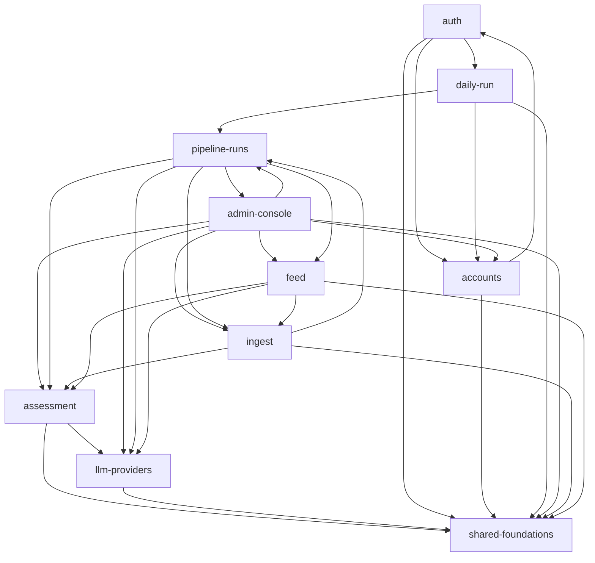

# Mapa projektu: szczur-radar

## TL;DR

Szczur Radar co noc pobiera posty inwestycyjne z Wykopu, każdy ocenia jednym wywołaniem LLM według kontraktu oceny V2 i pokazuje zaproszonym użytkownikom feed z filtrem i widokiem posta. Admin ma panel przebiegów z powiadomieniami, a konta zakłada się wyłącznie przez CLI. Rdzeń backendu (Spring Boot 4 / Java 25) to łańcuch **ingest → pipeline-runs → assessment → llm-providers**, a feed tylko czyta to, co zapisał silnik. Wokół są: platforma Railway (IaC, CI, dwa crony) i backup bazy przez `pg_dump`. Największy szum to platforma, ale prawie cały jest mechaniczny: każda zmiana dotyka IaC/CI, a poprawki to iteracja konfiguracji. **Realnie boli tam, gdzie produkcja już się zepsuła.** Chodzi o silnik przebiegów (run „trwający” ~22 h, przerwania przez deploy), klientów LLM (klucz 401, błędy flex w HTTP 200, `LLM_TIMEOUT=120` czytane jako 120 ms) oraz deploy Railway (Postgres zawieszony po restarcie, merge dokumentacji przerywający przebieg). Kontrakt oceny jest najszerzej importowanym kodem (`AssessmentInputV1`: Ca 28 plików), więc jego zmiana sięga czterech możliwości. Historia ma tylko 3 tygodnie i jednego autora, który pracuje z agentem. Rankingi opisują fazy budowy, nie dojrzałe trendy.

Graf możliwości backendu (runtime, z `evidence/3-structure.md`, bez krawędzi mechanicznych):

## Teren

Szum według rodzin sygnałów, ocenianych względem pozostałych możliwości: **zm** = zmiany i trend (historia), **fix** = udział poprawek i reverty, **tar** = tarcie (incydenty, drugie podejścia, otwarte sprawy), **uwg** = uwaga planistyczna, **zas** = zasięg w runtime. H/M/L = wysoki/średni/niski; `*` = sygnał w dużej mierze mechaniczny (zob. „Wygląda na gorące, nie jest”).

| Możliwość | Co robi | Krytyczność | zm | fix | tar | uwg | zas | Trend | Gdzie żyje |
|---|---|---|---|---|---|---|---|---|---|
| **pipeline-runs** | kolejka przebiegów w tle: fetch→store→select→assess→summarize, Embabel GOAP, odzyskiwanie po starcie, watchdog | high (rdzeń, zapis danych, inne zależą) | M | L | **H** | **H** | **H** | stały od W41 | `api/pipeline/**` |
| **llm-providers** | klienci OpenRouter/Gemini/DeepSeek, ponowienia transportu, flex, walidacja `LLM_*` | high (integracja zewn., koszt LLM, inne zależą) | M | **H** | **H** | **H** | **H** | sezonowy (W41) | `api/llm/**`, `config/Llm*` |
| **assessment** | kontrakt oceny V2: model, schemat, prompt, parser, walidator D1–D15, odsiew | high (rdzeń, wszyscy czytają jego wynik) | M* | L | M | **H** | **H** | wygasa | `api/agents/assessor/**`, `resources/assessor/` |
| **platform** | CI, IaC Railway, obrazy Docker, Caddy, healthcheck | high (zły apply/merge zatrzymuje produkcję) | H* | H* | **H** | H* | H (bez grafu) | objętość spada | `.railway/`, `.github/`, Dockerfile'e, `Caddyfile` |
| auth | logowanie JSON, sesja JDBC, limiter, filtr Origin, deny-by-default, guard SPA | high (tożsamość, publiczne wejście) | M* | M | M | H | L | stały | `api/auth`, `config/SecurityConfig`, web `router/`, `auth/` |
| accounts | CLI operatora, linki aktywacyjne, `/activate`, konto systemowe | high (tożsamość, dane użytkownika) | M | L | M | M | M | sezonowy | `api/cli`, `api/user`, `auth/activation` |
| feed | `/api/posts` z filtrem, widok posta i surowe dane | high (główna wartość) | H | L | L | M | M | rośnie | `api/posts/**`, web `FeedView`, `PostDetailView`, `PostCard` |
| ingest | pobranie z Wykopu, mapowanie do wspólnego modelu, surowe payloady | high (rdzeń, integracja zewn.) | M | L | L | M | M | wygasa | `api/sources/**`, `api/raw` |
| db-backup | codzienny `pg_dump`, restore check, bucket, retencja | high (jedyny backup na Hobby) | L | L | **H** | M | ? | nowy (W42) | `tools/db-backup/` |
| admin-console | `/admin`, strona przebiegu, ponowienia, dzwonek | medium (tylko admin, odpala płatne runy) | H | L | L | H | L | rośnie | web `AdminView`, `RunDetailView`, `Notification*`, `api/notifications` |
| daily-run | cron `pipeline-trigger` → `/internal/**` z tokenem, etykieta świeżości | medium (wejście z tokenem) | L | L | M | L | L | nowy (W42) | `tools/pipeline-trigger/`, `api/internal`, `InternalPipelineRunController` |
| model-evaluation | gold sample, nagrania, metryki (tylko testy) | low | L | L | L | M | L | wygasa | `src/test/.../measurement` |

- **shared-ui** (system projektowy, klient API, powłoka SPA): rośnie wraz z widokami; co-change z feedem w 5 na 5 commitów. `web/dev/mock-api.js` to ręcznie utrzymywany bliźniak API.
- **shared-foundations** (konwertery enumów, `ErrorCode`, `Whitespace`, testy schematu): po odjęciu krawędzi mechanicznych to czysty liść (I = 0).
- **docs-planning**: 477 zmian, 46 z 47 commitów. `deploy-plan.md` (30 commitów) to w praktyce dziennik incydentów platformy. Dług techniczny jest prowadzony w prozie (17 otwartych `[ ]` w follow-upach, 18 pozycji w roadmap Parked), a w kodzie jest 0 markerów TODO/FIXME.
- **Pokrycie możliwości:** 0 zmian nieprzypisanych. Koszyki zbiorcze to 30,6% zmian w kodzie (platform 15,2%, shared-ui 7,8%, shared-foundations 7,6%).
- **Gdzie foldery nie pasują do możliwości:**
  - Pakiet `pipeline/` obsługuje 4 możliwości: silnik, kontrolery admina, `/internal` crona i `FreshnessController`.
  - `posts/` to encje feedu, ale zapisuje je silnik (17 krawędzi `pipeline-runs → feed`).
  - `auth/activation` należy do accounts.
  - Web `api/posts.ts` (feed) obsługuje też trasę admina `/api/admin/posts/failed`.
  - `notifications/` to funkcja admina, ale woła ją rdzeń silnika.

## Realne powiązania

| Powiązanie | Źródło | Uwaga |
|---|---|---|
| assessment → llm-providers (13 krawędzi) | graf runtime | stabilne centrum: `LlmProviderProperties` Ca 21, Ce 0 |
| feed → assessment (20), ingest → assessment (9), pipeline-runs → assessment (7), admin → assessment (4) | graf runtime | kontrakty `AssessmentInputV1` (Ca 28) i `AssessmentOutputV2` (Ca 24) |
| pipeline-runs → feed (17), → ingest (15), → llm (7), → assessment (7) | graf runtime | `PipelineRunService` Ce 18 to hub orkiestracji |
| admin-console → pipeline-runs (20), daily-run → pipeline-runs (11) | graf runtime | oba wejścia tylko przez kontrolery |
| pipeline-runs → admin-console (`RunNotifications`) | graf runtime | rdzeń woła funkcję admina; pętla na poziomie możliwości, nie plików |
| `posts/Assessment` (encja) → `config/LlmProviderProperties` | graf runtime | encja trwałości zależy od klasy konfiguracji (enumy trzymane w configu) |
| auth ↔ accounts, pipeline ↔ ingest (`SourceIngest → RunFlow`) | graf runtime | artefakt podziału footprintu; `SourceIngest → RunFlow` łamie regułę „nowe źródło zmienia tylko pozyskanie” (inference) |
| feed–shared-ui (5/1,00), auth–platform (5/0,71), llm–platform (4/0,80), accounts–auth (3/1,00), admin–feed (3/1,00) | co-change | pominięto 3 mega-commity (S-02, S-05, S-06), więc **co-change rdzenia jest ślepy**; zależności rdzenia pokazuje graf |
| SPA `src/api/*.ts` ↔ rekordy odpowiedzi Java | ręczny kontrakt, **brak testu kontraktu** | rozjazd pól wyjdzie dopiero w runtime |
| API ↔ `szczur-radar-web/dev/mock-api.js` | ręczny bliźniak, **bez strażnika** | historia: zmieniany w 7 commitach |
| `tools/pipeline-trigger/trigger.sh` ↔ `GET /internal/pipeline-runs/{id}` | kontrakt HTTP | testowany tylko na atrapie API (`test.sh`) |
| `tools/db-backup` ↔ schemat bazy | ręczne listy tabel | `REQUIRED_TABLES` (9) i `COUNTED_TABLES` (5) nie znają `activation_tokens` (V7) ani `notifications` (V9). `pg_dump` zrzuca wszystko, ale restore check ich nie sprawdza (sprawdzone na HEAD) |
| `.railway/railway.ts` → zmienne wszystkich usług | referencje IaC (grep) | jeden plik konfiguruje wszystkie 5 usług; zły apply restartował produkcję |
| konwertery enumów, `ErrorCode`, `MigrationsIT`/`JpaSchemaIT`, `AuthorizationCompletenessIT`, `router/index.ts` | **mechaniczne** | config-as-code lub lockstep strzeżony testami |
| `/api/admin/llm/check` | **unknown (external)** | brak konsumenta w repo; wołany ręcznie w przeglądarce |

## Strefy ryzyka

### 1. Silnik przebiegów (`pipeline-runs`)
Wszystko przechodzi przez orkiestrator, a produkcja już trzy razy pokazała, że jego stan potrafi się rozjechać z rzeczywistością.
- **tar:** run „trwający” ~22 h, przerwania przez deploy (2026-10-13: 2 runy `interrupted`, 4 posty oddane), 7 min bez logów. Wszystkie trzy wywołały S-06 (`2-discussion.md`, Friction).
- **uwg:** S-02 + S-06: 6 plików review, ~28 findings, 6 otwartych follow-upów (m.in. „spalanie prób przy błędzie całego runu”). Ta uwaga częściowo wynika z tych samych incydentów, więc liczę ją razem z tarciem.
- **zas:** Ce = 5 możliwości, `PipelineRunService` Ce 18; zależą od niego admin i cron. 5 z 11 testów jest szerokich, a sprzężenie przez wspólne tabele (SQL w 10 plikach) jest poza grafem (`3-structure.md`).
- **hub:** `PipelineStartupRecovery` zmieniany w S-02, S-05 i S-06 (`1-history.md`, Hub files).
- Pliki: `szczur-radar-api/src/main/java/pl/szczurradar/api/pipeline/PipelineRunService.java`, `pipeline/PipelineStartupRecovery.java`, `pipeline/RunWatchdog.java`, `pipeline/state/RunRecorder.java`, `pipeline/flow/RunFlow.java`.

### 2. Klienci LLM (`llm-providers`)
To jedyne miejsce z realnym błędem w kodzie, który wyszedł na produkcji i kosztował dane.
- **fix/tar** (jedna przyczyna, liczona raz): klucz 401, flex zwracający błąd w HTTP 200 (15 postów straciło próbę) i dedykowany fix-PR #40; do tego `LLM_TIMEOUT=120` przeczytane jako 120 ms (`1-history.md` Fix pressure, `2-discussion.md` Friction).
- **uwg:** F-02 to największa zmiana (6 plików review, 7 otwartych follow-upów), wspólna z assessment.
- **zas:** `config/LlmProviderProperties` ma Ca 21 i importuje go nawet encja `posts/Assessment`. Instability 0,17.
- Pliki: `szczur-radar-api/src/main/java/pl/szczurradar/api/llm/transport/TransportRetry.java`, `llm/openrouter/OpenRouterClient.java`, `config/LlmProviderProperties.java`, `llm/CLAUDE.md`.

### 3. Kontrakt oceny (`assessment`, podobszar `contract/`)
Najszerzej importowany kod. Zmiana wersji kontraktu przeciąga feed, ingest, silnik i admina.
- **uwg:** 61 plików planu (8548 linii), 6 review, ~40 findings, 7 follow-upów, druga próba (#23 w Pythonie zamknięty → #31 w Javie).
- **zas:** `AssessmentInputV1` Ca 28, `AssessmentOutputV2` Ca 24, `Violation` Ca 23. Zmiana kontraktu dotyka 4 możliwości.
- Niezależność: wysoka zmienność (88 zmian) to narodziny w jednej kampanii, więc nie liczę jej jako szumu. Strefa stoi na uwadze i zasięgu.
- Pliki: `szczur-radar-api/src/main/java/pl/szczurradar/api/agents/assessor/contract/AssessmentInputV1.java`, `agents/assessor/contract/AssessmentOutputV2.java`, `agents/assessor/Assessor.java`, `szczur-radar-api/src/main/resources/assessor/system-prompt.md`.

### 4. Deploy i IaC Railway (`platform`, podobszar `.railway/` + CI)
Liczba commitów i udział fixów są tu mechaniczne. Do strefy wprowadzają ją wyłącznie zdarzenia produkcyjne.
- **tar:** Postgres nie wstał po uśpieniu (2026-10-09, `/api/ready` 503), apply restartujący bazę zawiesił ją (2026-10-12), `watchPatterns` w złym miejscu sprawiło, że merge dokumentacji przerwał przebieg (2026-10-13), a bucket backupu nie został wdrożony na produkcji. 5 lekcji w `lessons.md` dotyczy Railway (`2-discussion.md`). `deploy-plan.md` to zapis tych samych incydentów, więc nie liczę go osobno.
- **zas:** `.railway/railway.ts` ma 13 partnerów i konfiguruje każdą usługę, a apply z planu restartuje usługi. Shell i IaC nie mają grafu (confidence low).
- Pliki: `.railway/railway.ts`, `.github/workflows/ci.yml`, `szczur-radar-web/Caddyfile`, `context/deployment/deploy-plan.md`.

### Obserwuj (nie spełnia progu)
- **db-backup:** tarcie wysokie (4 incydenty przy wdrożeniu F-01), ale zasięg nieznany. Konkretne pytanie: restore check nie zna tabel z V7 i V9. Czy to zamierzone? Jeśli nie, lista tabel rozjeżdża się z każdą migracją.
- **auth + accounts:** dużo uwagi (S-01: 5 plików review, 2 re-review w jeden dzień; przepisanie w F-03, poprawka #28 ścieżki filtra Origin), ale zasięg mały. Krytyczne ze względu na tożsamość i publiczne trasy aktywacji. Zostało pytanie z roadmapy (Parked): unieważnianie sesji wersją poświadczeń.

### Wygląda na gorące, nie jest
- **platform jako #1** (25 commitów, ~13 fixów w treściach squashy): każda zmiana dotyka IaC/CI (reguła 4), a fixy to iteracja konfiguracji (reguła 5). Do strefy weszły tylko incydenty produkcyjne.
- **auth: 88 zmian w 10 commitach**: głównie rejestry tras (`router/index.ts`, `AuthorizationCompletenessIT`) dotykane przez każdą nową trasę (reguły 2 i 3) plus przepisanie w F-03 (reguła 12).
- **assessment: 88 zmian**: jedna kampania F-02 (narodziny), a 480 plików nagrań to szum.
- **docs-planning** i `tools/render_roadmap.swift`: proza i lockstep z roadmapą (reguły 7 i 8).
- **ErrorCode, MigrationsIT, JpaSchemaIT, konwertery enumów** (`EnumValueConverter` Ca 19): fan-in z założenia, strzeżony testami.
- **ui-hardening #42/#48**: zaplanowane dopracowanie UI, nie defekty.
- **100% autorstwa jednej osoby**: stan bazowy (reguła 6).
- **Pętle między możliwościami** (auth↔accounts itd.): artefakt podziału footprintu. Prawdziwe cykle plikowe są małe: dyspozytor CLI i rekordy kontraktu.

## Kogo zapytać

Baseline: 1 człowiek w oknie (właściciel repozytorium, dwie tożsamości git). 42 z 47 commitów współtworzył Claude. Koncentracja nie jest więc ustaleniem. Formalnej recenzji na forge'u nie ma (0 recenzji na 43 PR), więc wiedza „kto już próbował i dlaczego” leży w artefaktach zmian.

| Strefa | Osoba | Gdzie jest wiedza |
|---|---|---|
| pipeline-runs | właściciel | PR #37, #50, #60; `context/archive/2026-10-06-first-assessed-wykop-feed/`, `…/2026-10-15-pipeline-run-history-dashboard/`, `pipeline/CLAUDE.md` |
| llm-providers | właściciel | PR #31, #40; `context/archive/2026-09-27-assessment-contract-harness/`, `…/2026-10-10-openrouter-in-body-errors/`, `llm/CLAUDE.md` |
| assessment | właściciel | PR #23 (zamknięty), #31; `context/foundation/llm-assessment/` |
| platform / Railway | właściciel (operator Railway) | PR #2, #33, #44, #46, #52, #58; `context/deployment/deploy-plan.md`, `context/foundation/lessons.md` |

## Pierwszy dzień

1. `szczur-radar-api/src/main/java/pl/szczurradar/api/pipeline/CLAUDE.md`, potem `pipeline/PipelineRunService.java`: mapa i hub silnika (wejście dla admina i crona).
2. `szczur-radar-api/src/main/java/pl/szczurradar/api/pipeline/flow/RunFlow.java` i `pipeline/PipelineStartupRecovery.java`: kolejność kroków i odzyskiwanie, czyli tam, gdzie produkcja się psuła.
3. `szczur-radar-api/src/main/java/pl/szczurradar/api/agents/assessor/contract/AssessmentInputV1.java` i `AssessmentOutputV2.java`: kontrakt, który czyta pół systemu; logika w `agents/assessor/Assessor.java`.
4. `szczur-radar-api/src/main/java/pl/szczurradar/api/llm/CLAUDE.md`, potem `llm/transport/TransportRetry.java`: jedyne ponowienia i klasyfikacja błędów dostawców.
5. `szczur-radar-api/src/main/java/pl/szczurradar/api/sources/wykop/WykopRepository.java` (+ `sources/CLAUDE.md`): jak wchodzi źródło.
6. `szczur-radar-api/src/main/java/pl/szczurradar/api/config/SecurityConfig.java` + `szczur-radar-api/src/test/java/pl/szczurradar/api/auth/AuthorizationCompletenessIT.java`: dwa łańcuchy filtrów (sesja i token crona) oraz rejestr tras.
7. `szczur-radar-web/src/views/FeedView.vue` + `szczur-radar-web/src/api/client.ts`: wartość dla użytkownika i jedyny klient API.
8. `.railway/railway.ts` + `context/deployment/deploy-plan.md`: topologia produkcji i dziennik incydentów.

## Ograniczenia

- **Okno:** cała historia to 3 tygodnie (W39–W42) i 47 commitów squash, czyli jedna zmiana na commit. Trendy opisują fazy budowy, a próbka fixów jest za mała na solidny ranking. Kod Pythona sprzed F-03 (`app/`, `tests/`, `migrations/`) już nie istnieje.
- **Źródła:** git + gh. Brak ludzkich recenzji na forge'u; recenzje to pliki `reviews/` pisane przez sesje agenta, a ich jakość jest `unknown`. Brak error trackera: incydenty znamy tylko z ręcznych wpisów w `deploy-plan.md`, więc niezapisane awarie są niewidoczne.
- **Graf:** Java high (jdeps, 222/225 plików; `target/classes` w repo był nieaktualny, dlatego graf powstał z kompilacji HEAD). TS/Vue medium (regex importów). Shell i IaC low (grep). Niewidoczne: wstrzykiwanie Spring DI, planer Embabel GOAP, krawędzie type-only w Javie, sprzężenie przez wspólne tabele.
- **Możliwości:** 0% nieprzypisanych, koszyki zbiorcze 30,6% kodu. Inwentarz jest wnioskowaniem z tras, tabel, nazw zmian i słownictwa commitów.
- **Agenci:** wszyscy czterej skończyli; żaden nie był częściowy.
- **Czego mapa NIE mówi:** czy kod jest poprawny (to nie przegląd kodu), jak działa produkcja dziś (logi Railway poza zakresem) ani które z 17 otwartych follow-upów są nadal aktualne (np. F8b jest już rozwiązane).
- **Niewiadome warte osobnego `/10x-research`:**
  1. Kontrakt JSON SPA ↔ API bez testu kontraktu i z niestrzeżonym `dev/mock-api.js`. Czy dodać generowanie typów albo test kontraktu?
  2. Listy tabel w `tools/db-backup` vs migracje V7/V9: zamierzone czy dryf?
  3. Sprzężenie przez wspólne tabele (`posts`, `assessments`, `pipeline_runs`) poza grafem: kto pisze, kto czyta, gdzie warunkowe zapisy.
  4. Stan 17 follow-upów z archiwum i 18 pozycji Parked: co jest nadal długiem.
  5. Granice pakietów bez egzekucji: rozważyć ArchUnit / Spring Modulith (API) i dependency-cruiser / madge (web). Nic nie zostało zainstalowane.
  6. Dlaczego PR env deployuje web ze starego commitu (2 razy, przyczyna nieznana).
  7. Weryfikacja produkcji S-04 (locale `ILIKE`; `deploy-plan.md` nadal mówi „not merged”) i S-06 (issue #17, #19 otwarte).
  8. Obserwowalność: brak error trackera i aktywnych alertów poza regułą Railway „deployment crashed” (kandydat na `/10x-observability-audit`).
