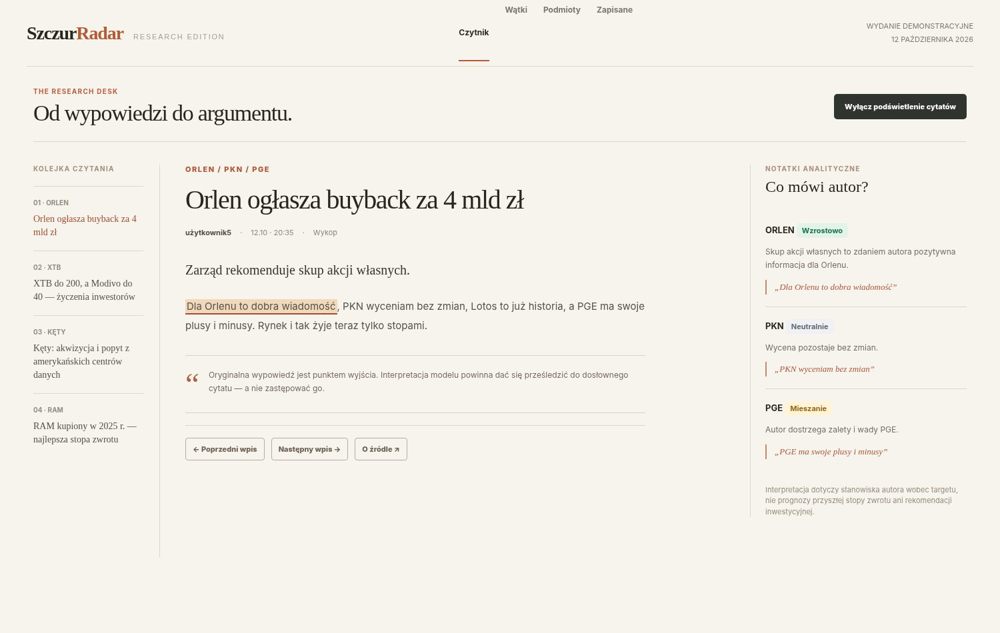
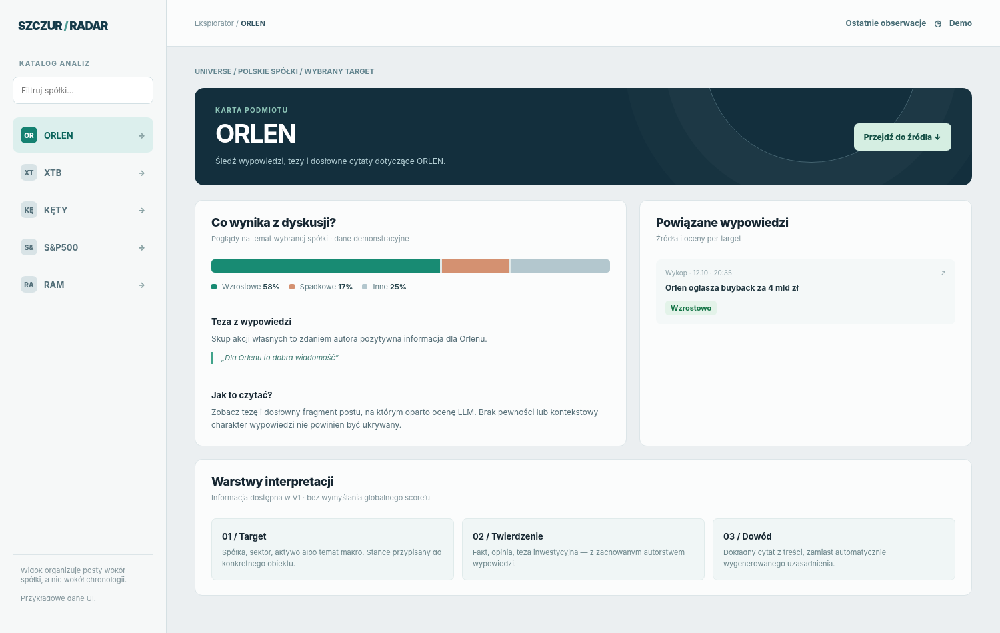
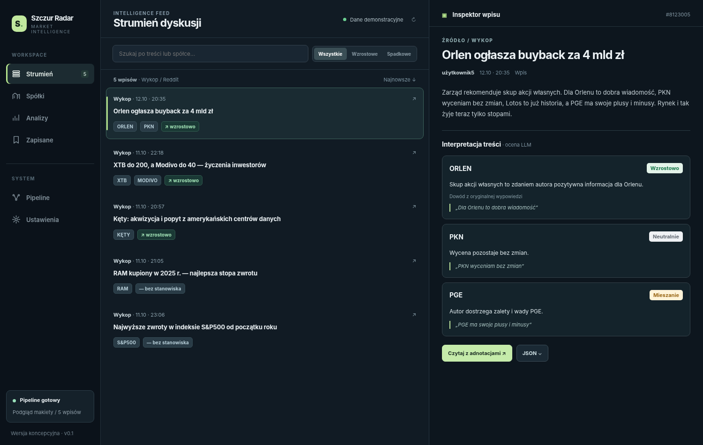
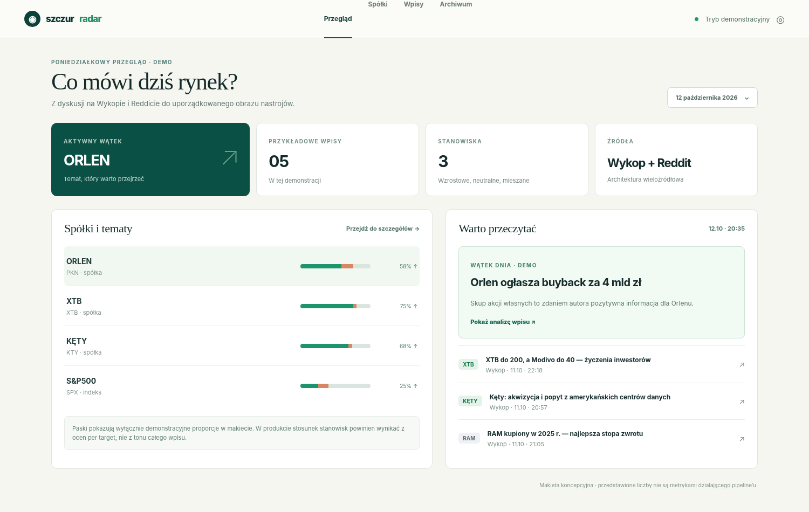

# M-4 (kandydat): nowe UI/UX — propozycje układu

Zapis decyzji użytkownika z 2026-10-27: **kolejny kamień milowy po M-3 to nowe UI i UX** aplikacji webowej. Poniżej cztery propozycje **układu** przekazane przez użytkownika jako makiety (dane demonstracyjne). To nie jest projekt wizualny ani zakres — kolory, typografię i szczegóły wyglądu ustali M-4 (`/10x-ui`, `/10x-roadmap`). Termin: bez presji (grudzień 2026, ewentualnie styczeń 2027).

Makiety (PNG 1500×950) leżą w `docs/visuals/m4-ui-ux/`; każda sekcja niżej linkuje swoją.

## 1. „Czytnik” (Research Edition) — czytanie jednego wpisu z adnotacjami

- Jasne, „papierowe” tło, szeryfowe nagłówki, nawigacja u góry: Czytnik · Wątki · Podmioty · Zapisane; hasło strony „Od wypowiedzi do argumentu.”
- Trzy kolumny:
  - lewa — **kolejka czytania**: numerowana lista wpisów z celem w nagłówku (`01 · ORLEN`, `02 · XTB`…);
  - środek — **wpis**: cele nad tytułem (`ORLEN / PKN / PGE`), tytuł, autor · czas · źródło (Wykop), treść z **podświetlonymi fragmentami, na których oparto ocenę** (przełącznik „Wyłącz podświetlenie cytatów”), notka, że interpretacja ma dać się prześledzić do dosłownego cytatu; przyciski „Poprzedni wpis”, „Następny wpis”, „O źródle”;
  - prawa — **notatki analityczne „Co mówi autor?”**: dla każdego celu nazwa, etykieta stanowiska (Wzrostowo / Neutralnie / Mieszanie), jedno zdanie tezy i cytat; zastrzeżenie, że interpretacja dotyczy stanowiska autora, nie prognozy ani rekomendacji.

## 2. „Karta podmiotu” (Eksplorator) — widok wokół spółki, nie chronologii

- Lewy panel **katalog analiz**: pole „Filtruj spółki…” i lista celów (ORLEN, XTB, KĘTY, S&P500, RAM); okruszki „Universe / Polskie spółki / wybrany target”.
- Nagłówek **karty podmiotu** (ORLEN) z przyciskiem „Przejdź do źródła”.
- „**Co wynika z dyskusji?**” — pasek proporcji stanowisk (wzrostowe / spadkowe / inne, w %), teza z wypowiedzi z cytatem, „Jak to czytać?”.
- „**Powiązane wypowiedzi**” — wpisy o tym celu ze źródłem, czasem i stanowiskiem.
- „**Warstwy interpretacji**” — 01 Target, 02 Twierdzenie, 03 Dowód (objaśnienie modelu oceny).

## 3. „Strumień dyskusji” + „Inspektor wpisu” — ciemny układ roboczy w trzech panelach

- Lewa nawigacja: Strumień (licznik), Spółki, Analizy, Zapisane; sekcja System: Pipeline, Ustawienia; stan „Pipeline gotowy” na dole.
- Środek — **strumień**: wyszukiwanie po treści lub spółce, przełącznik stanowiska (Wszystkie / Wzrostowe / Spadkowe), licznik wpisów i źródła (`Wykop / Reddit`), sortowanie „Najnowsze”; wiersz wpisu: źródło · czas, tytuł, etykiety celów i stanowiska.
- Prawa — **inspektor wpisu**: źródło, tytuł, autor · czas · typ, treść, „Interpretacja treści” jako karta na cel (stanowisko, teza, „Dowód z oryginalnej wypowiedzi” z cytatem); przyciski „Czytaj z adnotacjami” i „JSON” (surowe dane).

## 4. „Przegląd” — „Co mówi dziś rynek?”

- Nawigacja: Przegląd · Spółki · Wpisy · Archiwum; wybór dnia.
- Kafelki: aktywny wątek (ORLEN), liczba wpisów, liczba stanowisk, źródła (Wykop + Reddit).
- „**Spółki i tematy**” — lista celów z paskiem proporcji stanowisk i odsetkiem.
- „**Warto przeczytać**” — wątek dnia (tytuł, teza, „Pokaż analizę wpisu”) i lista kolejnych wpisów z etykietą celu.

## Co z tego wynika dla planowania M-4 (do rozstrzygnięcia, nie decyzje)

- Wszystkie cztery układy niosą to samo jądro, które produkt już ma: **stanowisko per cel z dosłownym cytatem** (kontrakt V2) i **źródło wpisu** (Wykop / Reddit — po S-27 i S-29 z M-3).
- Układy 1 i 3 (czytnik, strumień + inspektor) da się zbudować na dzisiejszych danych: feed, filtr po celu i stanowisku, widok posta z oceną i surowymi danymi.
- Układy 2 i 4 (karta podmiotu, przegląd) agregują wiele wpisów **wokół spółki** (proporcje stanowisk, „wątek dnia”, „warto przeczytać”). Dotyka to granic PRD: rozpoznawanie spółek i decyzja „wartościowy sygnał” są poza zakresem (`prd.md:314`), trend to FR-024/FR-025 (nice-to-have); dziś cel to tylko dopasowanie tekstu anchora („CDR” ≠ „CD Projekt”, `prd.md:126`). M-4 musi zdecydować, czy agregacja po tekście celu wystarczy, czy potrzebna jest zmiana PRD.
- Elementy z PRD i Parked, które pasują do M-4: sortowanie (FR-008/FR-011b), eksport widocznej listy (FR-031), własna nazwa wyświetlana (FR-020), komunikat przy nieudanym odczycie daty aktualizacji, przybliżony czas końca przebiegu (`roadmap.md`, `## Parked`).
- Zasady UI repozytorium obowiązują dalej: tokeny i komponenty z `szczur-radar-web/src/style.css` i `src/components/`, kitchen sink, macierz 7 stanów, zrzuty w obu motywach i przy 375 px (`REPOSITORY_GUIDELINES.md`, sekcja UI).
