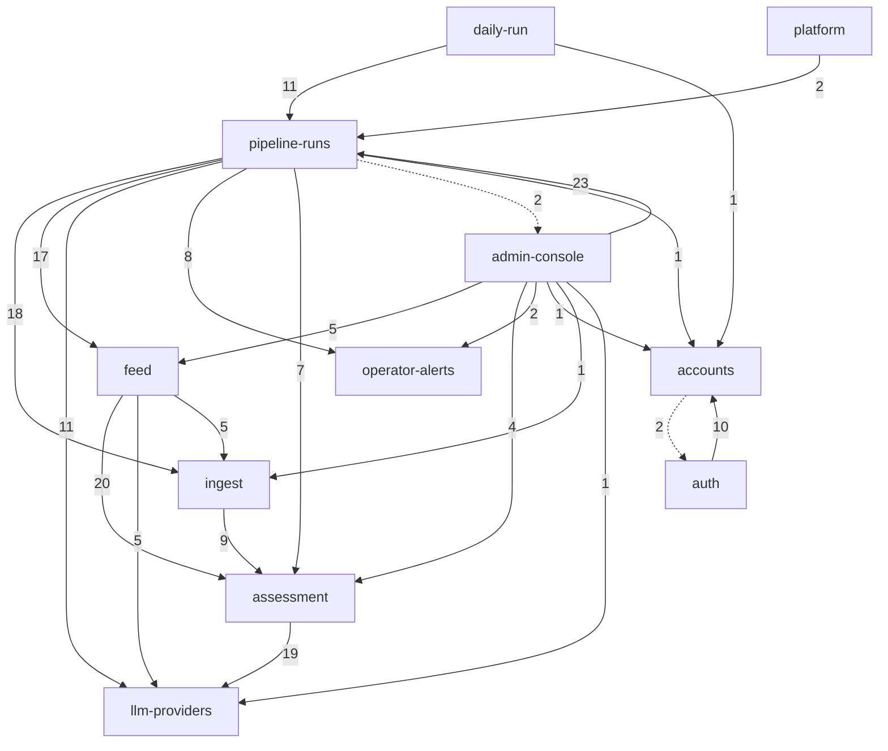
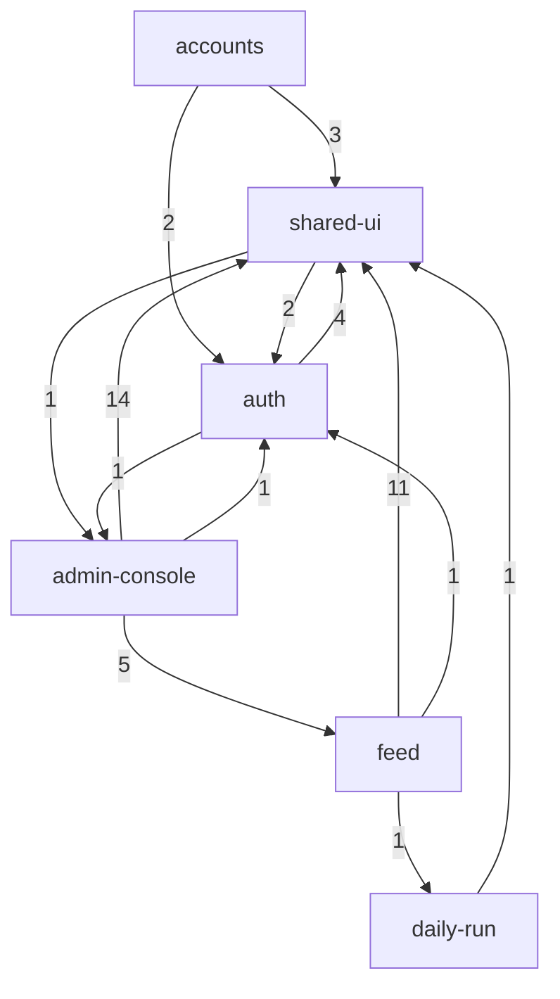

# Dowody: struktura

Statyczny graf zależności z HEAD `047b65d` (kod = `a783195`, po S-17), złożony do możliwości przez `context/map/.work/capabilities.tsv` (glob wygrywa, potem najdłuższy prefiks po całych segmentach; 0 plików nieprzypisanych w obu grafach). Graf wyjaśnia możliwości, nie szereguje ich. Oznaczenia: **evidence** (wynik polecenia z tej sesji), **inference** (interpretacja), **unknown** (ślepa plamka).

## Graph sources

| Język / moduł | Źródło | Poziom | Pokrycie | Confidence | Ślepe plamki |
|---|---|---|---|---|---|
| Java — `szczur-radar-api/src/main/java` | `./mvnw -o dependency:build-classpath` (tylko lokalne `~/.m2`, nic nie pobrano) → `javac -proc:none --release 25` źródeł z HEAD do `.work/struct/classes-main` (poza `target/`) → `jdeps -verbose:class` → klasa → plik źródłowy (atrybut `SourceFile` z bajtkodu) | 2 (toolchain) | 246 z 249 plików `.java` w krawędziach (861 krawędzi plik→plik); poza grafem `config/ClockConfig`, `config/SessionConfig`, `health/HealthController` (brak zależności wewnętrznych) | high dla krawędzi kodu | stałe wkompilowane (`static final`) i argumenty generyczne mogą zniknąć z bajtkodu; Java nie odróżnia krawędzi type-only (wszystkie `runtime`); wstrzykiwanie Spring niewidoczne |
| Java — testy `src/test/java` | jak wyżej, `classes-test` z `-cp classes-main` | 2 | 123 pliki, 1032 krawędzie test→kod | high | tylko do sekcji Test risks |
| TypeScript/Vue — `szczur-radar-web/src`, `dev/` | regex importów w `.ts`/`.vue` (blok `<script>`), bez `*.test.ts`; ścieżki względne rozwiązane do plików; aliasów brak (`tsconfig*`/`vite.config` bez `paths`/`alias`) | 4 (fallback) | 36 z 37 plików; 116 krawędzi (104 runtime, 12 `import type`); poza grafem `dev/mock-api.js` (samodzielny serwer atrapy) | medium | brak re-eksportów; 1 dynamiczny `import()` (router → `KitchenSinkView`) liczony jako runtime; w worktree nie ma `node_modules` (kompilator TS jest tylko w głównym checkoutcie, więc nie był użyty) |
| Shell — `tools/*` | `git grep` ścieżek HTTP, `source`, nazw tabel | 4 | brak grafu plików | low | zależności idą przez sieć, zmienne i schemat bazy |
| IaC — `.railway/railway.ts`, CI `ci.yml` | `git grep` referencji `*.env.*`, `${{…}}`, `healthcheck`, ścieżek | 4 | 1 + 1 plik | low | referencje między serwisami to konfiguracja, nie importy |
| Między językami | `git grep` URL-i w `web/src/api/*.ts`, `@*Mapping` w kontrolerach, `trigger.sh`, `tools/deploy-gate`, `Caddyfile` | 4 | wszystkie trasy | inference | kształt JSON nie jest sprawdzany przez graf |

Embabel zniknął z bajtkodu: `jdeps -verbose:package` nie pokazuje żadnego pakietu `com.embabel`; `org.springframework.ai` używa tylko `llm/` (**evidence**).

Surowe dane: `.work/edges-java.csv`, `.work/edges-ts.csv`, `.work/struct/` (`edges-*-nomech.csv`, `edges-java-tests.csv`, `edges-ts-tests.csv`, `metrics-*.md`, `pairs-*.txt`, `blast-*.txt`, `tests-java.txt`, `mermaid-*.txt`).

## Capability graph

Ca/Ce = liczba **możliwości** (nie plików). „Bez mech.” wyklucza krawędzie mechaniczne z sekcji Mechanical signals (konwertery enumów, bootstrap `SzczurRadarApiApplication`↔`cli`, `ContractValueBinding`, `SecurityConfig`→`internal/`, rejestr `CommandLine`↔`SendTestAlertCommand`; w TS `router/index.ts`, `main.ts`, `KitchenSinkView`). **evidence**

### Backend (Java)

| Capability | Ca | Ce | I | Bez mech.: Ca / Ce / I | Mapa 2026-10-17 (bez mech.) |
|---|--:|--:|--:|---|---|
| shared-foundations | 10 | 7 | 0.41 | 10 / 0 / **0.00** | 8 / 0 / 0.00 |
| llm-providers | 5 | 1 | 0.17 | 4 / 1 / 0.20 | 4 / 1 / 0.20 |
| assessment | 5 | 2 | 0.29 | 4 / 2 / 0.33 | 4 / 2 / 0.33 |
| accounts | 6 | 3 | 0.33 | 4 / 2 / 0.33 | 3 / 2 / 0.40 |
| ingest | 4 | 2 | 0.33 | 3 / 2 / 0.40 | 3 / 3 / 0.50 |
| operator-alerts *(nowa)* | 3 | 2 | 0.40 | 2 / 1 / 0.33 | — |
| feed | 3 | 4 | 0.57 | 2 / 4 / 0.67 | 2 / 4 / 0.67 |
| auth | 1 | 3 | 0.75 | 1 / 2 / 0.67 | 1 / 3 / 0.75 |
| pipeline-runs | 4 | 8 | 0.67 | 3 / 8 / 0.73 | 3 / 5 / 0.63 |
| admin-console | 2 | 8 | 0.80 | 1 / 8 / 0.89 | 1 / 7 / 0.88 |
| daily-run | 1 | 3 | 0.75 | 0 / 3 / 1.00 | 1 / 3 / 0.75 |
| platform (`DeploySafety*`) | 0 | 1 | 1.00 | 0 / 1 / 1.00 | poza grafem |

Najgrubsze krawędzie (plik→plik, bez mech.; w nawiasie poprzednia mapa): `admin-console→pipeline-runs` 23 (20), `feed→assessment` 20 (20), `assessment→llm-providers` 19 (13), `pipeline-runs→ingest` 18 (15), `pipeline-runs→feed` 17 (17), `pipeline-runs→llm-providers` 11 (7), `daily-run→pipeline-runs` 11 (11), `auth→accounts` 10 (10), `ingest→assessment` 9 (9), `pipeline-runs→operator-alerts` 8 (nowa). **evidence**

Diagram dla raportu (bez mechanicznych; etykieta = liczba krawędzi plik→plik; linia przerywana = krawędź zwrotna 2-cyklu). Pominięto 10 krawędzi do `shared-foundations` — to czysty liść (Ce 0), zależy od niego każda możliwość poza `platform`:

### Frontend (Vue/TS)

| Capability | Ca | Ce | I | Bez mech.: Ca / Ce / I |
|---|--:|--:|--:|---|
| shared-ui | 5 | 3 | 0.38 | 5 / 2 / 0.29 |
| auth | 4 | 4 | 0.50 | 4 / 2 / 0.33 |
| admin-console | 2 | 3 | 0.60 | 2 / 3 / 0.60 |
| feed | 3 | 3 | 0.50 | 1 / 3 / 0.75 |
| daily-run | 1 | 1 | 0.50 | 1 / 1 / 0.50 |
| accounts | 1 | 2 | 0.67 | 0 / 2 / 1.00 |

Wartości bez mechanicznych są identyczne jak w mapie 2026-10-17 — front strukturalnie się nie zmienił (**evidence**).

### Krawędzie między językami i serwisami (inference z `git grep`)

| Od | Do | Przez |
|---|---|---|
| web `api/auth.ts` (auth) | `AuthController` `/api/auth/{login,logout,me}` | HTTP przez Caddy `/api/*` |
| web `api/activation.ts` (accounts) | `ActivationController` `/api/auth/activation[/lookup]` | HTTP |
| web `api/posts.ts` (feed) | `PostController` `/api/posts[/{id}[/raw]]` **oraz** `FailedPostController` `/api/admin/posts/failed` (admin-console) | HTTP — klient feedu nadal niesie trasę admina |
| web `api/pipeline.ts`, `api/notifications.ts` (admin-console) | `PipelineRunController` `/api/admin/pipeline-runs[/{id},/sources,/missing-days]`, `NotificationController` `/api/admin/notifications[/{id}/read,/read]` | HTTP |
| web `api/freshness.ts` (daily-run) | `FreshnessController` `/api/freshness` | HTTP |
| `tools/pipeline-trigger/trigger.sh` (daily-run) | `InternalPipelineRunController` `/internal/pipeline-runs/daily`, `/{id}` | HTTP w sieci prywatnej, poza Caddy |
| `ci.yml` → `tools/deploy-gate/wait-safe.sh` (platform) | `DeploySafetyController` `/api/deploy-safety` → `PipelineRunRepository`, `PipelineStallSettings` (pipeline-runs) | HTTP; bramka wdrożeń zależy od semantyki stanów przebiegu |
| `tools/deploy-gate/verify-apply.sh`, `.railway/railway.ts` (`healthcheck`) | `/api/ready`, `/api/health` (`HealthController`, shared-foundations), `/healthz` (Caddy) | HTTP |
| `szczur-radar-web/Caddyfile` | `{$API_PRIVATE_DOMAIN}:{$API_PORT}` | reverse proxy `/api/*` |
| `tools/healthchecks/checks.sh` (operator-alerts) | healthchecks.io `/api/v3` | zewnętrzne API |
| `tools/db-backup/backup.sh` ↔ `tools/pipeline-trigger/trigger.sh` | ten sam kod check-in healthchecks (komentarz „The same code is in … change both”), ta sama reguła URL co `alerts/AlertSettings` w Javie | **kopie kodu**, nie import — patrz Broken boundaries |
| `tools/db-backup/tables.sh` (db-backup) | wszystkie 10 tabel z migracji V1–V11 sklasyfikowane; `restore-check.sh` pada na tabeli bez klasyfikacji (`information_schema`) | SQL po nazwach tabel |
| `.railway/railway.ts` (platform) | `db.env.PG*` ×10, `api.env.RAILWAY_PRIVATE_DOMAIN` ×2, `api.env.PIPELINE_TRIGGER_TOKEN`, `${{szczur-radar-web.RAILWAY_PUBLIC_DOMAIN}}` | referencje zmiennych Railway |

### Różnica wobec mapy 2026-10-17 (evidence, wnioski: inference)

- **Embabel usunięty (S-17):** znikły wejścia `PipelineAgent`, `AssessorAgent`; `pipeline/flow/` to teraz `RunFlow` + `RunSequence` wołane przez `PipelineRunService`. Kolejność kroków jest widoczna w grafie: `RunSequence → SourceIngest, PostStore, AssessmentSelection, AssessmentDispatcher, RunRecorder` (wcześniej wyznaczał ją planer GOAP — unknown).
- **Nowa możliwość `operator-alerts`:** Ca 2 (pipeline-runs 8 krawędzi z 4 plików: `PipelineRunService`, `PipelineStartupRecovery`, `RunWatchdog`, `ConcurrentAssessmentDispatcher`; admin-console 2 z `RunNotifications`), Ce tylko `shared-foundations`. Kontrakty: `AlertEvent` (Ca 10 plików), `OperatorAlertQueue`.
- **`LlmProviderProperties` przeniesione `config/` → `llm/`:** Ca plikowe 21 → 11; enumy `ServiceTier` (Ca 14), `Provider` (13), `ReasoningEffort` (9) są teraz osobnymi liśćmi w `llm/`. Encja `posts/Assessment` zależy od tych enumów, a nie od klasy konfiguracji.
- **Rdzeń jest mniej splątany:** z wykluczeniami jak w poprzedniej mapie (bez `SecurityConfig→internal/`) SCC obejmuje 5 możliwości (accounts, admin-console, auth, daily-run, pipeline-runs) zamiast 7. Po wykluczeniu także tej krawędzi zostają tylko dwa 2-cykle. `ingest` wypadł ze splotu: `sources/**` i `raw/**` nie importują nic z `pipeline/`. Część tej zmiany to atrybucja: `pipeline/step/SourceIngest` liczy się teraz do pipeline-runs, a wcześniej do ingest.
- **Huby urosły:** `Assessor` Ce 22 → 26, `ConcurrentAssessmentDispatcher` 16 → 24, `PipelineRunService` 18 → 22; `assessment→llm-providers` 13 → 19 (S-17: `Assessor` woła `LlmClient` wprost).

## Blast radius per capability

Krawędzie runtime bez mechanicznych; liczby = krawędzie plik→plik; „kontrakty” = pliki importowane przez inne możliwości (w nawiasie liczba importujących plików). **evidence** (krawędzie), **inference** (wnioski).

| Capability | Kto zależy (incoming) | Od czego zależy (outgoing) | Kontrakty importowane przez innych |
|---|---|---|---|
| assessment | feed 20, ingest 9, pipeline-runs 7, admin-console 4 (+ konwertery 4, binding 2) | llm-providers 19, shared-foundations 5 | `AssessmentInputV1` (Ca 27 plików ogółem), `AssessmentOutputV2` (24), `Violation` (23), `ValidationRule`, `RuleId` (17), `ItemType` (8 spoza), `AssessmentResult` (5), `Provenance` (4), `Direction`, `TargetKind` |
| llm-providers | assessment 19, pipeline-runs 11, feed 5, admin-console 1 (+ konwertery 5) | shared-foundations 4 | `LlmProviderProperties`, `Provider`, `ServiceTier` (po 4), `Channel`, `OutputMode`, `ReasoningEffort` (3), `LlmClient`, `LlmRequest`, `LlmResponse`, `LlmConfigurationException`; z `transport/`: `TransportRetry`, `ProviderMessages` |
| pipeline-runs | admin-console 23, daily-run 11, platform 2 (+ konwertery 5) | ingest 18, feed 17, llm-providers 11, operator-alerts 8, assessment 7, shared-foundations 4, admin-console 2, accounts 1 | `PipelineRunRepository` (6), `PipelineRun`, `RunStatus`, `RunKind`, `InterruptionCause` (4), `PipelineRunService`, `PipelineRunStep*`, `RunStep`, `StepStatus` (2); także wnętrza `state/RunRecorder`, `step/SourceIngest` |
| feed (`posts`) | pipeline-runs 17, admin-console 5 (+ konwerter 1) | assessment 20, shared-foundations 7, llm-providers 5, ingest 5 | `Post` (6), `PostRepository`, `PostStage` (5), `Assessment` (3), `AssessmentRepository`, `PostKey` |
| ingest | pipeline-runs 18, feed 5, admin-console 1 (+ konwertery 3) | assessment 9, shared-foundations 3 | `sources/Source` (13 spoza; Ca 22 ogółem, Ce 0), `RawPayloadRef` (4), `RawPayloadStore` (3), `SourcePost`, `RawInputMapper`, `SourceFetcher` |
| accounts | auth 10, daily-run 1, admin-console 1, pipeline-runs 1 | shared-foundations 6, auth 2 | `Role` (4), `User` (3), `Emails`, `UserRepository`, `SystemAccount` (2) |
| auth | accounts 2 | accounts 10, shared-foundations 8 | `auth/Passwords` (2) |
| operator-alerts | pipeline-runs 8, admin-console 2 | shared-foundations 3 | `AlertEvent`, `OperatorAlertQueue` (po 5) |
| daily-run | — w Javie (tylko mechaniczna krawędź `SecurityConfig`); `trigger.sh` przez HTTP | pipeline-runs 11, shared-foundations 2, accounts 1 | trasy `/internal/pipeline-runs/*` |
| admin-console | pipeline-runs 2 (`RunNotifications`) | pipeline-runs 23, shared-foundations 6, feed 5, assessment 4, operator-alerts 2, accounts/ingest/llm 1 | `RunNotifications` |
| platform | — (CI, IaC, obrazy działają z zewnątrz) | pipeline-runs 2 | trasy `/api/deploy-safety`, `/api/ready`, `/api/health` |
| db-backup | — | schemat przez nazwy tabel (10/10 sklasyfikowanych) | — |

Wnioski (inference):
- **assessment + llm-providers to nadal stabilne centrum backendu** (I 0.33 / 0.20). Zmiana `AssessmentInputV1/OutputV2` sięga do feed, ingest, pipeline-runs i admin-console. Zmiana enumów `llm/` (`Provider`, `ServiceTier` …) sięga do encji `posts/Assessment`, 5 konwerterów i `FailedPostController`, czyli także do schematu (konwertery + `CHECK`).
- **pipeline-runs to orkiestrator z najszerszym zasięgiem wychodzącym** (Ce 8 możliwości, wcześniej 5). Doszły `operator-alerts` i `accounts` (`PipelineRun → SystemAccount`). Wejścia admin-console i daily-run sięgają do niego 34 krawędziami.
- **feed jest właścicielem encji, które zapisuje silnik:** `pipeline-runs → feed` 17 krawędzi. Do tego surowy SQL na tabeli `posts` w `pipeline/state/PostTransitions` i `RunRecorder`, czyli poza encjami.
- **ingest ma czystą granicę:** zależy tylko od kontraktu oceny i `shared-foundations`. Silnik zna go przez `SourceFetcher`/`Source`/`RawInputMapper`, co zgadza się z NFR „nowe źródło = pozyskanie + mapowanie”.

## Cycles

Tylko runtime, `graph-metrics.mjs` na poziomie plików. **evidence**

| Cykl (plikowy) | Rozmiar | Możliwość | Ocena |
|---|--:|---|---|
| `SzczurRadarApiApplication` → `cli/CommandLine` → `Create*/Migrate/ResetPassword/LinkCommand` → `SzczurRadarApiApplication` | 7 plików; najmniejsza pętla 3 pliki (`Application → CommandLine → MigrateCommand → Application`) | shared-foundations ↔ accounts | inference: dyspozytor CLI w klasie `main`, a komendy startują kontekst z tą klasą — bootstrap, mechaniczne |
| `contract/Anchor` → `Evidence` → `Quote` | 3 | assessment | rekordy kontraktu V2 wewnątrz możliwości |
| `contract/Item` → `Parent` → `TextFields` | 3 | assessment | jw. |
| `activation/IssueOutcome` ↔ `IssuedLink` | 2 | accounts | typy wyniku wydania linku |
| TS: brak cykli plikowych | 0 | — | evidence |

Bez cykli plikowych zostały dwie pętle między możliwościami (artefakt podziału footprintu, nie pętla w kodzie):
- **`auth ↔ accounts`**: `auth/*`, `config/SecurityConfig` → `user/*` (10), a `auth/activation/ActivationLinks`, `cli/AdminBootstrap` → `auth/Passwords` (2). Pakiet `auth/activation` należy do accounts.
- **`pipeline-runs ↔ admin-console`**: `PipelineRunService`, `PipelineStartupRecovery` → `notifications/RunNotifications` (2), a kontrolery admina i `RunNotifications` → `pipeline/run/*` (23).
- Web: `auth ↔ admin-console` (`auth/session.ts → notificationsStore.ts`, `NotificationBell.vue → auth/session.ts`) i `auth ↔ shared-ui` (`AppHeader.vue → api/auth.ts, auth/session.ts`). Bez zmian od poprzedniej mapy.
- Z krawędziami mechanicznymi graf możliwości backendu tworzy jedno SCC 11 możliwości. Robią to konwertery (`shared-foundations → 6 możliwości`) i bootstrap, więc to sygnał mechaniczny.

## Broken boundaries

Zamierzone warstwy (**inference** z REPOSITORY_GUIDELINES i pakietów): `text`/`settings`/`persistence` → kontrakt (`agents/assessor/contract`) i enumy wartości `llm/` → klienci (`llm`, `sources`, `raw`) → encje (`posts`, `user`, `pipeline/run`, `notifications`) → silnik (`pipeline`: `flow` → `step`/`assess`/`state`) → kontrolery (`*/api`, `auth`, `internal`) → CLI. Web: `api/client.ts` → `api/*.ts` → komponenty → widoki → router/`main.ts`.

| Krawędź runtime | Pliki | Wobec czego | Status |
|---|---|---|---|
| kontroler admina → wnętrza silnika | `pipeline/api/PipelineRunController` → `pipeline/state/RunRecorder`, `pipeline/step/SourceIngest` (typ `SourceIngest.SourceState` dla `/sources`) | kontroler omija `PipelineRunService` i sięga do warstwy kroków i warunkowych zapisów | evidence (krawędź), inference (ocena) |
| silnik → transport LLM | `ConcurrentAssessmentDispatcher` → `llm/transport/ProviderMessages` (tworzy `new ProviderMessages(llmSettings.apiKey())`); `PipelineStallSettings` → `llm/transport/TransportRetry` | `transport/` to wnętrze `llm` („jedyne ponowienia wywołań modelu”); silnik zna jego typy, a klucz API przechodzi przez silnik | inference |
| silnik → funkcja admina | `PipelineRunService`, `PipelineStartupRecovery` → `notifications/RunNotifications` | rdzeń woła możliwość admina (2-cykl); powiadomienia są w praktyce częścią silnika | inference, bez zmian |
| encja → enumy dostawcy | `posts/Assessment` → `llm/Channel`, `OutputMode`, `Provider`, `ReasoningEffort`, `ServiceTier` | encja zależy od typów `llm/`. **Złagodzone**: wcześniej zależała od klasy konfiguracji `config/LlmProviderProperties` | evidence |
| silnik → tabele feedu (SQL) | `pipeline/state/PostTransitions` (`posts`, `pipeline_runs`), `RunRecorder` (`posts`, `pipeline_runs`, `pipeline_run_steps`) | zapis tabeli `posts` poza encjami i repozytoriami `posts/` | evidence (grep SQL) |
| admin → tabela kont (SQL) | `notifications/NotificationRepository` (`notifications` + `users`) | zapytanie admina łączy tabelę accounts | evidence (grep) |
| konta → tabela sesji (SQL) | `auth/activation/ActivationLinks` → `spring_session` | reset hasła czyści sesje bezpośrednio w tabeli auth (udokumentowane w guidelines) | evidence (grep) |
| reguła URL alarmów w 3 kopiach | `alerts/AlertSettings` (Java), `tools/db-backup/backup.sh:48–55`, `tools/pipeline-trigger/trigger.sh:52–59` („The same code is in … change both”) | wspólny kontrakt operator-alerts żyje w footprintach db-backup i daily-run. Każdy `test.sh` testuje swoją kopię; nie znaleziono testu, który pilnuje zgodności kopii | inference (grep) |
| auth → daily-run | `config/SecurityConfig` → `internal/PipelineTriggerToken*` | config-as-code łańcuchów filtrów (zasada 2) | mechaniczne |
| web auth → admin | `auth/session.ts` → `notificationsStore.ts` | sesja czyści magazyn dzwonka przy wylogowaniu (udokumentowane) — zależność odwrócona | inference, bez zmian |
| web shell → funkcje | `AppHeader.vue` (shared-ui) → `NotificationBell.vue`, `api/auth.ts`, `auth/session.ts` | wspólny komponent składa funkcje; oczekiwane dla nagłówka | inference |
| web feed → router | `FeedView.vue` → `router/scroll.ts` | widok zna pomocnika przewijania | niski |
| web klient feedu ↔ admin | `api/posts.ts` obsługuje `/api/admin/posts/failed`; `admin-console → feed` 5 runtime (`labels.ts` ×4, `api/posts.ts`) + 1 type | klient feedu niesie trasę admina; `labels.ts` to de facto wspólny słownik | inference |

## Test risks

Krawędzie test→kod z bajtkodu testów (`jdeps`, obejmuje też referencje z tego samego pakietu). „Szerokie” = testy, które sięgają do ≥3 innych możliwości (bez `shared-foundations`). Liczby użycia mocków pochodzą z grepa (`Mockito|@Mock|mock(`, `@MockitoBean`) — **low confidence**. Metoda „szerokich” różni się od poprzedniej mapy (tam był import-grep), więc liczby nie są ściśle porównywalne.

| Capability | `*Test` | `*IT` | Szerokie | Mocki (pliki / `@MockitoBean`) | Ocena (inference) |
|---|--:|--:|--:|---|---|
| pipeline-runs | 13 | 6 | **9** (`PipelineRunIT` → 7 możliwości, `PipelineRunServiceTest`, `ConcurrentAssessmentDispatcherTest` → 5) | 10 / 4 | najtrudniejsza izolacja: orkiestracja ciągnie ingest, feed, llm, assessment, operator-alerts; nawet testy jednostkowe wymagają dużo mocków |
| feed | **0** | 2 | 2 (`PostRepositoryIT` → 5, `PostsApiIT` → 4) | 0 / 0 | tylko integracja; encje zapisuje silnik, więc dane testowe idą przez typy 4–5 możliwości |
| admin-console | 1 | 4 | 3 (`PipelineRunControllerIT` → 6) | 3 / 2 | integracja z Postgresem; web: 8 plików Vitest (4 z `vi.mock`) |
| daily-run | 2 | 3 | 2 (`InternalPipelineRunIT` → 5, `FreshnessIT` → 4) | 1 / 1 | integracja + `tools/pipeline-trigger/test.sh` (Docker, atrapa API); brak testu web dla `api/freshness.ts` |
| assessment | 11 | 0 | 0 | 0 / 0 | łatwa izolacja: czysty model + walidator (IT agenta zniknął z Embabel) |
| llm-providers | 7 | 1 | 0 | 1 / 1 | izolowalne przez fixture'y HTTP |
| ingest | 7 | 0 | 0 | 2 / 0 | izolowalne (mapper, fetcher na fixture'ach) |
| operator-alerts | 5 | 0 | 0 | 0 / 0 | jednostkowe z lokalnym serwerem pingów (`LocalPingServer`); wybór `HealthchecksAlerts`/`NoOperatorAlerts` przez `@ConditionalOn*` ma `AlertsConfigurationTest`; kopie w shellu testowane osobno |
| auth | 8 | 4 | 0 | 1 / 0 | IT z sesją JDBC |
| accounts | 9 | 4 | 0 | 3 / 0 | CLI w IT (pełny kontekst Spring) |
| platform | 1 | 1 | 0 | 1 / 0 | + `tools/deploy-gate/test.sh` (stuby, bez Dockera) |
| shared-foundations | 5 | 3 | 1 (`JpaSchemaIT` → 7, z założenia) | 1 / 0 | `JpaSchemaIT`/`MigrationsIT` to strażnicy schematu |
| model-evaluation | 6 | 0 | 1 (`LiveSmokeTest`) | 0 / 0 | poza jarem, tag measurement |
| db-backup | — | — | — | — | tylko `tools/db-backup/test.sh` (Docker) |

Wszystkie `*IT` wymagają Dockera (Testcontainers). Web: 26 plików `*.test.ts` (admin-console 8, feed 8, shared-ui 6, auth 3, accounts 1, daily-run 0); testy web admina i feedu importują `auth` (10 i 8 krawędzi test→kod).

## Centres and thin entry points

| Plik | Ca | Ce | I | Rola (inference) |
|---|--:|--:|--:|---|
| `agents/assessor/contract/AssessmentInputV1` | 27 | 6 | 0.18 | kontrakt nośny wejścia oceny |
| `agents/assessor/contract/AssessmentOutputV2` | 24 | 5 | 0.17 | kontrakt nośny wyniku |
| `agents/assessor/validation/Violation` | 23 | 1 | 0.04 | rdzeń walidatora D1–D15 |
| `sources/Source` | 22 | 0 | 0.00 | rejestr źródeł (Ca 19 → 22); nowe źródło = nowa stała |
| `persistence/EnumValueConverter` | 19 | 0 | 0.00 | fan-in z założenia (zasada 2) — mechaniczne |
| `ValidationRule`, `RuleId` | 17 | 4 / 2 | 0.19 / 0.11 | walidator |
| `llm/ServiceTier`, `llm/Provider` | 14 / 13 | 0 | 0.00 | enumy wartości dostawcy — zbiory zamknięte, mapowane w bazie |
| `config/ErrorCode`, `user/Role`, `pipeline/run/RunStatus` | 12 | 0 | 0.00 | zamknięte zbiory wartości |
| `llm/LlmProviderProperties` | 11 | 6 | 0.35 | kontrakt `LLM_*` (wcześniej Ca 21 w `config/`) |
| `alerts/AlertEvent` | 10 | 0 | 0.00 | nowy kontrakt kanału alarmów |
| web `api/client.ts` | 11 | 0 | 0.00 | jedyny klient API |
| web `labels.ts`, `AppButton.vue`, `StatusMessage.vue` | 10 / 9 / 9 | 0 | 0.00 | słownik etykiet i system projektowy |

Huby wychodzące (wysokie Ce): `agents/assessor/Assessor` (26), `pipeline/assess/ConcurrentAssessmentDispatcher` (24), `pipeline/PipelineRunService` (22), `llm/deepseek/DeepSeekClient` (17), `ContractV2Rules`, `OpenRouterClient`, `PipelineRunController`, `PostController` (16), `GeminiClient` (15), `InternalPipelineRunController` (12).

Punkty wejścia (Ca 0): 47 plików Java = 19 konwerterów + 28 innych. Wśród nich 11 kontrolerów, `RunWatchdog`, `PipelineStartupRecovery`, `SecurityConfig`, `AlertsConfiguration`, `LlmConfiguration`, `LlmConfigurationCheck`, `WykopConfiguration`. **Uwaga:** `ConcurrentAssessmentDispatcher`, `PostgresRawPayloadStore`, `WykopFetcher` mają Ca 0 tylko dlatego, że są wstrzykiwane przez interfejs (`AssessmentDispatcher`, `RawPayloadStore`, `SourceFetcher`). To implementacje, nie wejścia (unknown dla grafu). Cienkie wejścia: `InternalPipelineRunController` (daily-run) deleguje do `PipelineRunService` i mapuje stan na JSON; `trigger.sh` deleguje całą pracę do API; `DeploySafetyController` tylko czyta `PipelineRunRepository`. Web: jedyne wejście `main.ts`; `router/index.ts` (Ce 11) to tabela tras.

## Mechanical signals

| Sygnał | Liczba | Zasada |
|---|--:|---|
| konwertery enumów `persistence/converters/*` → enumy w 6 możliwościach (+ `user/RoleConverter` w accounts); `EnumValueConverter` Ca 19 | 38 krawędzi (19 plików; 19 z nich wychodzi poza shared-foundations) | 2 (config as code); `JpaSchemaIT` + `CHECK` w migracjach łapią rozjazd |
| `SzczurRadarApiApplication` ↔ `cli/*` | 6 krawędzi, cykl 7 plików | bootstrap |
| `cli/CommandLine` ↔ `cli/SendTestAlertCommand` (rejestr komend; komenda operator-alerts w pakiecie accounts) | 4 | 2 |
| `config/ContractValueBinding` → `Direction`, `TargetKind` | 2 | 2 |
| `config/SecurityConfig` → filtr i token `internal/` | 2 | 2 |
| web `router/index.ts` → widoki (tabela tras) + `main.ts` | 11 + 2 | 2 |
| web `KitchenSinkView.vue` (tylko dev) → komponenty feed/admin | 10 (8 runtime, 2 type) | narzędzie deweloperskie |
| web `import type` | 12 (+2 do `vue-router`) | 9 |
| Java type-only | nie do odróżnienia w bajtkodzie | 9 — unknown |
| `tools/db-backup/tables.sh` ↔ migracje | 10/10 tabel; `restore-check.sh` pada na tabeli bez klasyfikacji | 3 (korytarz ze strażnikiem) — rozwiązuje unknown z poprzedniej mapy (brak `activation_tokens`, `notifications`) |

Po wyłączeniu powyższych `shared-foundations` ma Ce 0 (czysty liść, I = 0.00).

## Unknowns

- **Wiązanie w runtime (Java):** Spring DI przez interfejsy (`LlmClient` ×3 implementacje, `RawPayloadStore`, `AssessmentDispatcher`, `SourceFetcher`, `OperatorAlerts` ×2), 8 klas `@Bean`, `@ConditionalOn*` (`AlertsConfiguration`, `SecurityConfig`, `PipelineStallConfiguration`, `PipelineStartupRecovery`, `RunWatchdog`), `@EventListener(ContextClosedEvent)` w `PipelineRunService`, `SmartInitializingSingleton`/runner (`LlmConfigurationCheck`, `PipelineStartupRecovery`), `getBean(` w `cli/CreateAdminCommand`, `LinkCommand`, własne executory (`PipelineRunService`, `RunWatchdog`, `AssessmentPool`, dispatcher). Graf pokazuje typy, nie kto kogo wywołuje ani który bean wygrywa.
- **Sprzężenie przez tabele:** SQL (`JdbcTemplate`/`JdbcClient` w 6 plikach, `@Query` w 5 repozytoriach). Wspólne tabele `posts`, `assessments`, `pipeline_runs`, `users`, `spring_session` łączą możliwości poza grafem.
- **Kontrakt JSON SPA ↔ API:** typy w `web/src/api/*.ts` i rekordy Java nie mają generowanego klienta ani testu kontraktu wykrytego tym skanem.
- **Konsumenci zewnętrzni (zasada 10):** `/api/admin/llm/check` bez konsumenta w repo (ręcznie); `/api/ready` i `/healthz` sonduje też osobne repo `szczur-radar-monitor` (komentarz w `ci.yml`) — external.
- **Kopie kodu check-in** (`backup.sh` / `trigger.sh` / `AlertSettings`): czy jakikolwiek test pilnuje ich zgodności — nie znaleziono; unknown.
- **Języki bez grafu:** shell (`tools/*`), IaC (`.railway/railway.ts`), CI — tylko referencje z grepa (low).
- **Narzędzia warte instalacji (nie instalowano):** `dependency-cruiser` lub `madge` dla `szczur-radar-web` (SFC Vue, re-eksporty, reguły granic); ArchUnit / Spring Modulith w testach API do egzekwowania granic pakietów — w repo nadal brak reguł zależności (`git grep` archunit/modulith/cruiser/madge: 0 trafień); `ast-grep` dla dokładniejszego fallbacku TS.

## Polecenia

- `./mvnw -o -q dependency:build-classpath -Dmdep.outputFile=.work/struct/cp.txt`; `javac -proc:none --release 25 -d .work/struct/classes-{main,test}`; `jdeps -verbose:class -filter:none -e 'pl\.szczurradar\..*'`; `jdeps -verbose:package` (pakiety zewnętrzne)
- skrypty w scratchpadzie: parser `SourceFile` z bajtkodu, budowa krawędzi Java, regex importów TS, atrybucja wg `capabilities.tsv`, pary/blast radius/testy (wyniki w `.work/struct/`)
- `node .claude/skills/10x-repo-map/scripts/graph-metrics.mjs` — `--modules context/map/.work/capabilities.tsv --kind runtime [--top 20] [--emit mermaid]`, poziom plików `--format json`
- `git grep` — `@*Mapping`, URL-e `/api/*` w web, `/internal/` i `/api/*` w `tools/`, `Caddyfile`, `tables.sh` + `CREATE TABLE` w migracjach, `*.env.*` w `.railway/railway.ts`, `healthcheck` w CI/IaC, adnotacje DI, SQL po nazwach tabel, „same code … change both”
