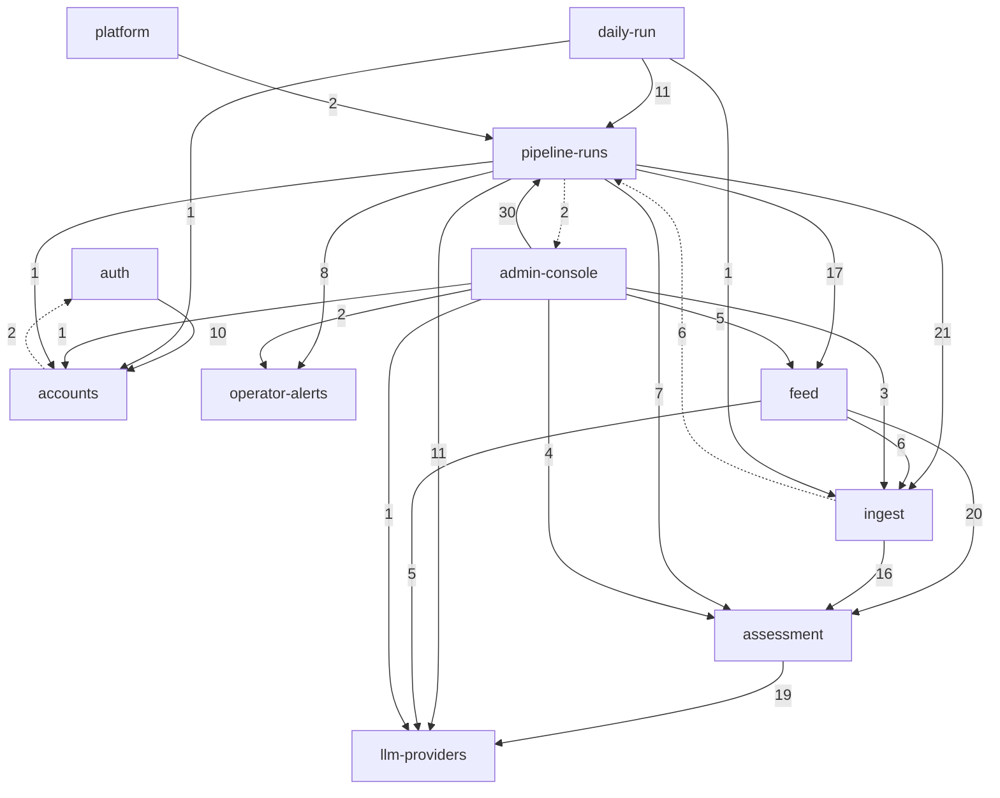
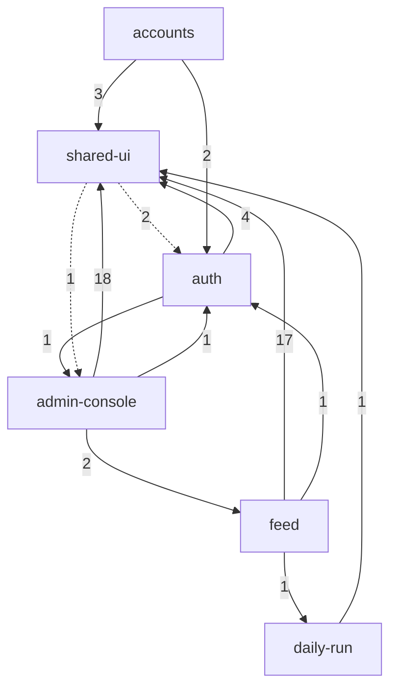

# Dowody: struktura

Statyczny graf zależności z HEAD `5b4ac92`, złożony do możliwości przez `context/map/.work/capabilities.tsv` (glob wygrywa, potem najdłuższy prefiks; 0 plików nieprzypisanych w obu grafach). Graf wyjaśnia możliwości, nie szereguje ich. Oznaczenia: **evidence** (wynik polecenia z tej sesji), **inference** (interpretacja), **unknown** (ślepa plamka).

Punkt odniesienia dla M-3: graf przebudowany tą samą metodą i tym samym `capabilities.tsv` ze stanu `e5ab295` (`git archive`, `.work/pre-m3/`). Porównania z liczbami z archiwalnej mapy byłyby nieścisłe, bo footprinty się zmieniły (np. `SourceIngest` należy teraz do `ingest`). Kontrola: odtworzony stan daje 249 plików i 861 krawędzi `jdeps`, tyle samo co mapa z 2026-10-27. **evidence**

## Graph sources

| Język / moduł | Źródło | Poziom | Pokrycie | Confidence | Ślepe plamki |
|---|---|---|---|---|---|
| Java, `szczur-radar-api/src/main/java` | `./mvnw -o dependency:build-classpath` (offline, tylko `~/.m2`, nic nie pobrano) → `javac -proc:none` plików śledzonych do `.work/classes-main` → `jdeps -verbose:class -filter:none` → klasa → plik przez `SourceFile` (`javap`) | 2 (toolchain) | 265 z 268 plików, 932 krawędzie runtime + 3 `type`; poza grafem `config/ClockConfig`, `config/SessionConfig`, `health/HealthController` (brak zależności wewnętrznych) | high dla krawędzi kodu | Spring DI, SQL, refleksja. Bajtkod gubi argumenty generyczne i stałe wkompilowane, a `jdeps` nie czyta wartości klas z adnotacji |
| Java, korekta źródłowa | skan nazw klas w kodzie (bez komentarzy i napisów) wobec krawędzi `jdeps`: `Nazwa.class` → `runtime`, reszta → `type` | 2 | +5 `runtime` (wszystkie z `@RestControllerAdvice`/`@ExceptionHandler` w `PipelineRunExceptionHandler`), +3 `type` (`LoginRequest→Emails`, `SourceIngest→SourcePost`, `RuleBasedValidator→Violation`); 8 importów tylko pod Javadoc odrzuconych (`.work/java-javadoc-imports.txt`) | high | Java nie ma odpowiednika `import type`, więc większość krawędzi to `runtime` |
| Java, testy `src/test/java` | jak wyżej, `classes-test` | 2 | 148 plików, 139 z krawędziami; 1387 krawędzi test→kod (`edges-java-test.csv`) | high | tylko do Test risks |
| TypeScript/Vue, `szczur-radar-web/src`, `dev/` | kompilator projektu: `typescript` 6.0.3 i `@vue/compiler-sfc` z `node_modules` głównego checkoutu (worktree ich nie ma; niczego nie instalowano); AST importów, eksportów, `import type`, `import()` (`.work/ts_edges.mjs`) | **2** (poprzedni skan: 4) | 66 plików; 121 krawędzi prod. (107 runtime, 14 type), 114 testowych. 0 aliasów, 0 nierozwiązanych w kodzie produkcyjnym | high | kompilator czytany z innego checkoutu (ta sama gałąź zależności, nie ten sam `package-lock`); `import.meta.glob` w `rules.test.ts` poza grafem; 1 `import()` (router → `KitchenSinkView`) liczony jako runtime |
| Shell, Python, `tools/*` | `git grep` ścieżek HTTP, `source`, nazw tabel; `difflib` dla kopii kodu | 4 | brak grafu plików | low | zależności idą przez sieć, zmienne i schemat |
| IaC i CI, `.railway/railway.ts`, `ci.yml` | `git grep` nazw zmiennych i ścieżek | 4 | 2 pliki | low | referencje między serwisami to konfiguracja, nie importy |
| Między stosami | `git grep` `@*Mapping`, URL-i w `web/src/api/*.ts` i `tools/`, tabel w SQL | 4 | wszystkie trasy i tabele | medium | kształt JSON poza czterema plikami kontraktu nie jest sprawdzony przez graf |

Surowe dane: `.work/edges-{java,java-test,ts,ts-test}.csv`, `edges-*-nomech.csv`, `metrics-*`, `analysis*.txt`, `tests.txt`, `.work/pre-m3/`.

## Capability graph

Ca/Ce = liczba **możliwości**. „Bez mech.” wyklucza krawędzie z sekcji Mechanical signals. **evidence** (`graph-metrics.mjs`)

### Backend (Java)

| Capability | Ca | Ce | I | Bez mech.: Ca / Ce / I | Przed M-3 (bez mech.) |
|---|--:|--:|--:|---|---|
| shared-foundations | 10 | 7 | 0.41 | 10 / 0 / **0.00** | 10 / 0 / 0.00 |
| llm-providers | 5 | 1 | 0.17 | 4 / 1 / 0.20 | 4 / 1 / 0.20 |
| assessment | 5 | 2 | 0.29 | 4 / 2 / 0.33 | 4 / 2 / 0.33 |
| accounts | 6 | 3 | 0.33 | 4 / 2 / 0.33 | 4 / 2 / 0.33 |
| operator-alerts | 3 | 2 | 0.40 | 2 / 1 / 0.33 | 2 / 1 / 0.33 |
| ingest | 5 | 3 | 0.38 | **4** / 3 / **0.43** | 3 / 3 / 0.50 |
| feed | 3 | 4 | 0.57 | 2 / 4 / 0.67 | 2 / 4 / 0.67 |
| auth | 1 | 3 | 0.75 | 1 / 2 / 0.67 | 1 / 2 / 0.67 |
| pipeline-runs | 5 | 8 | 0.62 | 4 / 8 / 0.67 | 4 / 8 / 0.67 |
| admin-console | 2 | 9 | 0.82 | 1 / 8 / 0.89 | 1 / 8 / 0.89 |
| daily-run | 2 | 4 | 0.67 | 0 / **4** / 1.00 | 0 / 3 / 1.00 |
| platform (`DeploySafety*`) | 0 | 1 | 1.00 | 0 / 1 / 1.00 | 0 / 1 / 1.00 |

**M-3 prawie nie zmienił kształtu grafu** (**evidence**): pliki Java 249 → 268, krawędzie runtime 866 → 932, testy Java 123 → 148, pliki web 63 → 66, krawędzie web 117 → 121. Pojawiła się jedna nowa krawędź między możliwościami: `daily-run → ingest` (`FreshnessController → sources/Source`, S-29). Zmienione grubości:

| Krawędź (plik→plik) | Przed M-3 | Teraz | Skąd (inference) |
|---|--:|--:|---|
| `ingest → assessment` | 9 | **16** | mapery Reddita budują `AssessmentInputV1` |
| `admin-console → pipeline-runs` | 25 | 30 | wyniki per źródło i powody uwagi (S-20, S-22) |
| `pipeline-runs → ingest` | 17 | 21 | izolacja źródeł (S-20) |
| `ingest → shared-foundations` | 3 | 6 | `Whitespace`, `Nul`, `SettingText` w Reddicie |
| `ingest → pipeline-runs` | 5 | 6 | wyłącznie plik `SourceIngest`, patrz Cycles |
| `feed → ingest`, `shared-foundations → pipeline-runs` | 5, 5 | 6, 6 | `Source` w odpowiedzi posta; konwerter `SourceFetchStatus` |
| web `admin-console → feed` | 1 | 2 | `api/pipeline.ts → api/posts.ts` stało się runtime: stała `MAX_ASSESSMENT_ATTEMPTS` (dawniej tylko `import type`) |

Diagram dla raportu (bez mechanicznych; etykieta = liczba krawędzi plik→plik; przerywana = słabsza strona 2-cyklu). Pominięto 10 krawędzi do `shared-foundations`, czystego liścia (Ce 0 bez mech.), od którego zależy każda możliwość poza `platform`:

Krawędź `ingest -.-> pipeline_runs` to tylko `pipeline/step/SourceIngest.java`, plik z pakietu silnika przypisany do `ingest`. Pakiety `sources/` i `raw/` nie importują niczego z `pipeline/` (**evidence**).

### Frontend (Vue/TS)

| Capability | Ca | Ce | I | Bez mech.: Ca / Ce / I |
|---|--:|--:|--:|---|
| shared-ui | 5 | 3 | 0.38 | 5 / 2 / 0.29 |
| auth | 4 | 4 | 0.50 | 4 / 2 / 0.33 |
| admin-console | 2 | 3 | 0.60 | 2 / 3 / 0.60 |
| feed | 3 | 3 | 0.50 | 1 / 3 / 0.75 |
| daily-run | 1 | 1 | 0.50 | 1 / 1 / 0.50 |
| accounts | 1 | 2 | 0.67 | 0 / 2 / 1.00 |

### Krawędzie między stosami i serwisami (`git grep`, confidence medium)

| Od | Do | Przez | Strażnik |
|---|---|---|---|
| web `api/posts.ts` (feed) | `PostController`, **oraz** `FailedPostController` `/api/admin/posts/failed` (admin-console) | HTTP przez Caddy | `post.json`, `failed-post.json` |
| web `api/pipeline.ts`, `api/notifications.ts` (admin-console) | `PipelineRunController`, `NotificationController` | HTTP | `run.json`; `sources`, `missing-days`, powiadomienia bez kontraktu |
| web `api/auth.ts`, `api/activation.ts` | `AuthController`, `ActivationController` | HTTP | brak kontraktu JSON; `rules.json` trzyma limity i kody błędów |
| web `api/freshness.ts` (daily-run) | `FreshnessController` | HTTP | `freshness.json` |
| `tools/pipeline-trigger/trigger.sh` (daily-run) | `InternalPipelineRunController` `/internal/pipeline-runs/*` | HTTP w sieci prywatnej | `pipeline-trigger-test` przeciw atrapie API |
| `tools/deploy-gate/wait-safe.sh` → `/api/deploy-safety` | `DeploySafetyController` → `PipelineRunRepository`, `PipelineStallSettings` | HTTP; bramka wdrożeń zależy od semantyki stanów przebiegu | `deploy-gate-test` na stubach |
| `verify-apply.sh`, `ci.yml`, `.railway/railway.ts` (`healthcheck`) | `/api/ready`, `/api/health` | HTTP | `api-container-smoke` |
| `tools/healthchecks/test.sh` | `alerts/AlertSettings.java` (`PING_PATTERN`, `PING_MAX_LENGTH` czytane z tekstu źródła) | sprawdzenie tekstowe | `healthchecks-test` (S-25) |
| `AlertSettingsTest` | `tools/healthchecks/fixtures/ping-urls.txt` | plik między modułami | backend + healthchecks-test |
| `ContractFiles`, `SpaRulesTest` | `../szczur-radar-web/src/contract/*` | plik między modułami (S-24) | backend + web-unit |
| `tools/db-backup/tables.sh` | 11 tabel + `flyway_schema_history` (12 pozycji) | SQL po nazwach | `db-backup-test`: 11/11 tabel z migracji sklasyfikowanych |

Zmienne wspólne dla co najmniej 3 obszarów (**evidence**, grep bez komentarzy): `PG*` ×5 (api, ci, db-backup, iac), `HEALTHCHECK_PING_URL` (api, db-backup, pipeline-trigger, iac), `PIPELINE_TRIGGER_TOKEN` (api, pipeline-trigger, iac), `API_PORT`, `API_PRIVATE_DOMAIN` (web, pipeline-trigger, iac), `LLM_*` ×6, `WYKOP_KEY/SECRET`, `REDDIT_SUBREDDITS` (api, ci, iac).

## Blast radius per capability

Krawędzie runtime bez mechanicznych. „Pliki” = pliki main w możliwości. „Bezpośredni” = pliki spoza możliwości, które ją importują. „Wystawione” = jej pliki importowane z zewnątrz. „Zasięg” = domknięcie wsteczne po plikach. „Testy obce” = pliki testowe innych możliwości (bez `model-evaluation`) z bezpośrednią krawędzią do niej. **evidence** (liczby), **inference** (wnioski).

| Capability | Pliki | Bezpośredni | Wystawione | Zasięg (plików: możliwości) | Testy obce |
|---|--:|--:|--:|---|--:|
| shared-foundations | 35 | 30 | 8 | 86: 11 możliwości | 11 |
| assessment | 57 | 18 | 13 | 32: pipeline-runs 12, ingest 10, feed 7, admin 2, daily 1 | 24 |
| ingest | 36 | 18 | 6 | 31: pipeline-runs 19, admin 6, feed 3, daily 2, platform 1 | 27 |
| accounts | 27 | 7 | 5 | 25: pipeline-runs 12, auth 4, admin 4, daily 3, platform 1, ingest 1 | 28 |
| llm-providers | 30 | 8 | 16 | 23: pipeline-runs 10, assessment 5, feed 4, admin 2, daily 1, platform 1 | 18 |
| feed | 9 | 8 | 6 | 13: pipeline-runs 10, admin 2, daily 1 | 13 |
| pipeline-runs | 36 | 9 | 23 | 9: admin 5, daily 2, platform 1, ingest 1 | 19 |
| auth | 14 | 2 | 1 | 8: accounts 8 | 5 |
| operator-alerts | 8 | 5 | 2 | 7: pipeline-runs 4, admin 2, daily 1 | 7 |
| admin-console | 9 | 2 | 1 | 4: pipeline-runs 3, daily 1 | 7 |
| daily-run | 4 | 0 | 0 | 0 w Javie; `trigger.sh` przez HTTP | 0 |
| platform | 3 | 0 | 0 | 0 w Javie; CI, IaC i obrazy działają z zewnątrz | 0 |

| Capability | Incoming | Outgoing | Kontrakty importowane przez innych (Ca plikowe) |
|---|---|---|---|
| assessment | feed 20, ingest 16, pipeline-runs 7, admin 4 (+ konwertery 4, binding 2) | llm-providers 19, shared-foundations 5 | `AssessmentInputV1` (29), `AssessmentOutputV2` (24), `Violation` (23), `ItemType` (12, zasięg 60 plików), `Direction` (9), `AssessmentResult`, `Provenance`, `TargetKind` |
| llm-providers | assessment 19, pipeline-runs 11, feed 5, admin 1 (+ konwertery 5) | shared-foundations 4 | `ServiceTier` (14), `Provider` (13), `LlmProviderProperties` (11), `ReasoningEffort` (9), `LlmClient`, `LlmRequest`; z `transport/`: `TransportRetry`, `ProviderMessages` |
| pipeline-runs | admin 30, daily-run 11, ingest 6, platform 2 (+ konwertery 6) | ingest 21, feed 17, llm 11, alerts 8, assessment 7, shared 4, admin 2, accounts 1 | `RunStatus` (12), `RunKind`, `RunStep` (11), `RunFlow` (8), `PipelineRun` (7), `RunRecorder` (5), `PipelineRunRepository` |
| feed (`posts`) | pipeline-runs 17, admin 5 (+ konwerter 1) | assessment 20, shared 7, ingest 6, llm 5 | `PostStage` (9), `Post` (8), `PostRepository` (6), `Assessment` (5), `AssessmentRepository` (3), `PostKey` |
| ingest | pipeline-runs 21, feed 6, admin 3, daily-run 1 (+ konwertery 3) | assessment 16, pipeline-runs 6, shared 6 | `sources/Source` (**30**, Ce 0, 5 możliwości), `RawPayloadRef`, `RawPayloadStore`, `SourcePost`, `RawInputMapper` |
| accounts | auth 10, daily-run, admin, pipeline-runs po 1 | shared 6, auth 2 | `Role` (12), `User`, `Emails`, `UserRepository`, `SystemAccount` |
| auth | accounts 2 | accounts 10, shared 8 | `auth/Passwords` (3) |
| operator-alerts | pipeline-runs 8, admin 2 | shared 2 | `AlertEvent` (10), `OperatorAlertQueue` (6) |
| daily-run | HTTP z `trigger.sh`, web `api/freshness.ts` | pipeline-runs 11, shared 2, accounts 1, ingest 1 | trasy `/internal/pipeline-runs/*`, `/api/freshness` |
| admin-console | pipeline-runs 2 (`RunNotifications`) | pipeline-runs 30, shared 6, feed 5, assessment 4, ingest 3, alerts 2, accounts 1, llm 1 | `RunNotifications` (2) |
| platform | CI, IaC, zewnętrzny monitor | pipeline-runs 2 | `/api/deploy-safety`, `/api/ready`, `/api/health` |
| db-backup | brak | schemat przez nazwy tabel | brak |

Web: zasięg wsteczny (z mechanicznymi) `shared-ui` 23 pliki, `auth` 8, `admin-console` 9, `feed` 6, `daily-run` 3, `accounts` 2. Pliki nośne: `api/client.ts` (Ca 11), `labels.ts` (10), `AppButton.vue`, `StatusMessage.vue` (9).

Wnioski (**inference**):

- **Nowe źródło trzyma się granicy, ale po przygotowaniu.** S-27 (`78c57ca`) zmienił poza `ingest` tylko dwa pliki produkcyjne Javy (`posts/Post.java`, `pipeline/step/PostStore.java`, nowe pole `channel`; 19 linii dodanych, 5 usuniętych) oraz `ci.yml`, `railway.ts` i `tools/db-backup/test.sh`. Rejestrację wykonał wcześniej S-20 (`5a013ca`): stała `REDDIT`, `V12`, `labels.ts`, a przy okazji izolacja źródeł w silniku (18 plików pipeline-runs, 13 admin-console). Czyli sam adapter był wąski, a cena „drugiego źródła” obejmuje też S-20. Stałe `Source.WYKOP/REDDIT` nie mają ani jednego użycia poza `sources/` (`git grep`: 0), a poza `sources/` nikt nie importuje `sources/wykop`, `sources/reddit` ani `sources/transport` (0 krawędzi). Fan-in `Source` (30) to typ wartości, nie rozgałęzienia. Trzeci adapter kosztuje stałą `Source`, jedną migrację czterech `CHECK` i wpisy w `rules.json`/`labels.ts`, wszystkie strzeżone (S-23, S-24); silnika już nie powinien dotykać, ale to jeszcze nie zostało sprawdzone trzecim adapterem.
- **Najdroższa zmiana to kontrakt oceny, nie silnik.** `AssessmentInputV1/OutputV2` sięgają 42 i 41 plików w 5 możliwościach, a bezpośrednio importuje je 30 i 27 plików testowych. Reddit prawie podwoił koszt zmiany wejścia: `ingest → assessment` 9 → 16.
- **pipeline-runs ma mało zależnych, a dużo zależności.** Zasięg wsteczny to 9 plików, ale Ce 8 możliwości i 23 wystawione pliki. Zmiana stanów przebiegu (`pipeline/run/*`) sięga kontrolerów, powiadomień, konwerterów, `CHECK` i bramki wdrożeń przez `/api/deploy-safety`.
- **feed jest właścicielem encji, którą zapisuje silnik.** `pipeline-runs → feed` 17 krawędzi plus surowy SQL, patrz Broken boundaries.

## Cycles

Tylko runtime, poziom plików. **evidence** (`graph-metrics.mjs`, najmniejsze pętle z BFS). Bez zmian wobec stanu sprzed M-3.

| Cykl | Rozmiar | Możliwość | Najmniejsza pętla | Ocena |
|---|--:|---|---|---|
| `SzczurRadarApiApplication` ↔ `cli/*` | 7 plików | shared-foundations ↔ accounts | 2: `CreateUserCommand ↔ LinkCommand`, `ResetPasswordCommand ↔ LinkCommand`; 3 z klasą main: `Application → CommandLine → MigrateCommand` | bootstrap, mechaniczne |
| `contract/Anchor`, `Evidence`, `Quote` | 3 | assessment | 2: `Anchor ↔ Quote`, `Evidence ↔ Quote` | rekordy kontraktu V2 wewnątrz możliwości |
| `contract/Item`, `Parent`, `TextFields` | 3 | assessment | 2: `Item ↔ TextFields`, `Parent ↔ TextFields` | jw., interfejs i jego rekordy |
| `activation/IssueOutcome ↔ IssuedLink` | 2 | accounts | 2 | typy wyniku wydania linku |
| TS | 0 runtime | — | — | jedyny cykl plikowy jest type-only, patrz Mechanical signals |

Żaden cykl plikowy nie łączy dwóch możliwości biznesowych. Pętle na poziomie możliwości wynikają z podziału footprintów:

- **`auth ↔ accounts`**: `auth/*`, `SecurityConfig → user/*` (10), wstecz `ActivationLinks`, `AdminBootstrap → auth/Passwords` (2).
- **`pipeline-runs ↔ admin-console`**: `PipelineRunService`, `PipelineStartupRecovery → notifications/RunNotifications` (2), wstecz kontrolery admina i `RunNotifications → pipeline/run/*` (30). To jedyna pętla między pakietami domenowymi: po usunięciu krawędzi mechanicznych zostają pętle pakietów `notifications ↔ pipeline` oraz `auth ↔ config`.
- **SCC bez mech. `{admin-console, feed, ingest, pipeline-runs}`** to artefakt przypisania `SourceIngest`. Po wykluczeniu tego jednego pliku zostają dwa 2-cykle powyżej (**evidence**, `--exclude 'pipeline/step/SourceIngest'`).
- Web: SCC 5 możliwości (`admin-console, auth, daily-run, feed, shared-ui`) bez żadnego cyklu plikowego. Robią je `auth/session.ts → notificationsStore.ts`, `NotificationBell.vue → auth/session.ts`, `AppHeader.vue → api/auth.ts, auth/session.ts`, `FeedView.vue → router/scroll.ts`.
- Z krawędziami mechanicznymi graf backendu tworzy jedno SCC 11 możliwości. Robią to konwertery i bootstrap, więc to sygnał mechaniczny.
- Pakiety wewnątrz silnika, bez cyklu plikowego: `pipeline/flow ↔ pipeline/step` (`RunSequence → kroki` 3, kroki → `RunFlow` 4), `pipeline/flow ↔ pipeline/assess`, `pipeline ↔ pipeline/step`. **inference:** `flow/` łączy typ-kontekst `RunFlow` (Ca 8) z orkiestracją `RunSequence`.

## Broken boundaries

Zamierzone warstwy (**inference** z REPOSITORY_GUIDELINES i pakietów): `text`/`settings`/`persistence` → kontrakt (`agents/assessor/contract`) i enumy `llm/` → klienci (`llm`, `sources`, `raw`) → encje (`posts`, `user`, `pipeline/run`, `notifications`) → silnik (`pipeline`: `flow` → `step`/`assess`/`state`) → kontrolery (`*/api`, `auth`, `internal`) → CLI. Web: `api/client.ts` → `api/*.ts` → komponenty → widoki → router, `main.ts`.

Egzekwowanie: w repo nie ma reguł zależności (`git grep` archunit, modulith, dependency-cruiser, madge, ArchRule: 0 trafień w `pom.xml`, `package.json`, `src`, `.github`). Te granice trzyma tylko dyscyplina. **evidence**

| Krawędź runtime | Pliki | Wobec czego | Zmiana w M-3 | Status |
|---|---|---|---|---|
| kontroler admina → wnętrza silnika | `pipeline/api/PipelineRunController` → `state/RunRecorder` (`recorder.inFlight`), `step/SourceIngest` (typ `SourceIngest.SourceState` w `GET /sources`) | kontroler omija `PipelineRunService`. Ce kontrolera 16 → 21 | bez zmiany krawędzi | evidence (krawędź), inference (ocena) |
| silnik → transport LLM | `ConcurrentAssessmentDispatcher:153` `new ProviderMessages(llmSettings.apiKey())`; `PipelineStallSettings:71` → `TransportRetry.maxCallDuration` | `transport/` to wnętrze `llm`; klucz API przechodzi przez silnik | bez zmian | inference |
| silnik → funkcja admina | `PipelineRunService:386,480`, `PipelineStartupRecovery` → `RunNotifications` | rdzeń woła możliwość admina (2-cykl) | bez zmian | inference |
| encja → enumy dostawcy | `posts/Assessment` → `llm/Channel`, `OutputMode`, `Provider`, `ReasoningEffort`, `ServiceTier` | encja zależy od `llm/`; Ce `Assessment` 14 | bez zmian | evidence |
| silnik → tabela feedu (SQL) | `pipeline/state/PostTransitions` (`UPDATE posts` ×4), `RunRecorder` (`SELECT count(*) FROM posts`) | zapis `posts` poza encją i repozytoriami `posts/` | bez zmian | evidence |
| admin → tabela kont (SQL) | `notifications/NotificationRepository:52` (`FROM users`) | fan-out powiadomień czyta `users` | bez zmian | evidence |
| konta → tabela sesji (SQL) | `ActivationLinks:196` `DELETE FROM spring_session` | reset hasła czyści sesje w tabeli auth (udokumentowane) | bez zmian | evidence |
| kopie kodu check-in | `backup.sh` i `trigger.sh`: 60 wspólnych linii w 4 blokach (`difflib`), w tym `check_in()` i `last_line()` | S-25 pilnuje tylko bloku reguły adresu, reszta to nadal kopia bez porównania | **złagodzone** | evidence (`test.sh:451–469`) |
| web klient feedu ↔ admin | `api/posts.ts` niesie trasę admina; `api/pipeline.ts → api/posts.ts` (runtime); `AdminView.vue → api/posts.ts` | `api/posts.ts` stał się wspólnym modułem typów `Page` i stałych | **pogłębione** (S-24) | evidence |
| web auth → admin | `auth/session.ts → notificationsStore.ts` | zależność odwrócona, udokumentowana | bez zmian | inference |
| web feed → router | `FeedView.vue → router/scroll.ts` | widok zna pomocnika przewijania | bez zmian | niski |
| auth → daily-run | `SecurityConfig → internal/PipelineTriggerToken*` | config-as-code łańcuchów filtrów (zasada 2) | bez zmian | mechaniczne |

### Sprzężenia z poprzedniej mapy a strażnicy M-3

Tylko to, co wynika z grepa i grafu. Czy strażnicy są czerwoni przy rozjeździe, tu nie uruchamiano (`*IT` wymaga Dockera), to sprawdza `backend` w CI. **evidence**

| Sprzężenie z mapy 2026-10-27 | Tam | Teraz | Strażnik | Co zostaje poza nim |
|---|---|---|---|---|
| zamknięte zbiory: enum ↔ `CHECK` | „`JpaSchemaIT` + `CHECK` łapią rozjazd” (ogólnie) | **zabezpieczone** w obie strony (S-23) | `persistence/ClosedSetsIT`: rejestr 24 pozycji, w tym cztery zbiory `Source`; testy `everyStoredEnumEqualsTheCheckOfItsColumn`, `everyEnumAttributeOfAnEntityIsInTheRegistry`, `everyValueListCheckIsInTheRegistry`, `everyCheckWithLiteralsIsAValueListOrKnown` | 13 świadomych wyjątków `NOT_A_VALUE_LIST` (m.in. `ck_posts_channel`) |
| kształt JSON SPA ↔ API | unknown: „bez testu kontraktu” | **zabezpieczone częściowo** (S-24) | `ContractFiles.assertMatches` ×4 (`PipelineRunControllerIT`, `PostsApiIT` ×2, `FreshnessIT`) ↔ `run/post/failed-post/freshness.json` ↔ `samples.ts` + `shapes.test.ts` + `vue-tsc` | bez pliku kontraktu: `User`, `ActivationLookup`, `NotificationList`/`AdminNotification`, `SourceState`, `MissingDays`, koperta `Page<T>`. Strzeżone są 4 kształty z 10 używanych przez SPA (policzone po typach w `src/api/*.ts`; `/raw` to tekst) |
| reguły kopiowane SPA ↔ API (white space, limity, etykiety, kody błędów) | `labels.ts` „de facto wspólny słownik”, bez strażnika | **zabezpieczone** (S-24) | `rules.json` (18 zbiorów `values`, 6 `limits`, 15 `errorCodes`, `whitespace`); `SpaRulesTest` ↔ serwer, `rules.test.ts` ↔ SPA, `dev/mock-api.js` | nowa kopia reguły musi sama trafić do rejestru (zasada w guidelines, nie mechanizm) |
| reguła adresu ping w 3 kopiach | „nie znaleziono testu” | **zabezpieczone** (S-25) | `tools/healthchecks/test.sh` krok 9: bloki `ping-url rule (S-25)` bajt w bajt, literał i limit długości w `AlertSettings` i `checks.sh`, tabela `fixtures/ping-urls.txt` czytana też przez `AlertSettingsTest`; job `healthchecks-test` | kopie nadal istnieją (teraz 4 miejsca), spięte testem: korytarz ze strażnikiem (zasada 3). Reszta `check_in()` poza strażnikiem |
| `tables.sh` ↔ migracje | korytarz ze strażnikiem | bez zmian | `db-backup-test` | 11/11 tabel (doszła `pipeline_run_sources`) |
| ruchome zależności między warstwami (`RunRecorder`, `ProviderMessages`, `RunNotifications`, SQL na `posts`) | wykazane | **bez zmian** | brak | M-3 nie dotykał tych granic; brak reguł zależności |

Efekt dla oceny ryzyka (**inference**): sprzężenia „kopia reguły między modułami” przeszły z ukrytego kontraktu do korytarza ze strażnikiem. Sprzężenia strukturalne wewnątrz backendu nie zmieniły się.

## Test risks

Krawędzie test→kod z bajtkodu testów. „Szerokie” = testy sięgające do ≥3 innych możliwości (bez `shared-foundations`). Mocki z grepa (`Mockito|@Mock|mock(`), **low confidence**. Metoda inna niż w archiwalnej mapie, więc liczby nie są ściśle porównywalne.

| Capability | `*Test` | `*IT` | Pomocnicze | Szerokie | Mocki (pliki / `@MockitoBean`) | Ocena (inference) |
|---|--:|--:|--:|--:|---|---|
| pipeline-runs | 11 | 7 | 1 | **10** (`PipelineRunIT` → 7, `PostColumnsIT`, `PipelineRunServiceTest` → 5) | 10 / 4 | najtrudniejsza izolacja: orkiestracja ciągnie ingest, feed, llm, assessment, alerts; testy jednostkowe wymagają dużo mocków |
| feed | **0** | 2 | 1 | 2 (`PostRepositoryIT` → 5, `PostsApiIT` → 4) | 0 / 0 | tylko integracja; dane testowe idą przez typy 4–5 możliwości |
| admin-console | 2 | 4 | 0 | 4 (`PipelineRunControllerIT` → 6) | 3 / 2 | integracja z Postgresem; web: 8 plików Vitest, 4 z `vi.mock` |
| daily-run | 2 | 3 | 0 | 2 (`InternalPipelineRunIT` → 5, `FreshnessIT` → 4) | 1 / 1 | integracja + `tools/pipeline-trigger/test.sh`; `api/freshness.ts` ma już krawędź testową (`FeedView.test.ts`) |
| shared-foundations | 7 | 6 | 2 | 4 (`JpaSchemaIT`, `ClosedSetsIT` → 7, `SpaRulesTest` → 6, z założenia) | 1 / 1 | to strażnicy, szerokość jest celem; web: 2 pliki kontraktu |
| assessment | 11 | 0 | 2 | 0 | 0 / 0 | łatwa izolacja: czysty model i walidator |
| ingest | 15 | 0 | 5 | 0 | 3 / 0 | izolowalne (fixture'y, `LocalApiServer`); pomocnicy używani też przez silnik (`LocalWykopServer`, `LocalReddit`) |
| llm-providers | 7 | 1 | 1 | 0 | 1 / 1 | izolowalne przez fixture'y HTTP |
| operator-alerts | 5 | 0 | 1 | 0 | 0 / 0 | lokalny serwer pingów; kopie w shellu testowane w `tools/` |
| auth | 6 | 4 | 1 | 0 | 2 / 0 | IT z sesją JDBC |
| accounts | 9 | 4 | 0 | 0 | 3 / 0 | CLI w IT, pełny kontekst Spring |
| platform | 2 | 2 | 0 | 0 | 2 / 0 | + `tools/deploy-gate/test.sh` na stubach |
| model-evaluation | 8 | 0 | 16 | 1 (`LiveSmokeTest`) | 0 / 0 | poza jarem; 99 krawędzi do assessment, 36 do llm, 22 do ingest, więc zmiana kontraktu dotyka też pomiarów |
| db-backup | — | — | — | — | — | tylko `tools/db-backup/test.sh` (Docker) |

Wszystkie `*IT` wymagają Dockera. Web: 28 plików `*.test.ts` (admin-console 8, feed 7, shared-ui 7, auth 3, kontrakt 2, accounts 1, daily-run 0); testy admina i feedu importują `auth` (10 i 8 krawędzi). Pomocnicy współdzieleni między możliwościami: `TestcontainersConfiguration`, `ContractFixtures`, `LocalApiServer`, `LocalWykopServer`, `LocalReddit`, `PostSeeds`, `ContractFiles`. 70 plików main bez bezpośredniej krawędzi z testu (26 w shared-foundations, 18 w assessment) to głównie konwertery i rekordy, pokrywane pośrednio: sygnał mechaniczny.

## Centres and thin entry points

| Plik | Ca | Ce | I | Zasięg | Możl. obce | Rola (inference) |
|---|--:|--:|--:|--:|--:|---|
| `sources/Source` | 30 | 0 | 0.00 | 44 | 5 | rejestr źródeł; Ca 22 → 30, ale bez stałych używanych poza `sources/`: fan-in typu wartości (zasada 2) |
| `agents/assessor/contract/AssessmentInputV1` | 29 | 6 | 0.17 | 42 | 3 | kontrakt nośny wejścia oceny |
| `agents/assessor/contract/AssessmentOutputV2` | 24 | 5 | 0.17 | 41 | 1 | kontrakt nośny wyniku |
| `agents/assessor/validation/Violation` | 23 | 1 | 0.04 | 41 | 2 | rdzeń walidatora D1–D15 |
| `agents/assessor/contract/ItemType` | 12 | — | — | **60** | 5 | największy zasięg przechodni (też przez konwerter i kolumnę) |
| `text/Whitespace` | 9 | 0 | 0.00 | 58 | 4 | zbiór białych znaków §10; zasięg przez kontrakt |
| `persistence/EnumValueConverter` | 20 | 0 | 0.00 | 20 | 0 | fan-in z założenia (zasada 2), mechaniczne |
| `llm/ServiceTier`, `llm/Provider` | 14 / 13 | 0 | 0.00 | 40 / 37 | 4 | enumy wartości, strzeżone przez `ClosedSetsIT` |
| `config/ErrorCode`, `user/Role`, `pipeline/run/RunStatus` | 13 / 12 / 12 | 0 | 0.00 | 14 / 28 / 23 | 5 / 2 / 3 | zamknięte zbiory, strzeżone przez `ClosedSetsIT`, `SpaRulesTest` |
| `llm/LlmProviderProperties` | 11 | 6 | 0.35 | 17 | 2 | kontrakt `LLM_*` |
| `alerts/AlertEvent` | 10 | 0 | 0.00 | 21 | 2 | kontrakt kanału alarmów |
| web `api/client.ts`, `labels.ts` | 11 / 10 | 0 | 0.00 | — | — | jedyny klient API, słownik etykiet |

Huby wychodzące: `agents/assessor/Assessor` (Ce 26), `pipeline/assess/ConcurrentAssessmentDispatcher` (24, 624 linie), `pipeline/PipelineRunService` (22, 576 linii), `pipeline/api/PipelineRunController` (21), `llm/deepseek/DeepSeekClient` (17), `posts/api/PostController` (17), `ContractV2Rules`, `OpenRouterClient` (16), `GeminiClient` (15), `posts/Assessment` (14), `RunSequence` (12).

Punkty wejścia (Ca 0): 49 plików Java = 21 konwerterów + 28 innych, w tym kontrolery, `RunWatchdog`, `PipelineStartupRecovery`, `SecurityConfig`, `AlertsConfiguration`, `LlmConfiguration`, `LlmConfigurationCheck`, `WykopConfiguration`, `RedditConfiguration`. **Uwaga:** `ConcurrentAssessmentDispatcher`, `PostgresRawPayloadStore`, `WykopFetcher`, `RedditFetcher` mają Ca 0, bo są wstrzykiwane przez interfejs (`AssessmentDispatcher`, `RawPayloadStore`, `SourceFetcher`). To implementacje, nie wejścia. Cienkie wejścia: `InternalPipelineRunController`, `DeploySafetyController` (czyta `PipelineRunRepository`), `trigger.sh`. Web: jedyne wejście `main.ts`, `router/index.ts` (Ce 11) to tabela tras.

## Mechanical signals

| Sygnał | Liczba | Zasada |
|---|--:|---|
| konwertery `persistence/converters/*` + `user/RoleConverter` → enumy w 6 możliwościach | 41 krawędzi (21 plików) | 2; `JpaSchemaIT`, `ClosedSetsIT` łapią rozjazd |
| `SzczurRadarApiApplication` ↔ `cli/*` | 6 krawędzi, cykl 7 plików | bootstrap |
| `cli/CommandLine`, `CommandType` ↔ `SendTestAlertCommand` | 9 krawędzi | 2 (rejestr komend; komenda operator-alerts w pakiecie accounts) |
| `config/ContractValueBinding` → `Direction`, `TargetKind` | 2 | 2 |
| `config/SecurityConfig` → filtr i token `internal/` | 2 | 2 |
| `PipelineRunExceptionHandler` → kontrolery (`assignableTypes`, tylko adnotacja) | 2 | 2; tworzy pozorną krawędź `admin-console → daily-run` |
| `ContractV2Rules` → 15 reguł `validation/rules` | pętla pakietów `validation ↔ rules` | 2 (rejestr) |
| `llm/LlmClientFactory` ↔ podpakiety dostawców | pętla pakietów | 2 (fabryka) |
| web `router/index.ts`, `main.ts` | 14 krawędzi | 2 |
| web `KitchenSinkView.vue` (tylko dev) | 8 krawędzi | narzędzie deweloperskie |
| web `import type` | 14; cykl plikowy `api/pipeline.ts → missingDays.ts` (runtime) i wstecz (type), nowy w M-3 | 9 |
| Java compile-only (generyki, stałe wkompilowane) | 3 krawędzie | 9; `LoginRequest → user/Emails`, `SourceIngest → SourcePost`, `RuleBasedValidator → Violation` |
| `tools/db-backup/tables.sh` ↔ migracje | 11/11 tabel | 3 |
| `contract/*.json` (w tym `rules.json`), `ping-urls.txt` między modułami | 6 plików | 3 (korytarze ze strażnikiem w CI) |
| `SourceIngest` w `ingest` | 6 krawędzi `ingest → pipeline-runs` | atrybucja footprintu; plik leży w `pipeline/step` |

Po wyłączeniu sygnałów `shared-foundations` ma Ce 0 (czysty liść, I = 0.00).

## Unknowns

- **Wiązanie w runtime (Java):** Spring DI przez interfejsy (`LlmClient` ×3, `Command` ×4, `SourceFetcher` ×2, `RawInputMapper` ×2, `OperatorAlerts` ×2, `RawPayloadStore`, `AssessmentDispatcher`), `@Bean` 16 w 9 plikach, `@ConditionalOn*` 7 w 5 plikach, `ObjectProvider<` 11 wystąpień w 5 plikach (opcjonalne `OperatorAlertQueue`, `PipelineStallSettings`), `@EventListener` 1, `getBean(` w `CreateAdminCommand`, `LinkCommand`, własne wykonawce w 7 plikach. `@Scheduled`, `@Async`, `ApplicationEventPublisher`, `Class.forName`: 0 w kodzie. Graf pokazuje typy, nie kto kogo wywołuje ani który bean wygrywa.
- **Sprzężenie przez tabele:** SQL w 3 plikach z tabelami (`PostTransitions`, `RunRecorder`, `ActivationLinks`) plus blokady i `SELECT 1` w 3 innych; `@Query` w 5 repozytoriach (8 natywnych). Tabele `posts`, `pipeline_runs`, `users`, `spring_session` łączą możliwości poza grafem.
- **Kształt JSON poza 4 plikami kontraktu:** `User`, `ActivationLookup`, powiadomienia, `SourceState`, `MissingDays`, `Page<T>`. Typy po stronie SPA nie są porównane z rekordami Java.
- **Konsumenci zewnętrzni (zasada 10):** `/api/admin/llm/check` bez konsumenta w repo (ręcznie, unknown external); `/api/ready`, `/healthz`, `GET /` sonduje `szczur-radar-monitor` w osobnym repo, jego zależność od tras jest poza tym skanem.
- **Skuteczność strażników:** tu potwierdzono ich obecność i wpięcie w `ci.yml`, nie przeprowadzono próby rozjazdu.
- **Języki bez grafu:** shell (`tools/*`), Python (`pc_runners.py`), IaC, CI: tylko referencje z grepa (low).
- **Narzędzia warte instalacji (nie instalowano):** ArchUnit albo Spring Modulith w testach API do egzekwowania granic pakietów; `dependency-cruiser` dla `szczur-radar-web` jako reguły zależności. Sam odczyt grafu TS nie potrzebuje już narzędzia, wystarcza kompilator projektu. `ast-grep` dla dokładniejszego skanu shella.

## Polecenia

- `./mvnw -o -q dependency:build-classpath -Dmdep.outputFile=.work/cp-test.txt -Dmdep.includeScope=test`; `javac -proc:none -d .work/classes-{main,test}`; `jdeps -verbose:class -filter:none -e '^pl\.szczurradar\..*' --multi-release 25`; `javap -p`
- `.work/java_edges.py`, `java_mentions.py`, `nomech.py`, `analyze.py`, `analyze2.py`, `tests.py`, `final.py`; `node .work/ts_edges.mjs <node_modules głównego checkoutu>`
- `node .claude/skills/10x-repo-map/scripts/graph-metrics.mjs` z `--modules context/map/.work/capabilities.tsv --kind runtime [--top N] [--emit mermaid] [--exclude …] [--reaches …] [--format json]`
- `git archive e5ab295 …` + ten sam łańcuch w `.work/pre-m3/`
- `git grep`: `@*Mapping`, URL-e `/api/`, `/internal/` w web i `tools/`, `@Query`, `JdbcClient`, SQL po tabelach, `Source\.(WYKOP|REDDIT)`, adnotacje DI, `ContractFiles\.`, `PING_PATTERN`, `ping-url rule`, archunit/modulith/cruiser/madge; `jq` na `rules.json`; `difflib` na `backup.sh`/`trigger.sh`; `awk` na `commit-files.tsv` (`78c57ca`)
