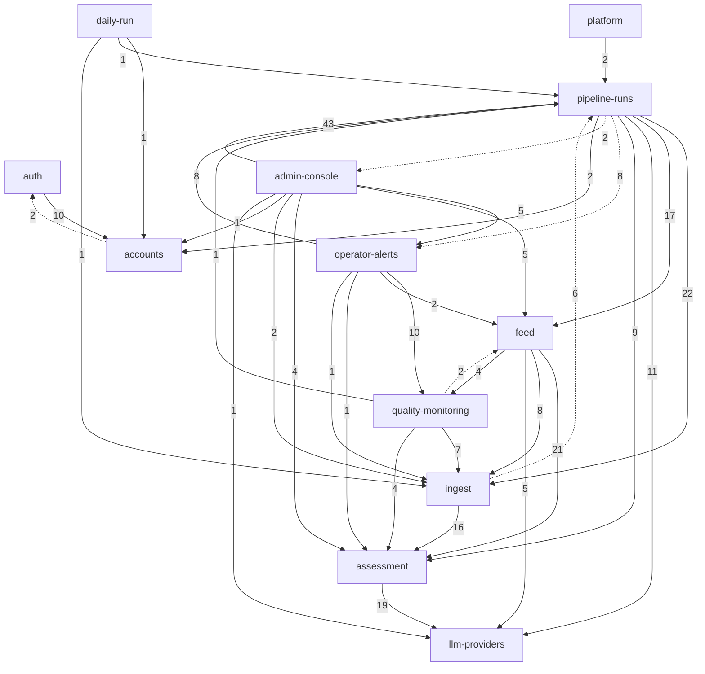
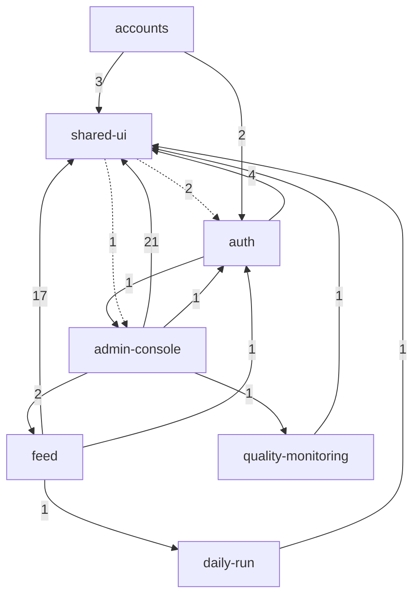

# Dowody: struktura

Statyczny graf zależności z HEAD `ef56ddc`, złożony do możliwości funkcją `cap()` z `context/map/.work/attribute.py` (glob wygrywa, wśród globów najdłuższy, potem najdłuższy prefiks na całych segmentach). `graph-metrics.mjs` dostał mapę **plik → capability** (`.work/filecap.tsv`, zbudowaną przez `cap()`), bo jego własny glob `*` nie przechodzi przez `/`, a `fnmatch` w `attribute.py` przechodzi: przy bezpośrednim podaniu `capabilities.tsv` wzorce typu `*AssessmentQuality*` nie trafiłyby w pełne ścieżki. Nieprzypisane pliki produktu: **0** (42 nieprzypisane pliki to `.claude/`, `.agents/`, `skills-lock.json`, `.10x-cli.json` i dwa `package-lock.json`, czyli szum według kontraktu). Graf wyjaśnia możliwości, ale ich nie szereguje. Oznaczenia: **evidence** to wynik polecenia z tej sesji, **inference** to interpretacja, **unknown** to ślepa plamka.

Punkt odniesienia dla M-4: graf przebudowany tą samą metodą i z **tym samym** `capabilities.tsv` ze stanu `5b4ac92`, czyli końca poprzedniej mapy (`git archive` → `.work/pre-m4/`). Kontrola wypadła dobrze: odtworzony stan ma 268 plików Java i 932 krawędzie runtime + 3 `type`, dokładnie jak archiwalna mapa. Liczby z archiwum (`context/archive/2026-11-01-repo-map/evidence/3-structure.md`) liczono starym `capabilities.tsv`, więc porównuję się z odtworzeniem, nie z nimi. **evidence**

**Artefakt atrybucji (evidence, do poprawy w `capabilities.tsv`, nie w kodzie):** `pipeline/api/InternalPipelineRunController.java` pasuje do dwóch globów: `*PipelineRunController*` (23 znaki → admin-console) i `*InternalPipelineRun*` (21 → daily-run). Wygrywa dłuższy, więc plik ląduje w **admin-console**, a jego test `InternalPipelineRunIT` w daily-run. Inwentarz w kontrakcie przypisuje go do daily-run. Skutek w liczbach: z 43 krawędzi `admin-console → pipeline-runs` 10 pochodzi z tego pliku, a 3 z 5 krawędzi `admin-console → operator-alerts` też (w tym `→ NightSummary`). Gdyby plik należał do daily-run, `daily-run → pipeline-runs` wyniosłoby 11, jak w archiwum. Wszystkie tabele niżej trzymają się reguły `cap()`.

## Graph sources

| Język / moduł | Źródło | Poziom | Pokrycie | Confidence | Ślepe plamki |
|---|---|---|---|---|---|
| Java, `szczur-radar-api/src/main/java` | `./mvnw -o dependency:build-classpath` (offline, tylko `~/.m2`, nic nie pobrano) → `javac -proc:none` plików z `git ls-files` do `.work/classes-main` → `jdeps -verbose:class -filter:none` → klasa → plik przez atrybut `SourceFile` (`.work/java_edges.py`) | 2 (toolchain) | 285 z 288 plików; 1018 krawędzi runtime + 6 `type`. Poza grafem `config/ClockConfig`, `config/SessionConfig`, `health/HealthController` (bez wewnętrznych zależności) | high | Spring DI, SQL i JPQL, refleksja; bajtkod gubi generyki i wkompilowane stałe |
| Java, korekta źródłowa | skan nazw typów w kodzie bez komentarzy i napisów (tokenizer) wobec krawędzi `jdeps`: `Nazwa.class` → `runtime`, reszta → `type` (`.work/java_mentions.py`) | 2 | +5 `runtime` (wszystkie z `@ExceptionHandler`/`assignableTypes` w `PipelineRunExceptionHandler`), +6 `type`: `PageLimits` ×3 (wkompilowane stałe; nowe w M-4), `LoginRequest→Emails`, `SourceIngest→SourcePost`, `RuleBasedValidator→Violation`. 11 importów tylko pod Javadoc odrzuconych (`.work/java-javadoc-imports.txt`) | high | Java nie ma `import type`, więc prawie wszystko jest `runtime` |
| Java, testy `src/test/java` | jak wyżej, `classes-test` | 2 | 198 plików; 1407 krawędzi test→main (`edges-java-test-raw.csv`) | high | tylko do Test risks; `Class.forName` w 3 plikach testowych |
| TypeScript/Vue, `szczur-radar-web/src`, `dev/` | kompilator projektu: `typescript` 6.0.3 i `@vue/compiler-sfc` 3.5.43 z `node_modules` głównego checkoutu (worktree ich nie ma; wersje zgodne z `package-lock.json` worktree, który jest bajt w bajt taki sam; nic nie instalowano). AST: importy, re-eksporty, `import type`, `import()`, `import.meta.glob`, zapytania `?raw` (`.work/ts_edges.mjs`) | 2 | 70 plików; 129 krawędzi prod. (109 runtime, 19 type, 1 build), 126 testowych. 0 aliasów, 0 nierozwiązanych | high | `import.meta.glob` ×4 w testach poza grafem; zależność od tokenów CSS (`var(--…)`) to nie import, więc idzie grepem (poziom 4) |
| Shell, Python, `tools/*` | `git grep` ścieżek HTTP, zmiennych, nazw tabel | 4 | brak grafu plików | low | zależności idą przez sieć, zmienne i schemat |
| IaC i CI (`.railway/railway.ts`, `ci.yml`) | `git grep` nazw zmiennych i ścieżek | 4 | 2 pliki | low | referencje między serwisami to konfiguracja |
| Między stosami | `git grep` `@*Mapping`, URL-i w `src/api/*.ts`, `ContractRegistry`, tabel w SQL | 4 | 24 trasy `/api`, 3 `/internal`, 12 tabel | medium | kształt JSON jest strzeżony testami, nie grafem |

Surowe dane: `.work/edges-{java,java-all,java-extra,java-nomech,java-test-raw,ts,ts-test,ts-nomech}.csv`, `analysis-{java,ts}.txt`, `metrics-java-cap.md`, `gm-java-files.json`, `mermaid-*.txt`, `ts-notes.txt`, `.work/pre-m4/`.

## Capability graph

Ca/Ce = liczba **możliwości**. „Bez mech.” wyklucza krawędzie z sekcji Mechanical signals. **evidence** (`analyze.py`, `graph-metrics.mjs`)

### Backend (Java)

| Capability | Pliki main | Ca / Ce / I | Bez mech.: Ca / Ce / I | Przed M-4 (bez mech., ten sam tsv) |
|---|--:|---|---|---|
| shared-foundations | 40 | 10 / 7 / 0.41 | 10 / 0 / **0.00** | 9 / 0 / 0.00 |
| assessment | 57 | 7 / 2 / 0.22 | **6** / 2 / 0.25 | 4 / 2 / 0.33 |
| ingest | 36 | 7 / 3 / 0.30 | **6** / 3 / 0.33 | 4 / 3 / 0.43 |
| pipeline-runs | 37 | 7 / 8 / 0.53 | **6** / 8 / 0.57 | 4 / 8 / 0.67 |
| accounts | 27 | 6 / 3 / 0.33 | 4 / 2 / 0.33 | 4 / 2 / 0.33 |
| feed | 10 | 5 / 5 / 0.50 | **4 / 5** / 0.56 | 2 / 4 / 0.67 |
| llm-providers | 30 | 5 / 1 / 0.17 | 4 / 1 / 0.20 | 4 / 1 / 0.20 |
| operator-alerts | 9 | 3 / 7 / 0.70 | 2 / **6** / 0.75 | 2 / 1 / 0.33 |
| quality-monitoring (nowa) | 12 | 2 / 5 / 0.71 | 2 / 5 / 0.71 | — |
| admin-console | 10 | 2 / 8 / 0.80 | 1 / 8 / 0.89 | 1 / 8 / 0.89 |
| auth | 14 | 1 / 3 / 0.75 | 1 / 2 / 0.67 | 1 / 2 / 0.67 |
| daily-run | 3 | 1 / 3 / 0.75 | 0 / 3 / 1.00 | 0 / 3 / 1.00 |
| platform | 3 | 0 / 1 / 1.00 | 0 / 1 / 1.00 | 0 / 1 / 1.00 |

**M-4 dodał dwie nowe gęste krawędzie i jedną nową możliwość, rdzenia nie przestawił** (**evidence**): pliki Java 268 → 288, krawędzie runtime 932 → 1018, bez mech. 875 → 959, testy Java 148 → 198 (+50, z czego 23 w regression-harness), pliki web 66 → 70, krawędzie web 121 → 129. Żadna krawędź między możliwościami nie zniknęła. Nowe i zmienione (plik→plik, bez mech.):

| Krawędź | Przed M-4 | Teraz | Skąd |
|---|--:|--:|---|
| `operator-alerts → quality-monitoring` | 0 | **10** | `pipeline/NightSummary` → `posts/AssessmentQuality`, `Quality*`, `Language*`, `Source*` (S-34–S-36) |
| `operator-alerts → pipeline-runs` | 0 | **8** | `NightSummary` → `PipelineRunService`, `pipeline/run/*` |
| `quality-monitoring → ingest` | 0 | 7 | `sources/Source` w 7 plikach jakości |
| `feed → quality-monitoring` / `quality-monitoring → feed` | 0 / 0 | 4 / 2 | repozytoria `posts/` zwracają projekcje jakości; `AssessmentQuality` czyta `AssessmentRepository`, `PostStatement` |
| `quality-monitoring → assessment` | 0 | 4 | `validation/FailureClass` |
| `admin-console → pipeline-runs` | 40 | 43 | `DeadPostController → pipeline/state/PostTransitions` (S-33), `AttentionReason` ×2 |
| `admin-console → operator-alerts` | 2 | 5 | wyłącznie `InternalPipelineRunController` (artefakt atrybucji, patrz wyżej) |
| `admin-console → shared-foundations` | 8 | 12 | `config/PostIdLimits`, błędy w `DeadPostController` |
| `feed → shared-foundations`, `feed → ingest` | 7, 6 | 10, 8 | `text/Language` (S-36), `posts/PostStatement` |
| `pipeline-runs → assessment` | 7 | 9 | `ConcurrentAssessmentDispatcher → Violation` (wyłącznik S-32), `RunFlow → ItemType` |
| `ingest → shared-foundations` | 6 | 7 | `sources/Source → text/Language`: rejestr źródeł niesie teraz język i progi jakości |

Diagram dla raportu (bez mechanicznych; etykieta = liczba krawędzi plik→plik; linia przerywana = słabsza strona 2-cyklu). Pominięto 12 krawędzi do `shared-foundations`, czystego liścia (Ce 0 bez mech.), od którego zależy każda możliwość poza `platform` i `daily-run`:

Krawędź `ingest -.-> pipeline_runs` to wyłącznie `pipeline/step/SourceIngest.java`. Krawędzie `operator_alerts` w obie strony z `pipeline_runs` to po stronie alerts wyłącznie `pipeline/NightSummary.java`: plik leży w pakiecie `pipeline/`, a glob `*NightSummary*` przypisuje go do operator-alerts. **evidence**

### Frontend (Vue/TS)

| Capability | Pliki (prod / test) | Ca / Ce / I | Bez mech.: Ca / Ce / I |
|---|---|---|---|
| shared-ui | 10 + `style.css` / 7 | 6 / 3 / 0.33 | 6 / 2 / 0.25 |
| auth | 6 / 3 | 4 / 4 / 0.50 | 4 / 2 / 0.33 |
| admin-console | 9 / 8 | 2 / 4 / 0.67 | 2 / 4 / 0.67 |
| feed | 8 / 7 | 3 / 3 / 0.50 | 1 / 3 / 0.75 |
| daily-run | 1 / 0 | 1 / 1 / 0.50 | 1 / 1 / 0.50 |
| quality-monitoring (nowa) | 1 / 0 | 1 / 1 / 0.50 | 1 / 1 / 0.50 |
| accounts | 2 / 1 | 1 / 2 / 0.67 | 0 / 2 / 1.00 |
| regression-harness | 3 / 4 | type i build | (tylko `samples.ts` type, `mockApi.ts` build) |

Różnica wobec M-3 w kodzie produkcyjnym SPA to 3 krawędzie runtime (`AdminView.vue → api/quality.ts`, `api/quality.ts → api/client.ts`) i 1 `type` (`api/quality.ts → api/posts.ts`). Reszta nowych krawędzi to `samples.ts` (type) i `mockApi.ts → dev/mock-api.js?raw` (build). **evidence** (`diff` krawędzi `pre-m4` ↔ teraz)

### Widoki SPA: od czego zależą (runtime, `type` w nawiasie; **evidence**, kompilator)

| Widok (capability, linie) | `api/*.ts` | Komponenty | `labels.ts` | `runs.ts` | Inne |
|---|---|---|:-:|:-:|---|
| `FeedView` (feed, 261) | `posts`, `freshness` (daily-run) | `AppButton`, `AppHeader`, `FeedFilter`, `PostCard`, `StatusMessage` | ✓ | — | `feedFilter.ts`, `router/scroll.ts` |
| `PostDetailView` (feed, 286) | `client`, `posts` | `AppButton`, `AppHeader`, `PostAssessment`, `StatusMessage` | ✓ | — | — |
| `AdminView` (admin-console, **790**, w M-4 +261 linii) | `pipeline`, `posts`, `quality` | `AppButton`, `AppHeader`, `StatusBadge`, `StatusMessage` | ✓ | ✓ | `missingDays.ts`, `polling.ts` |
| `RunDetailView` (admin-console, 442) | `client`, `pipeline` | `AppButton`, `AppHeader`, `StatusBadge`, `StatusMessage` | ✓ | ✓ | `polling.ts` |
| `LoginView` (auth, 132) | `auth`, `client` | `StatusMessage` | — | — | `auth/session.ts`, `router/redirect.ts` |
| `ActivateView` (accounts, 223) | `activation`, `auth` | `AppButton`, `StatusMessage` | — | — | `auth/session.ts` |
| `KitchenSinkView` (shared-ui, 817, tylko dev, `import()` z routera) | (`notifications`, `posts`) | `AppButton`, `FeedFilter`, `NotificationMenu`, `PostAssessment`, `PostCard`, `StanceText`, `StatusBadge`, `StatusMessage` | — | — | — |

Komponenty: `AppHeader` → `api/auth`, `auth/session`, `AppButton`, `NotificationBell`, `StatusMessage`. `NotificationBell` → `NotificationMenu`, `notificationsStore`, `auth/session`, `polling` (+ type `api/notifications`). `NotificationMenu` → `AppButton`, `StatusBadge`, `StatusMessage`, `labels`, `runs`. `PostCard`, `PostAssessment` → `StanceText`, `StatusBadge`, `labels` (+ type `api/posts`). `FeedFilter` → `api/posts`, `feedFilter`, `AppButton`, `labels`. `runs.ts` → `labels` (+ type `api/pipeline`, `StatusBadge`).

Pliki nośne SPA (Ca plikowe bez mech.): `api/client.ts` 11 (zasięg 19 plików, 6 możliwości), `labels.ts` 10, `AppButton.vue` 8, `StatusMessage.vue` 8, `api/posts.ts` 6, `StatusBadge.vue` 5, `api/auth.ts` 4, `auth/session.ts` 4, `AppHeader.vue` 4 (Ce 5), `runs.ts` 3 (`AdminView`, `RunDetailView`, `NotificationMenu`), `polling.ts` 3. **evidence**

`style.css` (185 linii, 34 własności `--*`): w grafie importów ma jedną krawędź (`main.ts`). Zależność widoków od tokenów to `var(--…)` (grep, poziom 4): 16 z 18 plików `.vue` (bez `App.vue` i `NotificationBell.vue`), najczęściej `--space-4` 40×, `--space-3` 36×, `--space-2` 36×, `--text-h` 32×, `--space-1` 23×, `--font-size-sm` 21×, `--accent` 15×. Lista `CLEANED` w `styleContract.test.ts` obejmuje 16 plików `.vue`, wszystkie poza `App.vue` i `LoginView.vue`. **evidence**

### Korytarze SPA ↔ API i ich strażnicy

| Korytarz | Strona SPA | Strona API | Strażnik (job CI) | Status |
|---|---|---|---|---|
| 17 plików kształtu `src/contract/*.json` (bez `rules.json`) | `samples.ts` (typowane próbki, krawędzie `type` do 7 plików `api/*.ts`); `shapes.test.ts` (glob `./*.json` bez `rules.json` ↔ próbki; nowy plik bez próbki daje czerwień); `responseTypes.test.ts` (żadnych pól `?:` w `src/api` poza listą wyjątków); `vue-tsc` w obrazie | `contract/ContractRegistry.SHAPES`: 15 tras → pliki i typ Java (po nazwie binarnej, `Class.forName`); `NOT_READ_BY_SPA`: 9 tras z uzasadnieniem; `ContractRoutesIT` porównuje obie listy z zamapowanymi trasami (15 + 9 = 24 = wszystkie `/api` z `@*Mapping`); `ContractVariantsTest`; `ContractFiles.assert*` w 11 plikach `*IT` | `backend` + `web-unit` + obraz web | **zabezpieczone dla wszystkich tras czytanych przez SPA** (archiwum: 4 z 10 kształtów). Odczyt: SPA woła 20 tras, nie woła 4 (`health`, `ready`, `deploy-safety`, `llm/check`), zgodnie z `NOT_READ_BY_SPA` |
| `rules.json` (whitespace 29, `limits` 7, `values` 27, `errorCodes` 15; archiwum: 6 / 18 / 15) | `rules.test.ts` (stałe, `labels`, unie TS, skan literałów kodów błędów w `../**/*.{ts,vue}` przez `import.meta.glob` i w `dev/mock-api.js?raw`) | `SpaRulesTest` (m.in. `PageLimits.MAX_SIZE/MAX_PAGE`) | `backend` + `web-unit` | korytarz ze strażnikiem (zasada 3) |
| `dev/mock-api.js` (701 linii; skrypt `playwright-cli run-code`, `page.route` na `/api/*`, 8 stałych trybu: `MODE`, `AUTH`, `LOGIN`, `START`, `ACTIVATION`, `FRESHNESS`, `MISSING`, `QUALITY`, plus `NOTIFICATIONS`) | `contract/mockApi.ts` wykonuje jego tekst bez przeglądarki; `mockApi.test.ts` porównuje każdą trasę z plikami kontraktu (klucze, typy JSON, enumy z `rules.json`) i z tabelą zachowań `ROWS` (statusy, kody błędów, sesja, stronicowanie) | nagłówek wskazuje kontrolery, które naśladuje | `web-unit` | korytarz ze strażnikiem (S-43); od początku historii zmieniało go 20 commitów |
| Co-change (commit-files, cała historia) | 7 commitów zmieniło pliki `src/contract/*.json`. Wszystkie 7 zmieniły też testy Java i `src/api/*.ts`, 5 z nich także `mock-api.js` | | | lockstep wymuszony przez workflow (zasada 3) |

Inne korytarze między stosami (grep, confidence medium):

| Od | Do | Strażnik |
|---|---|---|
| `tools/pipeline-trigger/trigger.sh` | `/internal/pipeline-runs/daily`, `/{id}`, **`/nightly-summary`** (nowe w S-34; obsługuje je `InternalPipelineRunController` → `NightSummary`) | `pipeline-trigger-test` z atrapą `fixtures/api/nightly-summary.json` |
| `tools/deploy-gate/wait-safe.sh` | `/api/deploy-safety` → `DeploySafetyController` → `PipelineRunRepository`, `PipelineStallSettings` | `deploy-gate-test` |
| `tools/db-backup/tables.sh` | 10 tabel aplikacji, 2 tabele sesji, `flyway_schema_history` (12/12 nazw z `CREATE TABLE` + flyway) | `db-backup-test` |
| zmienne | `NTFY_URL`/`NTFY_TOKEN` (api, iac, healthchecks); `HEALTHCHECK_PING_URL` **już nie w API** (iac, db-backup, healthchecks, pipeline-trigger); `PIPELINE_TRIGGER_TOKEN` (api, pipeline-trigger, iac); `API_PRIVATE_DOMAIN` (web, pipeline-trigger, iac, compose); `PG*` (api, ci, db-backup, iac); `LLM_API_KEY` (api, ci, iac, deploy-gate); `REDDIT_SUBREDDITS`, `WYKOP_KEY` (api, ci, iac) | brak jednego strażnika; część w `railway-config` |
| reguła adresu ping (S-25) | bloki `ping-url rule (S-25)`: `backup.sh` 3, `trigger.sh` 3, `checks.sh` 1, `test.sh` 2 | `healthchecks-test` |

## Blast radius per capability

Krawędzie runtime bez mechanicznych. „Pliki” to pliki main w grafie. „Bezpośredni” to pliki spoza możliwości, które ją importują. „Wystawione” to jej pliki importowane z zewnątrz. „Zasięg” to domknięcie wsteczne po plikach. „Testy obce” to pliki testowe innych możliwości z bezpośrednią krawędzią do niej (bez model-evaluation i regression-harness, podane osobno). **evidence**

| Capability | Pliki | Bezpośredni | Wystawione | Zasięg (pliki: możliwości) | Testy obce (+ model-eval, + regression-harness) |
|---|--:|--:|--:|---|---|
| shared-foundations | 14 | 36 | 11 | 121: assessment 27, pipeline 22, ingest 16, quality 11, accounts 10, llm 9, feed 7, admin 7, alerts 5, auth 5, platform 1, daily 1 | 16 (+4, +2) |
| ingest | 36 | **28** | 6 | **46**: pipeline 20, quality 11, admin 7, feed 5, alerts, platform, daily po 1 | 38 (+6, +3) |
| assessment | 57 | 24 | 13 | 40: pipeline 12, ingest 10, feed 7, quality 6, admin 4, alerts 1 | 32 (+19, +3) |
| accounts | 26 | 8 | 5 | 27: pipeline 12, admin 5, auth 4, daily 2, quality, alerts, platform, ingest po 1 | 35 (+0, +4) |
| llm-providers | 30 | 8 | 16 | 27: pipeline 10, assessment 5, feed 4, admin 4, quality 2, alerts, platform po 1 | 19 (+7, +4) |
| feed | 10 | 10 | 7 | 17: pipeline 10, admin 4, quality 2, alerts 1 | 19 (+1, +1) |
| quality-monitoring | 12 | 3 | 11 | 16: pipeline 8, admin 4, feed 3, alerts 1 | 3 (+0, +1) |
| pipeline-runs | 37 | 11 | **25** | 11: admin 6, quality, alerts, platform, daily, ingest po 1 | 17 (+0, +2) |
| auth | 13 | 2 | 1 | 8: accounts 8 | 4 (+0, +1) |
| operator-alerts | 9 | 6 | 3 | 8: pipeline 4, admin 3, quality 1 | 8 (+0, +1) |
| admin-console | 10 | 2 | 1 | 5: pipeline 3, quality 1, alerts 1 | 6 (+0, +1) |
| daily-run, platform | 3, 2 | 0 | 0 | 0 w Javie (wejścia: HTTP z `trigger.sh`, CI, monitor) | — |

Przed M-4 (ten sam tsv, `.work/pre-m4/analysis-java.txt`): bezpośredni / zasięg `ingest` 18 / 31, `assessment` 18 / 32, `feed` 8 / 13, `pipeline-runs` 8 / 8, `shared-foundations` 31 / 87; reszta bez istotnych zmian. **evidence**

Web (bez mech.): zasięg `shared-ui` 23 pliki (admin 8, feed 8, auth 3, accounts 2, daily 1, quality 1), `auth` 7, `admin-console` 6, `feed` 3, `daily-run` 1, `quality-monitoring` 1.

| Capability | Incoming | Outgoing | Kontrakty importowane przez innych (pliki obce / możliwości) |
|---|---|---|---|
| ingest | pipeline 22, feed 8, quality 7, admin 2, daily 1, alerts 1 | assessment 16, shared 7, pipeline 6 (`SourceIngest`) | `sources/Source` **28 / 6** (Ca plikowe 39, przed M-4 29; zasięg 58, przed M-4 43), `RawPayloadRef`, `RawPayloadStore`, `SourceIngest` |
| assessment | feed 21, ingest 16, pipeline 9, quality 4, admin 4, alerts 1 | llm 19, shared 5 | `ItemType` 11/4 (zasięg 62), `AssessmentInputV1` 8/3 (Ca 29), `FailureClass` 7/4 (nowy importer: jakość), `Provenance`, `AssessmentResult`, `Violation` |
| pipeline-runs | admin 43, alerts 8, ingest 6, platform 2, quality 1, daily 1 | ingest 22, feed 17, llm 11, assessment 9, alerts 8, shared 4, admin 2, accounts 2 | `PipelineRunRepository` 7/4, `RunStatus`, `RunKind`, `PipelineRun`, `InterruptionCause`, `PipelineRunService` 4/3 (w tym tylko stała `ZONE` dla jakości i `NightSummary`) |
| feed (`posts`) | pipeline 17, admin 5, quality 2, alerts 2 | assessment 21, shared 10, ingest 8, llm 5, quality 4 | `PostRepository` 6/3, `Post` 6/2, `PostStage` 5/2, `AssessmentRepository` **4/4** |
| quality-monitoring | alerts 10 (`NightSummary`), feed 4 (repozytoria) | ingest 7, assessment 4, feed 2, shared 2, pipeline 1 | projekcje `SourceCount` 3/2, `SourceAssessmentTotals` 2/2, `SourceClassCount`; `AssessmentQuality` (Ce 14) |
| operator-alerts | pipeline 8, admin 5 | quality 10, pipeline 8, shared 3, feed 2, assessment, ingest po 1 (wszystko z `NightSummary`, Ce 22, 620 linii) | `AlertEvent` 6/2, `OperatorAlertQueue` 6/2 |
| llm-providers | assessment 19, pipeline 11, feed 5, admin 1 | shared 4 | `ServiceTier`, `Provider`, `LlmProviderProperties`, `ReasoningEffort`, `OutputMode`, `Channel` |
| accounts | auth 10, pipeline 2, admin 1, daily 1 | shared 6, auth 2 | `Role`, `User`, `SystemAccount` |
| admin-console | pipeline 2 (`RunNotifications`) | pipeline 43, shared 12, feed 5, alerts 5, assessment 4, ingest 2, accounts, llm po 1 | `RunNotifications` |

Wnioski (**inference**):

- **M-4 przesunął zasięg w stronę `ingest` i `assessment`, nie silnika.** Bezpośredni zależni od `ingest` wzrośli z 18 do 28, a zasięg z 31 do 46 plików. Robi to `Source`, które czyta teraz każda statystyka jakości. `Source` niesie też język i dwa progi jakości (`WYKOP(5, Language.PL, 2)`, `REDDIT(25, Language.EN, 30)`). Nowe źródło dopisuje więc progi S-35 i S-36 w stałej rejestru, oprócz czterech `CHECK` i `rules.json`. Stałe `Source.WYKOP/REDDIT` nadal nie mają ani jednego użycia poza `sources/` (`git grep`: 0), więc fan-in to typ wartości (zasada 2).
- **quality-monitoring siedzi wewnątrz `posts/` i ma dwa sposoby wejścia.** Pierwszy to repozytoria feedu, które zwracają jego projekcje (JPQL `select new pl.szczurradar.api.posts.SourceCount(...)`). Drugi to `NightSummary`, które składa noc z jakością, przebiegami i postami. Zmiana progu albo okna jakości sięga `NightSummary`, kontrolera admina i `AdminView` (16 plików Java). Zmiana zapytań zaczyna się w repozytoriach feedu.
- **`NightSummary` to nowy hub wychodzący (Ce 22).** Leży w pakiecie `pipeline/` i należy do operator-alerts, a robi z `pipeline-runs` 2-cykl na poziomie możliwości (8/8).

## Cycles

Tylko runtime, poziom plików. **evidence** (`graph-metrics.mjs`). Cykle plikowe są bez zmian wobec stanu sprzed M-4.

| Cykl | Rozmiar | Możliwość | Najmniejsza pętla | Ocena |
|---|--:|---|---|---|
| `SzczurRadarApiApplication` ↔ `cli/*` | 7 | shared-foundations ↔ accounts | 2: `CreateUserCommand ↔ LinkCommand`; 3 z klasą main | bootstrap, mechaniczne |
| `contract/Anchor`, `Evidence`, `Quote` | 3 | assessment | 2: `Anchor ↔ Quote` | rekordy kontraktu V2 |
| `contract/Item`, `Parent`, `TextFields` | 3 | assessment | 2: `Item ↔ TextFields` | interfejs i jego rekordy |
| `activation/IssueOutcome ↔ IssuedLink` | 2 | accounts | 2 | typy wyniku |
| TS | 0 runtime | — | — | jedyny cykl plikowy (`api/pipeline.ts ↔ missingDays.ts`) jest type-only |

Żaden cykl plikowy nie łączy dwóch możliwości biznesowych. Pętle na poziomie możliwości (bez mech.; 2-cykle z `analyze.py`):

- **`auth ↔ accounts`** (10 / 2), bez zmian.
- **`pipeline-runs ↔ admin-console`** (2 / 43): `PipelineRunService`, `PipelineStartupRecovery → RunNotifications`, bez zmian.
- **`pipeline-runs ↔ ingest`** (22 / 6) to artefakt przypisania `SourceIngest`.
- **NOWE `pipeline-runs ↔ operator-alerts`** (8 / 8). Silnik woła `AlertEvent`/`OperatorAlertQueue`, a `NightSummary` (pakiet `pipeline/`, glob → alerts) czyta przebiegi. Bez tego jednego pliku to SCC znika (`--exclude 'pipeline/NightSummary'`).
- **NOWE `feed ↔ quality-monitoring`** (4 / 2). W tę stronę idzie przez `AssessmentRepository`, `PostRepository` → projekcje jakości, wstecz przez `AssessmentQuality → AssessmentRepository`, `PostStatement`. Na poziomie pakietu to jeden pakiet `posts/`, więc pętla wynika z podziału footprintu.
- SCC bez mech.: `{admin-console, feed, ingest, operator-alerts, pipeline-runs, quality-monitoring}`. Po wykluczeniu `SourceIngest` i `NightSummary` zostaje `{admin-console, feed, pipeline-runs, quality-monitoring}`. Tę pętlę domykają `quality → pipeline-runs` (1 krawędź: `AssessmentQualityController → PipelineRunService.ZONE`, sama stała strefy czasu) oraz `pipeline-runs → feed` i `feed ↔ quality`.
- Web: SCC 6 możliwości (`admin-console, auth, daily-run, feed, quality-monitoring, shared-ui`) bez cyklu plikowego. Robią je `auth/session.ts → notificationsStore.ts`, `NotificationBell.vue → auth/session.ts`, `AppHeader.vue → api/auth.ts, auth/session.ts, NotificationBell.vue` i `FeedView.vue → router/scroll.ts`, a dochodzi `AdminView → api/quality.ts`.

## Broken boundaries

Zamierzone warstwy (**inference** z REPOSITORY_GUIDELINES i pakietów): `text`/`settings`/`persistence` → kontrakt `agents/assessor/contract` i enumy `llm/` → klienci (`llm`, `sources`, `raw`) → encje (`posts`, `user`, `pipeline/run`, `notifications`) → silnik (`pipeline`: `flow` → `step`/`assess`/`state`) → kontrolery (`*/api`, `auth`, `internal`) → CLI. Web: `api/client.ts` → `api/*.ts` → komponenty → widoki → router, `main.ts`.

Egzekwowanie: w repo nadal nie ma reguł zależności (`git grep archunit|modulith|dependency-cruiser|madge|ArchRule` w `pom.xml`, `package.json`, `src`, `.github`: 0). **evidence**

| Krawędź runtime | Pliki | Wobec czego | W M-4 | Status |
|---|---|---|---|---|
| **kontroler admina → stan silnika** | `posts/api/DeadPostController → pipeline/state/PostTransitions.restore` (S-33) | kontroler z pakietu `posts/api` zapisuje stan postów przez warstwę `state/` silnika, z pominięciem `PipelineRunService`. `PostTransitions` ma teraz 5 `UPDATE posts` (przedtem 4) | **nowe** | evidence (krawędź, SQL), inference (ocena) |
| kontroler admina → wnętrza silnika | `PipelineRunController → state/RunRecorder.inFlight`, `step/SourceIngest.SourceState` | omija `PipelineRunService`; Ce kontrolera 21 → 22 | bez zmian | evidence |
| **repozytoria feedu → projekcje jakości** | `AssessmentRepository`, `PostRepository` → `SourceCount`, `SourceAssessmentTotals`, `SourceClassCount` (4) | zapytania jakości żyją w repozytoriach feedu | **nowe** | evidence |
| **przebieg → podsumowanie nocy** | `NightSummary` (pakiet `pipeline/`, Ce 22) → `PipelineRunService`, `pipeline/run/*`, `posts/*Repository`, `Quality*`, `Language*`, `FailureClass`, `Source` | moduł alarmów czyta trzy warstwy naraz; wołany z `InternalPipelineRunController` | **nowe** | evidence (krawędzie), inference (ocena) |
| jakość → silnik dla stałej | `AssessmentQualityController`, `NightSummary` → `PipelineRunService.ZONE` | strefa Warszawy siedzi w serwisie silnika; jedyny powód krawędzi `quality → pipeline-runs` | **nowe** | evidence |
| rejestr źródeł → jakość | `sources/Source → text/Language` + progi jakości w stałych | konfiguracja jakości w rejestrze `ingest` | **nowe** | evidence |
| silnik → transport LLM | `ConcurrentAssessmentDispatcher` (661 linii, w M-4 +37) `new ProviderMessages(llmSettings.apiKey())`; `PipelineStallSettings → TransportRetry.maxCallDuration` | `transport/` to wnętrze `llm` | bez zmian | inference |
| silnik → funkcja admina | `PipelineRunService`, `PipelineStartupRecovery → RunNotifications` | 2-cykl | bez zmian | inference |
| encja → enumy dostawcy | `posts/Assessment → llm/Channel, OutputMode, Provider, ReasoningEffort, ServiceTier` | Ce `Assessment` 14 | bez zmian | evidence |
| SQL poza encją | `PostTransitions` (`UPDATE posts` ×5, `FROM pipeline_runs` ×3), `RunRecorder` (`FROM posts` ×1, 18 zapisów `pipeline_run*`), `NotificationRepository` (`FROM users`), `ActivationLinks` (`DELETE FROM spring_session`) | tabele łączą możliwości poza grafem | +1 `UPDATE posts` | evidence |
| web klient feedu niesie trasy admina | `api/posts.ts` → `/api/admin/posts/failed` i **`/api/admin/posts/restore`** (nowe); `api/pipeline.ts → api/posts.ts` (runtime), `api/quality.ts → api/posts.ts` (type), `AdminView → api/posts.ts` | `api/posts.ts` (217 linii, w M-4 +70) to wspólny moduł typów i stałych | **pogłębione** | evidence |
| web: widok admina bez własnych komponentów | `AdminView.vue` 790 linii (Ce 11): dni bez danych, jakość, nieudane i martwe posty inline; z komponentów tylko wspólne | mechanizm wspólnych komponentów (guidelines) nie objął sekcji admina | rośnie (+261 linii w M-4) | evidence (liczby), inference |
| web auth → admin | `auth/session.ts → notificationsStore.ts` | zależność odwrócona, udokumentowana | bez zmian | inference |
| web feed → router | `FeedView.vue → router/scroll.ts` | widok zna pomocnika przewijania | bez zmian | niski |
| auth → daily-run | `SecurityConfig → internal/PipelineTriggerToken*` | config-as-code łańcuchów filtrów (zasada 2) | bez zmian | mechaniczne |

## Test risks

Krawędzie test→kod z bajtkodu testów. „Szerokie” to testy, które sięgają do co najmniej 3 innych możliwości (bez shared-foundations). Mocki policzone grepem (`Mockito|@Mock|mock(`), **low confidence**. **evidence**

| Capability | `*Test` | `*IT` | Pomocnicze | Szerokie (przykłady → liczba obcych możliwości) | Mocki (pliki / `@MockitoBean`) | Ocena (inference) |
|---|--:|--:|--:|---|---|---|
| pipeline-runs | 21 | 10 | 3 | **13** (`PipelineRunIT` 7, `PipelineRunServiceTest` 5, `ConcurrentAssessmentDispatcherTest` 5, `PostColumnsIT` 5) | 13 / 4 | najtrudniejsza izolacja; PIT obejmuje `assess`, `flow`, `state`, `run`, `step`, `PipelineRunService`, `RunWatchdog`, ale wyklucza `RunRecorder`, `PostTransitions` (SQL) i `*.api.*` |
| quality-monitoring | 1 | 2 | 0 | 3 (`AssessmentQualityIT` 4, `AssessmentQualityControllerIT` 4, `AssessmentQualityTest` 3) | 2 / 0 | `AssessmentQuality*` w PIT; dane idą przez typy ingest, assessment, feed |
| operator-alerts | 6 | 1 | 2 | 2 (`NightSummaryIT` 4, `NightSummaryTest` 4) | 0 / 0 | `NightSummary` wymaga przebiegów, postów i jakości naraz |
| feed | **0** | 2 | 1 | 3 (`PostRepositoryIT` 5, `PostsApiIT` 5, `PostSeeds` 5) | 0 / 0 | nadal tylko integracja |
| admin-console | 1 | 2 | 0 | 2 (`PipelineRunControllerIT` 6, `RunNotificationsTest` 4) | 3 / 2 | Postgres; web: 8 plików Vitest, 4 z `vi.mock` |
| daily-run | 2 | 3 | 0 | 2 (`InternalPipelineRunIT` 8, `FreshnessIT` 4) | 1 / 2 | `InternalPipelineRunIT` testuje kontroler, który `cap()` przypisuje do admin-console |
| shared-foundations | 9 | 7 | 5 | 2 (`JpaSchemaIT`, `ClosedSetsIT` po 7, z założenia) | 1 / 1 | strażnicy; szerokość jest celem |
| regression-harness | 5 | 3 | 15 | 2 (`SpaRulesTest` 9, `PrEnvScenariosIT` 4) | 0 / 0 | sięga llm 20, assessment 19, pipeline 9, ingest 7, accounts 6 krawędziami; zmiana kontraktu oceny albo dostawcy dotyka scenariuszy |
| assessment | 12 | 0 | 2 | 0 | 0 / 0 | łatwa izolacja; 18 plików main bez bezpośredniego testu (rekordy) |
| ingest | 16 | 0 | 6 | 0 | 3 / 0 | izolowalne przez fixture'y |
| llm-providers | 7 | 1 | 1 | 0 | 1 / 1 | fixture'y HTTP |
| auth / accounts / platform | 6/4/0, 9/4/0, 2/2/0 | | | 0 | 3/1, 3/0, 2/0 | IT z sesją JDBC, CLI w pełnym kontekście |
| model-evaluation | 8 | 0 | 17 | 1 (`LiveSmokeTest`) | 0 / 0 | poza jarem; 105 krawędzi do assessment, 48 do llm, 22 do ingest |

Wszystkie `*IT` wymagają Dockera. 72 pliki main bez bezpośredniej krawędzi z testu (27 w shared-foundations, 18 w assessment, 8 w auth) to głównie konwertery i rekordy, więc to sygnał mechaniczny.

**Web (ważne dla E2E w następnym kamieniu, evidence):** 30 plików `*.test.ts`: admin-console 8, shared-ui 7, feed 7, regression-harness 4, auth 3, accounts 1. `vi.mock` jest w 10. Każdy z 6 testów widoków importuje `router/index.ts` (który ładuje wszystkie widoki) i `auth/session.ts`; testy admina i feedu mają 10 i 9 krawędzi do `auth`. W repo **nie ma** runnera E2E: brak `@playwright/test` w `package.json`, skrypty to tylko `dev`, `build`, `test` (Vitest), a z Playwrighta jest tylko `.playwright/cli.config.json` dla `playwright-cli`. Jedyną przeglądarkową atrapą jest `dev/mock-api.js` (`page.route`), strzeżona przez `mockApi.test.ts` bez przeglądarki. Job `web-unit` uruchamia `npm test`.

## Centres and thin entry points

| Plik | Ca | Ce | I | Zasięg | Możl. obce | Rola (inference) |
|---|--:|--:|--:|--:|--:|---|
| `sources/Source` | **39** (przed M-4: 29) | 1 | 0.03 | 58 | 7 | rejestr źródeł + język i progi jakości; fan-in typu wartości (zasada 2) |
| `agents/assessor/contract/AssessmentInputV1` | 29 | 6 | 0.17 | 45 | 6 | kontrakt nośny wejścia oceny |
| `AssessmentOutputV2`, `validation/Violation` | 24 / 24 | 5 / 1 | 0.17 / 0.04 | 43 / 43 | 5 | wynik i rdzeń walidatora D1–D15 |
| `contract/ItemType` | 12 | 0 | 0.00 | **62** | 6 | największy zasięg przechodni |
| `text/Whitespace` | 9 | 0 | 0.00 | 61 | 8 | zbiór §10 |
| `validation/FailureClass` | 13 | 0 | 0.00 | 48 | 5 | klasy porażek; nowi importerzy: jakość, `NightSummary`, `FailedPostController` |
| `config/ErrorCode`, `ApiError` | 14 / 13 | 0 / 1 | 0.00 | 15 / 14 | 4 | odpowiedzi błędów; strzeżone przez `rules.json` |
| `llm/ServiceTier`, `Provider` | 13 / 12 | 0 | 0.00 | 40 / 37 | 7 | enumy wartości, `ClosedSetsIT` |
| `pipeline/run/RunStatus`, `RunKind`, `user/Role` | 12 / 11 / 11 | 0 | 0.00 | 24 / 21 / 26 | 6 / 6 / 5 | zamknięte zbiory |
| `alerts/AlertEvent` | 11 | 0 | 0.00 | 15 | 3 | kontrakt kanału alarmów (ntfy od S-34) |
| web `api/client.ts`, `labels.ts` | 11 / 10 | 0 | 0.00 | 19 / 12 | 6 / 2 | jedyny klient API, słownik etykiet |

Huby wychodzące: `agents/assessor/Assessor` (Ce 26), `pipeline/assess/ConcurrentAssessmentDispatcher` (25), **`pipeline/NightSummary` (22, nowy)**, `pipeline/PipelineRunService` (22), `pipeline/api/PipelineRunController` (22), `DeepSeekClient` (17), `posts/api/PostController` (17), `ContractV2Rules`, `OpenRouterClient` (16), `GeminiClient`, `InternalPipelineRunController` (15), `posts/Assessment`, **`posts/AssessmentQuality` (14, nowy)**. Web: `AdminView.vue` (Ce 11), `router/index.ts` (11, tabela tras).

Punkty wejścia (Ca 0 po wszystkich krawędziach runtime): 52 pliki Java. 21 z nich to konwertery, reszta to m.in. kontrolery (w tym nowe `DeadPostController`, `AssessmentQualityController`), `RunWatchdog`, `PipelineStartupRecovery`, `SecurityConfig`, konfiguracje. `ConcurrentAssessmentDispatcher`, `PostgresRawPayloadStore`, `WykopFetcher`, `RedditFetcher` mają Ca 0, bo wstrzykuje się je przez interfejs: to implementacje, nie wejścia. Cienkie wejścia: `DeploySafetyController` (2 krawędzie), `FreshnessController` (2), `DeadPostController` (4: deleguje do `PostTransitions.restore`), `trigger.sh`. `InternalPipelineRunController` nie jest już cienki (Ce 15, w tym `NightSummary`). Web: wejście `main.ts`, `router/index.ts` to tabela tras.

## Mechanical signals

| Sygnał | Liczba | Zasada |
|---|--:|---|
| konwertery `persistence/converters/*` + `user/RoleConverter` → enumy | 43 krawędzie (20 między możliwościami; nowy `LanguageConverter`) | 2; `JpaSchemaIT`, `ClosedSetsIT` |
| `SzczurRadarApiApplication` ↔ `cli/*` | 6, cykl 7 plików | bootstrap |
| `cli/*` ↔ `SendTestAlertCommand` | 4 | 2 (rejestr komend; komenda alerts w pakiecie accounts) |
| `config/ContractValueBinding` → `Direction`, `TargetKind` | 2 | 2 |
| `config/SecurityConfig` → `internal/` | 2 | 2 |
| `PipelineRunExceptionHandler` → kontrolery (`assignableTypes`) | 2 (wewnątrz admin-console po atrybucji) | 2 |
| Java compile-only (`PageLimits` ×3, `LoginRequest→Emails`, `SourceIngest→SourcePost`, `RuleBasedValidator→Violation`) | 6 `type` | 9 |
| web `router/index.ts`, `main.ts` | 14 krawędzi | 2 |
| web `KitchenSinkView.vue` (tylko dev) | 8 | narzędzie deweloperskie |
| web `import type` | 19; cykl `api/pipeline.ts ↔ missingDays.ts` (runtime w jedną stronę, type wstecz) | 9 |
| web `?raw` / `import.meta.glob` (strażnicy czytają źródła jako tekst) | 1 prod (`mockApi.ts → mock-api.js`), 18 test, 4 globy | 1 i 3 |
| `src/contract/*.json` + `rules.json` + `mock-api.js` ↔ IT, `SpaRulesTest`, `ContractRoutesIT` | 18 plików, 7 commitów lockstepu | 3 (korytarz ze strażnikiem) |
| `tools/db-backup/tables.sh` ↔ migracje | 12/12 tabel | 3 |
| `SourceIngest` w ingest, `NightSummary` w operator-alerts, `InternalPipelineRunController` w admin-console | 6, 22, 15 krawędzi | atrybucja footprintu; pliki leżą w `pipeline/` |

Po wyłączeniu sygnałów `shared-foundations` ma Ce 0 (czysty liść, I = 0.00).

## Unknowns

- **Wiązanie w runtime (Java):** `@Bean` 16 w 9 plikach, `@ConditionalOn*` 7 w 5, `ObjectProvider<` 14 w 6, `@EventListener` 1, `getBean(` 2; `@Scheduled`, `@Async`, `ApplicationEventPublisher`, `Class.forName` w main: 0. Wybór `NtfyAlerts`/`NoOperatorAlerts` i dostawcy LLM zapada w konfiguracji, a graf pokazuje typy, nie który bean wygrywa.
- **Sprzężenie przez tabele i zapytania:** `JdbcClient` w 5 plikach, `@Query` 29× w 5 repozytoriach. Konstruktory JPQL (`select new pl.szczurradar.api.posts.SourceCount`) odwołują się do klas napisem. Tabele `posts`, `assessments`, `pipeline_runs`, `users`, `spring_session` łączą możliwości poza grafem.
- **Refleksja w strażnikach:** `ContractRegistry` ładuje typy odpowiedzi przez `Class.forName` po nazwie binarnej, a `ClosedSetsGuard` i `RunEndingGuard` też. Rename rekordu odpowiedzi nie zostawia krawędzi w grafie. Wykrywa go dopiero czerwony test.
- **Skuteczność strażników:** tu potwierdzono ich obecność i wpięcie w `ci.yml`, ale nie przeprowadzono próby rozjazdu (`*IT` wymaga Dockera).
- **Konsumenci zewnętrzni (zasada 10):** `/api/ready`, `/healthz`, `GET /` sonduje `szczur-radar-monitor` (inne repo). `/api/admin/llm/check` wywołuje operator ręcznie. Kanał ntfy i healthchecks.io konsumują treść `AlertEvent` poza repo: unknown (external).
- **Tokeny CSS i stany UI:** zależność widoków od `style.css` jest tekstowa (`var(--…)`). Graf nie widzi, który widok renderuje który stan (7 stanów z guidelines) ani które ścieżki `mock-api.js` pokrywają tryby. Nie wiadomo, czy każda z 20 tras czytanych przez SPA ma w atrapie każdy tryb.
- **Rozjazd dokumentacji (do raportu):** `REPOSITORY_GUIDELINES.md` opisuje `alerts/HealthchecksAlerts` i `HEALTHCHECK_PING_URL` w API, a M-4 usunął ten plik (`NtfyAlerts`, `NTFY_URL`/`NTFY_TOKEN`). Grep `HEALTHCHECK_PING_URL` w `szczur-radar-api`: 0.
- **Języki bez grafu:** shell (`tools/*`), Python (`pc_runners.py`), IaC, CI: tylko referencje z grepa (low).
- **Narzędzia warte instalacji (nie instalowano):** ArchUnit albo Spring Modulith w testach API, żeby egzekwować granice pakietów (dziś 0 reguł, a M-4 dodał 3 nowe przejścia przez warstwy). `dependency-cruiser` dla `szczur-radar-web` jako reguły zależności (np. widok nie importuje `router/*`). `ast-grep` dla shella.

## Polecenia

- `./mvnw -o -q dependency:build-classpath -Dmdep.outputFile=…/.work/cp-test.txt -Dmdep.includeScope=test`; `javac -proc:none -d .work/classes-{main,test} @lista z git ls-files`; `jdeps -verbose:class -filter:none -e '^pl\.szczurradar\..*' --multi-release 25`
- `.work/java_edges.py` (SourceFile), `.work/java_mentions.py`, `.work/capmap.py` (`cap()` z `attribute.py`), `.work/analyze.py`, `.work/xcap.py`; `node .work/ts_edges.mjs <node_modules głównego checkoutu>`
- `node …/10x-repo-map/scripts/graph-metrics.mjs` z `--modules .work/filecap.tsv --kind runtime [--exclude …] [--emit mermaid] [--format json]`
- `git archive 5b4ac92 …` + ten sam łańcuch w `.work/pre-m4/`
- `git grep`: `@*Mapping`, URL-e `/api/` w `src/api`, `/internal/` w `tools/`, SQL po tabelach, `Source\.(WYKOP|REDDIT)`, adnotacje DI, `Class.forName`, `NTFY_*`, `HEALTHCHECK_PING_URL` i inne zmienne, `ping-url rule`, archunit/modulith/cruiser/madge, `var(--` w `.vue`; `grep` w `ContractRegistry`, `styleContract.test.ts` (`CLEANED`), `pom.xml` (PIT `targetClasses`); `python3` na `rules.json` i `commit-files.tsv`; `git diff --name-status 5b4ac92 ef56ddc`
