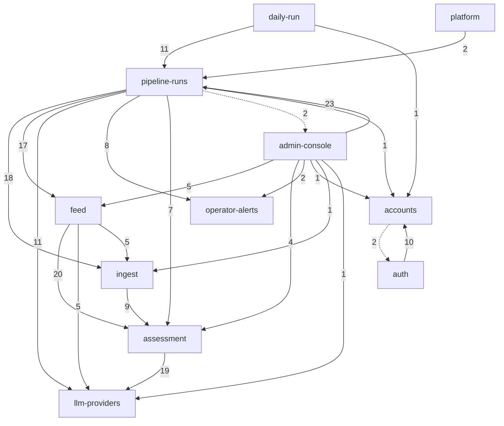

# Mapa projektu: szczur-radar

Poprzednia mapa (2026-10-17 @ 5b6eabb, przed M-2) leży w `context/archive/2026-10-17-repo-map/`. Od niej weszło 30 commitów: kamień M-2 „MVP Quality & Reliability Hardening” (F-04, S-08–S-11, S-13–S-19) i usunięcie Embabel (S-17).

## TL;DR

Szczur Radar codziennie pobiera posty z Wykopu (#gielda). Ocenia je LLM-em według zamkniętego kontraktu V2 i pokazuje zaproszonym osobom jako feed z filtrem i widokiem posta. Operator ma do tego panel `/admin`, cron, backup i alarmy w Telegramie. Rdzeń to łańcuch **ingest → pipeline-runs → assessment → llm-providers**, a `pipeline-runs` jest orkiestratorem z największym zasięgiem: zależy od 8 możliwości. W M-2 szum przesunął się z funkcji dla użytkownika (feed, auth, UI) na **silnik przebiegów**: 10 z 14 commitów silnika przypada na tygodnie W43–W44, a w 18 dni był przerabiany 7 razy, aż do przepisania bez Embabel. W tym samym czasie przerabiano **obsługę błędów dostawców LLM** (5 podejść) i **weryfikację wdrożeń** (3 podejścia w 5 dni). Te trzy obszary bolą najbardziej. Dwa ustalenia S-14 z #73 (fałszywy `SKIPPED` po apply i deploy commita z czerwonym CI) nie mają żadnej zmiany ani issue. Feed, auth, konta i kontrakt oceny są ciche od M-1. Kontrakt oceny pozostaje jednak nośnym centrum (`AssessmentInputV1` importuje 27 plików) i ma największy dług jakości w Parked.

Graf możliwości backendu, bez krawędzi mechanicznych; etykieta to liczba krawędzi plik→plik, linia przerywana to krawędź zwrotna 2-cyklu. Pominięto 10 krawędzi do `shared-foundations` (czysty liść). Źródło: `evidence/3-structure.md`, sekcja Capability graph.

## Teren

Szum według rodzin sygnałów, oceniany względem pozostałych możliwości (H/M/L = wysoki/średni/niski):
- **zm** — zmiany i trend (historia);
- **fix** — realne poprawki defektów i reverty, po odjęciu spilloveru i iteracji CI;
- **tar** — tarcie: drugie podejścia, PR-y zamknięte bez merge'a, nierozwiązane ustalenia;
- **uwg** — uwaga planistyczna;
- **zas** — zasięg w runtime.

`*` oznacza sygnał w dużej mierze mechaniczny (zob. „Wygląda na gorące, nie jest”).

| Możliwość | Co robi | Krytyczność | zm | fix | tar | uwg | zas | Trend | Gdzie żyje |
|---|---|---|---|---|---|---|---|---|---|
| **pipeline-runs** | kolejka przebiegów w tle; FETCH→STORE→SELECT→ASSESS→SUMMARIZE jako sekwencja w Javie od S-17; odzyskiwanie przy starcie, sprzątanie sierot, watchdog, próby i błędy techniczne postów | high (rdzeń, zapis danych, inne zależą) | **H** | M (remediacja 9/14) | **H** | **H** | **H** | rośnie (W43) | `api/pipeline/**` |
| **llm-providers** | klienci OpenRouter, Gemini i DeepSeek (Spring AI wprost), ponowienia transportu, flex→standard, fail-fast `LLM_*` | high (integracja zewn., koszt, inne zależą) | M | **H** | **H** | M | **H** | stały, dwa zrywy | `api/llm/**`, `config/LlmConfigurationCheck` |
| assessment | kontrakt oceny V2 jako kod: model, schemat, prompt, parser, walidator D1–D15, odsiew | high (rdzeń; każdy widok czyta wynik) | L (sezonowy) | L | M | M | **H** | sezonowy (F-02, W41) | `api/agents/assessor/**`, `resources/assessor/` |
| **platform** | CI, IaC Railway, bramka wdrożeń (`tools/deploy-gate`, `/api/deploy-safety`), obrazy Docker, Caddy, self-hosted runnery | high (zły apply albo merge zatrzymuje produkcję) | H* | H* | **H** | **H** | ? (bez grafu) | stały | `.railway/`, `.github/`, `tools/deploy-gate/`, `tools/ci-runner/`, Dockerfile'e |
| ingest | pobieranie z Wykopu (stronicowanie, ponowienia), mapowanie do wspólnego modelu, surowe payloady osobno | high (rdzeń, integracja zewn.) | M | **H** | L | M | M | sezonowy (F-02, S-16) | `api/sources/**`, `api/raw/**` |
| feed | `/api/posts` ze stroną i filtrem `q`/`kind`/`direction`, widok posta i surowe dane | high (główna wartość) | M | L | L | L | M | stały, cichy od M-1 | `api/posts/**`, web `FeedView`, `PostDetailView`, `PostCard` |
| auth | logowanie JSON, Spring Session JDBC, limiter, filtr Origin, deny-by-default, guard SPA | high (tożsamość, publiczne wejście) | M* | L | L | L | L | słabnie | `api/auth`, `config/SecurityConfig`, web `router/`, `auth/` |
| accounts | CLI operatora, linki aktywacyjne, `/activate`, konto systemowe | high (tożsamość, dane użytkownika) | M | L | L | L | M | stały | `api/cli`, `api/user`, `auth/activation` |
| db-backup | codzienny `pg_dump`, pełny restore check, klasyfikacja tabel, bucket, retencja | high (jedyna kopia na Hobby) | M | L | L | M | ? | rośnie (od W42) | `tools/db-backup/` |
| admin-console | `/admin` (przebiegi, start, dni bez danych, nieudane posty), strona przebiegu, dzwonek | medium (tylko admin, odpala płatne runy) | **H** | L | L | M | L | rośnie | web `AdminView`, `RunDetailView`, `Notification*`; `api/notifications`, `PipelineRunController` |
| operator-alerts *(nowa)* | healthchecks.io → Telegram: `OperatorAlerts`, `OperatorAlertQueue`, `AlertEvent`, `send-test-alert`, checki cronów | medium (integracja zewn., woła ją silnik) | H* (nowa) | M | M | H* (nowa) | M | sezonowy (W43) | `api/alerts/**`, `tools/healthchecks/` |
| daily-run | cron `pipeline-trigger` → `/internal/pipeline-runs/daily` z tokenem; etykieta świeżości | medium (wejście z tokenem) | M | L | L | L | L | rośnie (od W42) | `tools/pipeline-trigger/`, `api/internal`, `InternalPipelineRunController`, `FreshnessController` |
| model-evaluation | gold sample, nagrania, metryki (tylko testy) | low | L | L | L | L | L | sezonowy | `src/test/.../measurement` |

- **shared-ui** (tokeny, wspólne komponenty, kitchen sink, klient API, `dev/mock-api.js`). Trend słabnie: 38% jego historii to usunięty scaffold. `mock-api.js` (11 commitów) to ręczny bliźniak API bez strażnika.
- **shared-foundations** (persistence/konwertery, `settings`, `text`, `ErrorCode`, `health`, `pom.xml`, `JpaSchemaIT`, `MigrationsIT`). Po odjęciu krawędzi mechanicznych to czysty liść (Ce 0).
- **docs-planning**: 1023 zmian w 76 z 77 commitów. `deploy-plan.md` (1976 linii, 49 commitów) to jedyny runbook i dziennik incydentów. Dług żyje w prozie: Parked urósł z 18 do 32 pozycji, w kodzie jest 0 markerów TODO/FIXME.
- **Pokrycie możliwości:** 0 zmian nieprzypisanych. Koszyki zbiorcze to 17,8% zmian w kodzie (shared-foundations 9,1%, shared-ui 8,7%), a razem z platform 26,9%. Szum wykluczony: 946 zmian plików (452 binarne, 480 nagrań LLM, 14 lockfile'i).
- **Gdzie foldery nie pasują do możliwości:**
  - `pipeline/api/` obsługuje admin-console, daily-run (`/internal`, świeżość) i platform (`/api/deploy-safety`).
  - `posts/` to encje feedu, ale zapisuje je silnik: 17 krawędzi i surowy SQL `UPDATE posts` w `pipeline/state/PostTransitions` (`RunRecorder` tylko czyta `posts`).
  - `pipeline/step/SourceIngest` to szew pobierania ze źródeł, liczony do silnika, nie do ingest.
  - `cli/` trzyma komendy kont i `send-test-alert` (operator-alerts).
  - `agents/` nosi nazwę po Embabel, choć od S-17 zawiera już tylko kontrakt oceny.
  - Web `api/posts.ts` (feed) obsługuje też trasę admina `/api/admin/posts/failed`.

## Realne powiązania

| Powiązanie | Skąd wiadomo | Mechaniczne? |
|---|---|---|
| admin-console → pipeline-runs (23 krawędzie; `PipelineRunController` sięga do `state/RunRecorder` i `step/SourceIngest` z pominięciem `PipelineRunService`) | graf runtime + co-change 4 (conf. 0.57: S-08, S-11, S-13, S-18) | nie |
| pipeline-runs → ingest (18), feed (17), llm-providers (11), operator-alerts (8, nowe), assessment (7) | graf runtime; zapis tabeli `posts` surowym SQL poza encjami | nie |
| assessment → llm-providers (19, było 13: `Assessor` woła `LlmClient` wprost od S-17) | graf runtime; dawny co-change szedł przez agenta Embabel, który już nie istnieje | nie |
| feed → assessment (20); kontrakty `AssessmentInputV1` (27 importujących), `AssessmentOutputV2` (24) | graf runtime | nie, to kontrakt nośny |
| enumy `llm/` (`Provider`, `ServiceTier`, …) → encja `posts/Assessment`, konwertery, `CHECK` w migracjach | graf runtime | częściowo: rozjazd łapią `JpaSchemaIT` i `CHECK` |
| silnik → `llm/transport` (`ConcurrentAssessmentDispatcher` tworzy `ProviderMessages` z kluczem API; `PipelineStallSettings` → `TransportRetry`) | graf runtime | nie; granica `llm` przecieka |
| pipeline-runs ↔ admin-console (`RunNotifications` wołane z rdzenia) | graf runtime, 2-cykl | nie, bez zmian od 17.10 |
| auth ↔ accounts (10/2) | graf runtime + co-change 3 | częściowo: pilnuje `AuthorizationCompletenessIT` |
| ingest ↔ pipeline-runs: w historii tylko 1 wspólna zmiana kodu (S-16), reszta to pliki `CLAUDE.md` | co-change bez `*.md` (support 1) | granica „nowe źródło = pozyskanie + mapowanie” trzyma się w historii i w grafie (`sources/**` nic nie importuje z `pipeline/`) |
| reguła URL ping healthchecks w 3 kopiach: `alerts/AlertSettings.java`, `tools/db-backup/backup.sh`, `tools/pipeline-trigger/trigger.sh` („change both”) | grep (komentarze w kodzie) | nie; nie znaleziono testu zgodności kopii |
| SPA ↔ API: typy w `web/src/api/*.ts` wobec DTO Javy; `dev/mock-api.js` wobec API | grep tras; **brak generowanego klienta i testu kontraktu** | unknown |
| `tools/deploy-gate/wait-safe.sh` → `/api/deploy-safety` → stany `pipeline_runs` | grep + graf (`DeploySafetyController` → `PipelineRunRepository`) | nie; bramka wdrożeń zależy od semantyki stanów przebiegu |
| `.railway/railway.ts` ↔ nazwy zmiennych Springa; `tools/healthchecks/checks.sh` ↔ harmonogramy cronów | grep | unknown; ponowny `apply` checków jest ręczny |
| `.railway/railway.ts` (21), `ci.yml` (15), `deploy-plan.md`, `roadmap.md` + regeneracja SVG, `router/index.ts`, `EnumValueConverter` | co-change huby / fan-in | **tak** (reguły 2, 3, 4, 8) |

## Strefy ryzyka

**1. pipeline-runs — silnik przebiegów po siedmiu przeróbkach w 18 dni**
- Dlaczego: to rdzeń, który zapisuje dane i od którego zależy reszta. Był przerabiany seriami (S-02 → S-06 → S-08 → S-09 → S-11 → S-18 → S-17), a ostatnia przeróbka przepisała całą orkiestrację. Przegląd z tego samego dnia mówi, że wyścig F3 „nie jest całkowicie wyeliminowany”.
- Niezależne sygnały:
  - *zasięg*: Ce 8 możliwości (było 5), `PipelineRunService` Ce 22, `ConcurrentAssessmentDispatcher` Ce 24; wejścia admina i crona sięgają do silnika 34 krawędziami (`3-structure.md`, Blast radius);
  - *tarcie*: resztkowe okno wyścigu (fałszywy `RUN_CLOSE_FAILED`), niestabilny `ConcurrentAssessmentDispatcherTest…cancellingARunInterrupts…` (run 39133095273), A4/A8 przyjęte jako ryzyka (`2-discussion.md`, Friction);
  - *zmiany i uwaga*: 10 z 14 commitów w W43–W44, 9 zmian, 27 WARNING-ów z impl-review, 4 CRITICAL-e z plan-review (`1-history.md`, Trend; `2-discussion.md`, Planning attention). Te dwa sygnały mają wspólną przyczynę: M-2 celowo utwardzał ten obszar. Liczę je jako jeden.
- Pułapka testowa: 9 z 19 testów sięga do ≥3 innych możliwości, a w 10 plikach są mocki.
- Gdzie żyje: `szczur-radar-api/src/main/java/pl/szczurradar/api/pipeline/PipelineRunService.java`, `pipeline/flow/RunSequence.java`, `pipeline/assess/ConcurrentAssessmentDispatcher.java`, `pipeline/RunWatchdog.java`, `pipeline/state/RunRecorder.java`, `pipeline/state/PostTransitions.java`; testy `szczur-radar-api/src/test/java/pl/szczurradar/api/pipeline/PipelineRunIT.java`, `szczur-radar-api/src/test/java/pl/szczurradar/api/pipeline/assess/ConcurrentAssessmentDispatcherTest.java`. Pierwsza noc crona na nowym silniku to 2026-10-28, już po HEAD.

**2. llm-providers — obsługa błędów zewnętrznego API**
- Dlaczego: niespodzianki w kontrakcie dostawcy (błąd OpenRouter w odpowiedzi 200, błąd po częściowym wyjściu, pusta odpowiedź) kosztowały próby postów. Obsługę błędów przerabiano 5 razy: #40 → S-09 → S-10 → S-18 → S-17.
- Niezależne sygnały:
  - *fix*: po odjęciu spilloveru to realna presja defektów, 1 commit na main i 3 w PR-ach (`1-history.md`, Fix pressure);
  - *zasięg*: assessment 19, pipeline-runs 11 i feed 5 krawędzi; enumy dostawcy sięgają do encji, konwerterów i `CHECK`, a `transport/` przecieka do silnika (`3-structure.md`).
  - *tarcie* (5 podejść) częściowo dzieli przyczynę z fix, więc nie liczę go osobno.
- Gdzie żyje: `szczur-radar-api/src/main/java/pl/szczurradar/api/llm/openrouter/OpenRouterClient.java`, `llm/transport/TransportException.java`, `llm/transport/ProviderMessages.java`, `llm/LlmClient.java`, `llm/LlmClientException.java`, `llm/LlmProviderProperties.java`.

**3. platform — weryfikacja wdrożeń (pod-obszar `tools/deploy-gate` + Wait for CI)**
- Dlaczego: mechanizm, który ma chronić produkcję, w M-2 wymagał trzech podejść w 5 dni. S-14 dało `deploy-verify` i 7 issue `deploy-health`, w tym fałszywy alarm #98 na produkcji. Potem dwa PR-y zamknięto bez merge'a (#92, #97), aż monitor przeniesiono do zewnętrznego repo (#99). Do tego kontrola po apply padła fałszywie: `gate.jq` liczy każdą zmianę jako redeploy, a `source.checkSuites` nie wywołuje deploymentu, więc `verify-apply.sh` wziął za „deployment apply'a” deployment z równoległego pusha (`SKIPPED` przez watch paths). Następny apply z taką zmianą znów zrobi `railway-config` czerwonym, a wtedy Wait for CI pominie deploy kodu. Zapis z komentarza #73, że produkcja wdrożyła `2abc64c` mimo czerwonego CI, okazał się błędny: deployment API został `SKIPPED` 3 s po czerwonym CI (audyt `context/changes/post-m2-audit/research.md`, P1–P2).
- Niezależne sygnały:
  - *tarcie*: 3 podejścia, 2 PR-y bez merge'a i 2 nierozwiązane ustalenia (`2-discussion.md`, Friction);
  - *uwaga*: sekcja C audytu (15 ustaleń, najwięcej ze wszystkich) powstała przed tymi podejściami, a Open Roadmap Question 3 (czy deploy po `config apply` czeka na CI) wciąż jest otwarte (`2-discussion.md`, Planning attention).
  - Liczba commitów i poprawek w platform jest mechaniczna (reguły 4 i 5) i nie wchodzi do oceny.
- Gdzie żyje: `tools/deploy-gate/verify-apply.sh`, `tools/deploy-gate/gate.sh`, `tools/deploy-gate/wait-safe.sh`, `.github/workflows/ci.yml` (job `railway-config`), `.railway/railway.ts`, `szczur-radar-api/src/main/java/pl/szczurradar/api/pipeline/api/DeploySafetyController.java`; runbook S-14 w `context/deployment/deploy-plan.md` ma jeszcze 13 nieodhaczonych pól.

**Obserwować** (nie spełniają progu):
- **assessment.** Krytyczność high, zasięg H (kontrakt nośny), ale szum niski: 0 zmian od M-1. To sprzeczność warta pytania. Krytyczny rdzeń, o którym nikt nie rozmawia, trzyma największy dług jakości w Parked: żaden model nie spełnił progów kierunku (złagodzone do ≥70%/≤10%) i brak ochrony przed dryfem modelu.
- **ingest + szew `pipeline/step/SourceIngest`.** Fix H (1 + 2 poprawki), reszta M lub L. Nie jest strefą ryzyka, ale tu wyląduje drugie źródło. `SourceIngest.fetch` przechodzi źródła po kolei bez izolacji, więc awaria albo pustka jednego źródła zawala cały krok, a świeżość jest globalna. `sources/Source` importują 22 pliki.
- **operator-alerts.** Nowy i od razu wołany przez silnik. Reguła URL żyje w 3 kopiach bez testu zgodności, a dwie pozycje długu z przeglądu S-18 (F4, F5) leżą w Parked.

**Wygląda na gorące, nie jest:**
- **platform, liczba commitów i poprawek:** 32 commity i 22 z 38 poprawek w PR-ach to iteracja na IaC i CI. Każdy slice dotyka `railway.ts` i `ci.yml` (reguły 4 i 5).
- **docs-planning:** 45% zmian i co-change ≈ 1.00 z każdą możliwością, bo każdy PR niesie folder zmiany (reguła 8).
- **auth, wolumen:** 43% to usunięte Python API (F-03; reguła 11). Na żywych ścieżkach auth spada z 3. na 8. miejsce.
- **assessment, zmiany:** 79 z 106 zmian to jedna kampania F-02, a najczęściej zmieniane `AssessorAgentIT` i `AssessorAgent` usunięto w S-17.
- **31 commitów „poprawki z przeglądu”:** to krok procesu na każdym PR-ze, nie dowód defektu.
- **7 issue `deploy-health`:** 6 to test mechanizmu w PR env jednego dnia, a #98 to fałszywy alarm z awarii Railway. Należą do tarcia platformy, to nie 7 incydentów.
- **operator-alerts, zmiany i uwaga:** obszar jest nowy i właśnie budowany (reguła 4).
- **Cykl SCC 11 możliwości:** tworzą go konwertery enumów i bootstrap CLI. Bez nich zostają dwa 2-cykle.

## Kogo zapytać

Baseline: w oknie jest **1 człowiek** (kwmacioszek, trzy tożsamości git), 0 review na forge'u, a 94% commitów ma trailer agenta Claude. „Kogo zapytać” ma więc zawsze tę samą odpowiedź. Użyteczne jest **gdzie czytać** i **kto poza repo trzyma wiedzę** (`4-people.md`).

| Strefa | Najpierw przeczytaj | Wiedza poza repo |
|---|---|---|
| pipeline-runs | `pipeline/CLAUDE.md` (506 linii, zmieniany w 13/14 commitów); `deploy-plan.md` sekcje S-06, S-08, S-11, S-17, S-18; `context/archive/2026-10-27-pipeline-concurrency-review/`; issues #70, #76, #77 | zachowanie przebiegów na produkcji: Railway, alarmy w Telegramie |
| llm-providers | `llm/CLAUDE.md` (Bumping Spring AI, Adding a provider); `deploy-plan.md` F-02 (ustawienia `LLM_*`) | konto OpenRouter (limit $10/mies., tier flex) |
| platform / bramka | `tools/deploy-gate/README.md`, `deploy-plan.md` S-14 i deploy-verification-hardening, komentarz zamykający #73, lekcje Railway w `lessons.md` | konto Railway (Wait for CI, reguła „deployment crashed”, sealed variables), repo `szczur-radar-monitor` |
| obserwowane | `agents/assessor/CLAUDE.md` + `context/foundation/llm-assessment/`; `sources/CLAUDE.md` („Adding a source (e.g. Reddit)”); `tools/healthchecks/README.md` | Wykop API, healthchecks.io |

Luka w prozie: **auth i feed nie mają pakietowego `CLAUDE.md`**. Ich reguły są tylko w `REPOSITORY_GUIDELINES.md` i w archiwum zmian.

## Pierwszy dzień

1. `szczur-radar-api/src/main/java/pl/szczurradar/api/pipeline/CLAUDE.md`, potem `pipeline/PipelineRunService.java` i `pipeline/flow/RunSequence.java`. Mapa silnika i jego kolejność kroków bez planera GOAP.
2. `szczur-radar-api/src/main/java/pl/szczurradar/api/pipeline/assess/ConcurrentAssessmentDispatcher.java`. Ocena równoległa, bezpiecznik, przerwanie, liczniki: najgęstszy plik silnika.
3. `szczur-radar-api/src/main/java/pl/szczurradar/api/agents/assessor/contract/AssessmentInputV1.java` i `AssessmentOutputV2.java`, potem `agents/assessor/Assessor.java`. Kontrakt, który czyta każdy widok.
4. `szczur-radar-api/src/main/java/pl/szczurradar/api/llm/CLAUDE.md`, potem `llm/openrouter/OpenRouterClient.java` i `llm/transport/TransportException.java`. Produkcyjny dostawca i klasyfikacja błędów.
5. `szczur-radar-api/src/main/java/pl/szczurradar/api/sources/CLAUDE.md`, `sources/Source.java` i `pipeline/step/SourceIngest.java`. Szew, w który wejdzie drugie źródło.
6. `.railway/railway.ts` i `.github/workflows/ci.yml` (job `railway-config`), potem `tools/deploy-gate/README.md`. Jak merge staje się deployem.
7. `context/deployment/deploy-plan.md`. Runbook i dziennik incydentów; czytaj sekcję obszaru, który zmieniasz.
8. `szczur-radar-web/src/api/client.ts` i `szczur-radar-web/src/views/AdminView.vue`. Jedyny klient API i najbardziej aktywny widok, który odzwierciedla model stanu przebiegu.

## Ograniczenia

- **Okno:** ok. miesiąc (2026-09-26..2026-10-27), skrajne tygodnie W39 i W44 są częściowe. Trendy opisują kampanie, nie długoterminowy kierunek.
- **Źródła:** git + gh. Review tylko agentowe (pliki `reviews/` w archiwum), drugiego człowieka brak, więc jakości przeglądu nie da się zmierzyć.
- **Graf:**
  - Java: high, poziom 2. Spring DI przez interfejsy, `@ConditionalOn*`, własne executory i krawędzie type-only są niewidoczne.
  - TS: medium (regex). Shell, IaC i CI: low (tylko grep).
  - Sprzężenie przez wspólne tabele (`posts`, `pipeline_runs`, `users`, `spring_session`) jest poza grafem.
- **Pokrycie możliwości:** 0% nieprzypisanych, koszyki 17,8% (26,9% z platform). Przypisanie issues, zmian i pozycji Parked do możliwości poszło po nazwach (inference). Poprawki wewnątrz PR-ów przypisano po nagłówkach commitów.
- **Agenci:** wszyscy czterej skończyli bez luk.
- **Czego mapa NIE mówi:**
  - czy produkcja ma błędy: nie ma error trackera, a alarmy (healthchecks.io → Telegram) i monitor po deployu (`szczur-radar-monitor`) są poza repo;
  - jak zachowa się nocny przebieg na silniku S-17 (pierwszy 2026-10-28);
  - kto poza autorem zna obszary: brak `CODEOWNERS`, a wiedza dla auth i feed, nieutrwalona w prozie, istnieje tylko w głowie autora;
  - ile linii napisał agent: trailer mówi tylko „współautor commitu”, więc tego nie mierzymy;
  - kto konsumuje `/api/admin/llm/check`: nie ma konsumenta w repo, więc to unknown (external), podobnie sondy `szczur-radar-monitor`;
  - odpowiedzi na Open Roadmap Questions 2–5: locale bazy dla filtra S-04, ustalenia z żywego Railway, próg FR-025, budżet LLM na przebieg.
- **Niewiadome warte skupionego badania:**
  1. Czy redeploy wywołany przez apply zmiany, która deployuje, czeka na Wait for CI (`deploy-plan.md`: „Not verified yet”) — Open Roadmap Question 3. Samo `2abc64c` jest wyjaśnione: Wait for CI zadziałał, deployment API był `SKIPPED`; zostaje fałszywa kontrola po apply w `verify-apply.sh` (audyt `post-m2-audit`, P1–P2).
  2. Kontrakt JSON SPA ↔ API i `dev/mock-api.js`: brak generowanego klienta i testu kontraktu, więc zgodność trzyma się na ręcznie utrzymywanych bliźniakach.
  3. Resztkowe okno wyścigu F3 w zamykaniu przebiegu i niestabilny test anulowania (`pipeline-concurrency-review`).
  4. Izolacja źródeł w `SourceIngest.fetch` i świeżość per źródło, przed dodaniem Reddita (Parked „Izolacja źródeł i świeżość per źródło”).
  5. Trzy kopie reguły URL alarmów bez testu zgodności.
  6. Strażnik `tools/db-backup/tables.sh` nie zadziałał ani razu (V10 i V11 nie dodały tabel), więc nie ma dowodu, że działa w praktyce.
  7. Narzędzia warte instalacji (nie instalowano): ArchUnit lub Spring Modulith do granic pakietów API, dependency-cruiser lub madge dla web, ast-grep.
