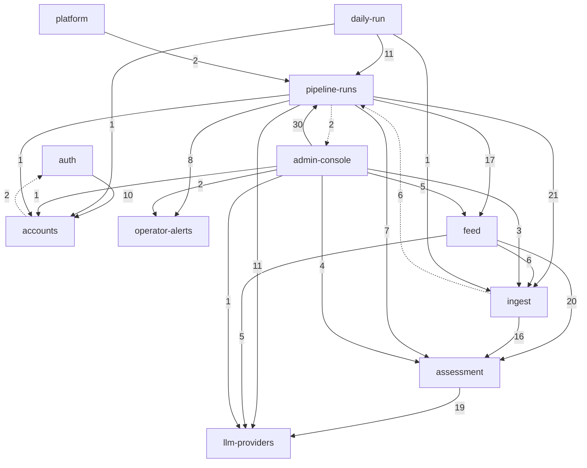

# Mapa projektu: szczur-radar

## TL;DR

Szczur Radar zbiera posty inwestycyjne z Wykopu i od 2026-11-01 także z Reddita (przez archiwum Arctic Shift), ocenia je modelem LLM i pokazuje zaproszonym użytkownikom w feedzie z filtrem. Rdzeń to łańcuch pozyskanie, silnik przebiegów, ocena, feed, a wokół niego stoją konta przez CLI, panel admina, alarmy poza aplikacją, kopie bazy i bramka wdrożeń.

M-3 przesunął szum z platformy na kontrakt między silnikiem, SPA i źródłami: 78% zmian kodu M-3 trafiło w pięć możliwości, które wcześniej miały 35%. Kształt zależności prawie się nie zmienił, doszła jedna krawędź między możliwościami.

Najbardziej boli to, czego M-3 nie dotknął: `assessment` i `llm-providers` mają 0 zmian w M-3, `system-prompt.md` stoi od F-02, a Reddit wszedł na produkcję bez napraw oceny, które zapisano w Parked. Trzy strefy ryzyka to kontrakt oceny, silnik przebiegów i weryfikacja wdrożeń; ta ostatnia wyraźnie stygnie, ale jej działanie leży już częściowo poza tym repozytorium.

Możliwości i ich zależności w backendzie (z grafu `jdeps`, etykieta to liczba krawędzi plik→plik, przerywana to słabsza strona 2-cyklu, pominięto 10 krawędzi do liścia `shared-foundations`):

## Teren

Kolumny szumu: **zm** zmiana, **fix** presja napraw, **tar** tarcie, **uwg** uwaga planistyczna, **zas** zasięg. H/M/L są względne wobec innych możliwości, `mech` oznacza sygnał mechaniczny poza rankingiem. Progi: zm H to ponad 80 zmian i trend rosnący, zm L to poniżej 50; fix H to co najmniej 5 nazwanych defektów, M to 2–4 albo co najmniej 2 commity naprawcze po merge'u; uwg H to ponad 3000 linii planów. Audyty liczone są jako uwaga, drugie podejścia i PR-y bez merge'a jako tarcie.

| Możliwość | Co robi | Krytyczność | zm | fix | tar | uwg | zas | Trend | Gdzie żyje |
|---|---|---|---|---|---|---|---|---|---|
| **pipeline-runs** | kolejka przebiegów w tle, kroki, odzyskiwanie po starcie, watchdog, wynik per źródło | high (rdzeń, zapis danych, inni zależą) | H | M | H | H | M | rosnący | `api/pipeline/**` bez kontrolerów, V3, V5, V8, V10–V12 |
| **assessment** | kontrakt oceny V2 jako kod: model, schemat, prompt, parser, walidator D1–D15, odsiew | high (rdzeń, każdy widok czyta wynik) | M | L | H | L | **H** | sezonowy, 0 w M-3 | `api/agents/**`, `resources/assessor/` |
| **platform** | CI, IaC Railway, bramka wdrożeń, runnery, obrazy, Caddy | high (zły apply lub bramka kładzie produkcję) | M | mech | H | H | L w Javie, reszta przez HTTP i CI | stały, 2 commity w M-3 | `.github`, `.railway`, `tools/deploy-gate`, `tools/ci-runner`, `api/health` |
| ingest | pobieranie z Wykopu i Reddita, `HttpRetry`, mapowanie do wspólnego modelu, surowe payloady | high (rdzeń, integracje zewnętrzne) | H | L | M | M | M | rosnący, 38 z 44 zmian M-3 to S-27 | `api/sources/**`, `api/raw`, `pipeline/step/SourceIngest`, V4, V13 |
| llm-providers | klienci OpenRouter, Gemini, DeepSeek, ponowienia, fail-fast `LLM_*` | high (integracja, koszt za wywołanie) | M | **H** | M | M | M | sezonowy, 0 w M-3 | `api/llm/**`, `config/LlmConfigurationCheck` |
| feed | `/api/posts` z filtrem, widok posta i surowe dane, pochodzenie posta | high (główna wartość) | M | L | L | M | M | stały | `api/posts/**`, web `FeedView`, `PostDetailView`, `PostCard`, `PostAssessment`, `FeedFilter` |
| auth | logowanie, Spring Session JDBC, limiter, filtr Origin, deny-by-default, guard SPA | high (tożsamość, publiczne wejście) | M | M | M | M | L | zanikający, 2 zmiany w M-3 | `api/auth/**`, `config/Security*`, `Session*`, web `LoginView`, `router/` |
| accounts | CLI operatora, linki aktywacyjne, `/activate`, konto systemowe | high (tożsamość, dane użytkownika) | M | M | L | L | M | zanikający | `api/cli`, `api/auth/activation`, `api/user`, web `ActivateView` |
| db-backup | codzienny `pg_dump`, pełny restore check, bucket, retencja, NAS | high (jedyna kopia na Hobby) | L | M | M | M | L | stały | `tools/db-backup` |
| admin-console | `/admin`, strona przebiegu, dni bez danych, nieudane posty, dzwonek | medium (tylko admin, uruchamia płatne przebiegi) | H | M | L | M | L | rosnący | web `AdminView`, `RunDetailView`, `runs.ts`, `api/notifications`, `PipelineRunController` |
| operator-alerts | healthchecks.io do Telegrama, kolejka zdarzeń, checki jako kod | medium (jedyny sygnał złej nocy poza aplikacją) | L | L | M | M | L | sezonowy | `api/alerts`, `tools/healthchecks` |
| daily-run | cron `pipeline-trigger`, trasy `/internal/*` z tokenem, `/api/freshness` | medium (wejście z tokenem, świeżość) | L | M | M | M | L | stały | `tools/pipeline-trigger`, `api/internal`, `FreshnessController` |
| model-evaluation | próbka złota, nagrania, miary, jakość i koszt Reddita (tylko testy) | low (poza jarem) | L | L | H, wspólne z assessment | L | L | sezonowy | `src/test/.../measurement`, `fixtures/llm` |

**Koszyki:**
- **platform** w tabeli wyżej, bo może położyć produkcję.
- **shared-foundations** (110 zmian, 8,2% kodu): liść bez zależności po odjęciu krawędzi mechanicznych, zasięg 86 plików w 11 możliwościach. Wzrost w M-3 to strażnicy S-23 i S-24.
- **shared-ui** (80 zmian, 5,9%): tokeny, komponenty, `api/client.ts`, `labels.ts`, `mock-api.js`.
- **docs-planning** (882 zmiany prozy): raportowane osobno, nie jest obszarem gorącym.

**Pokrycie możliwości:** 0 nieprzypisanych z 1349 zmian kodu. Koszyki to 14,1% (26,3% z platformą), w granicach progów. Szum wykluczony z 3652 wierszy: 884 vendored i fikstury, 522 binarne, 15 lockfile'i.

**Gdzie foldery nie pasują do możliwości:**
- Pakiet `pipeline/` obsługuje pięć możliwości: silnik, admin (`PipelineRunController`), daily-run (`InternalPipelineRunController`, `FreshnessController`), platform (`DeploySafetyController`) i ingest (`SourceIngest`).
- Encja `Post` należy do `posts/` (feed), a zapisuje ją silnik: 17 krawędzi plus surowy SQL w `PostTransitions` i `RunRecorder`.
- `assessment` rozciąga się na `agents/`, `resources/assessor/`, `measurement/` i web `PostAssessment.vue`, które przypisano do feedu.
- `config/` obsługuje auth, llm-providers i błędy API. `cli/` obsługuje accounts, `migrate` i komendę alarmu testowego.
- Web `api/posts.ts` niesie trasę admina i stał się wspólnym modułem typów `Page`; S-24 to pogłębiło.

## Realne powiązania

| Powiązanie | Skąd wiadomo | Mechaniczne? |
|---|---|---|
| admin-console → pipeline-runs, 30 krawędzi (25 przed M-3); co-change 7/0.64, w M-3 3/0.75 | graf runtime + co-change | nie, `PipelineRunController` sięga do `RunRecorder` i `SourceIngest` z pominięciem `PipelineRunService` |
| pipeline-runs → ingest 21, feed 17, llm-providers 11, operator-alerts 8, assessment 7 | graf runtime, dla `posts` także SQL | nie |
| ingest → assessment, 16 krawędzi (9 przed M-3) | graf runtime; mapery Reddita budują `AssessmentInputV1` | nie, kontrakt |
| feed → assessment 20, assessment → llm-providers 19; `AssessmentInputV1` i `OutputV2` sięgają 42 i 41 plików w 5 możliwościach | graf runtime | nie, kontrakt nośny |
| pipeline-runs ↔ admin-console przez `RunNotifications` | graf runtime, 2-cykl pakietów | nie, bez zmian od poprzedniej mapy |
| auth ↔ accounts, 10/2 | graf runtime + co-change 4/0.67 | częściowo, `AuthorizationCompletenessIT` |
| ingest ↔ pipeline-runs, co-change 4/0.67; S-27 wypada z liczenia | co-change | nie; krawędź 6 to tylko plik `SourceIngest`, `sources/` i `raw/` nie importują `pipeline/` |
| reguły SPA ↔ API: `rules.json` (zbiory, limity, kody błędów, white space) | grep + `SpaRulesTest`, `rules.test.ts` | tak, korytarz ze strażnikiem (S-24) |
| kształt JSON SPA ↔ API: `run`, `post`, `failed-post`, `freshness` | `ContractFiles` + `shapes.test.ts` | tak dla 4 z 10 kształtów; `User`, `ActivationLookup`, powiadomienia, `SourceState`, `MissingDays`, `Page<T>` bez strażnika, **unknown** |
| enum ↔ `CHECK` w migracjach | `ClosedSetsIT`, 24 pozycje | tak, korytarz (S-23) |
| reguła adresu ping w 4 miejscach | `tools/healthchecks/test.sh`, krok 9 | tak dla reguły (S-25); reszta `check_in()`, 60 wspólnych linii `backup.sh` i `trigger.sh`, bez porównania |
| `tools/db-backup/tables.sh` ↔ migracje | `db-backup-test`, 11/11 tabel | tak, korytarz |
| `wait-safe.sh` → `/api/deploy-safety` → stany `pipeline_runs` | grep + graf | nie, bramka zależy od semantyki stanów przebiegu; test tylko na stubach |
| `trigger.sh` ↔ `/internal/pipeline-runs/*` | grep + `pipeline-trigger-test` | test przeciw atrapie API, zgodność atrapy **unknown** |
| `dev/mock-api.js` ↔ odpowiedzi API; 8 partnerów, 11 commitów | co-change | częściowo, skan obejmuje tylko kody błędów; kształt **unknown** |
| `.railway/railway.ts` ↔ zmienne Springa; `checks.sh` ↔ harmonogramy cronów | grep | hub mechaniczny; ponowny `apply` ręczny, **unknown** |
| `szczur-radar-monitor` → `/api/ready`, `/healthz`, `GET /`; `/api/admin/llm/check` | opis w `deploy-plan.md`; brak konsumenta w repo | **unknown (external)** |
| tabele `posts`, `pipeline_runs`, `users`, `spring_session` | grep SQL; graf ich nie widzi | **unknown** poza znalezionymi miejscami |

Zmiana wobec mapy z 2026-10-27: sprzężenia typu „kopia reguły między modułami” stały się korytarzami ze strażnikiem. Sprzężenia strukturalne wewnątrz backendu pozostały bez zmian. W repo nie ma reguł zależności (ArchUnit, Modulith, dependency-cruiser), więc granice pakietów trzyma tylko dyscyplina.

## Strefy ryzyka

**1. assessment z model-evaluation: ocena Reddita przy nietkniętym kontrakcie**

Największy realny zasięg w repo stoi obok celu jakości, który obniżono dwa razy, a Reddit działa już na produkcji bez napraw oceny.
- *Krytyczność:* high, główna wartość; każdy widok czyta wynik.
- *Tarcie H:* progi F-02 złagodzone (≥75% do ≥70%, ≤3% do ≤10%), Outcome S-28 zmieniony ze spełnienia progów na obraz konfiguracji, włączenie bez napraw (`2-discussion.md:91`, `roadmap.md:82`, `:342`). PR #23 zamknięty bez merge'a.
- *Zasięg H, niezależny od tarcia:* kontrakty sięgają 42 i 41 plików w 5 możliwościach, `ItemType` 60 plików, 24 obce pliki testowe; `ingest → assessment` wzrosło z 9 do 16 (`3-structure.md:190`, `:172`).
- *Kontekst:* 0 zmian w M-3, prompt niezmieniony od 663c687 (`1-history.md:39`). To może znaczyć stabilność albo zaniedbanie; historia tego nie rozstrzyga. `assessment` i `model-evaluation` liczone są raz, bo chodzi o ten sam cel.
- *Pliki:* `szczur-radar-api/src/main/resources/assessor/system-prompt.md`, `szczur-radar-api/src/main/java/pl/szczurradar/api/agents/assessor/contract/AssessmentInputV1.java`, `szczur-radar-api/src/main/java/pl/szczurradar/api/agents/assessor/contract/AssessmentOutputV2.java`, `szczur-radar-api/src/main/java/pl/szczurradar/api/agents/assessor/Assessor.java`.

**2. pipeline-runs: silnik, który rośnie przez każdą falę**

Jedyna możliwość rosnąca przez wszystkie fale, z największą uwagą i złamanymi granicami bez zmian. Dane mówią raczej „ważne” niż „psuje się”.
- *Krytyczność:* high, rdzeń, zapisuje dane użytkowników.
- *Tarcie H:* S-02 na Embabel, po 18 dniach S-17 bez Embabel, potem S-20 i S-26 wracają do tego samego kodu (`2-discussion.md:92`).
- *Uwaga H:* 8 + 6 ustaleń audytów, 4474 linie planów, najwięcej w repo (`2-discussion.md:49`, `:120`). Zmiana H (`1-history.md:17`) ma tę samą przyczynę co uwaga, czyli planowe utwardzanie, więc liczona jest raz.
- *Przeciwwaga:* 1 nieplanowana poprawka, 0 revertów, 0 commitów naprawczych po merge'u (`2-discussion.md:110`).
- *Bez zmian po M-3:* `PipelineRunController → RunRecorder, SourceIngest`, klucz API tworzony w `ConcurrentAssessmentDispatcher`, SQL na `posts` (`3-structure.md:223–227`). Dziesięć szerokich testów, najtrudniejsza izolacja (`3-structure.md:257`).
- *Pliki:* `szczur-radar-api/src/main/java/pl/szczurradar/api/pipeline/PipelineRunService.java`, `szczur-radar-api/src/main/java/pl/szczurradar/api/pipeline/assess/ConcurrentAssessmentDispatcher.java`, `szczur-radar-api/src/main/java/pl/szczurradar/api/pipeline/state/RunRecorder.java`, `szczur-radar-api/src/main/java/pl/szczurradar/api/pipeline/state/PostTransitions.java`, `szczur-radar-api/src/main/java/pl/szczurradar/api/pipeline/api/PipelineRunController.java`.

**3. platform: weryfikacja wdrożeń (pod-obszar bramki i monitora)**

Najsłabsza z trzech stref: stygnie, ale to tu było jedyne prawdziwe drugie podejście na infrastrukturze, a stan w dokumentacji rozjechał się ze stanem faktycznym.
- *Krytyczność:* high, bramka może zatrzymać lub przepuścić każdy deploy.
- *Tarcie H:* `deploy-verify` usunięte po 4 dniach, przeniesione do zewnętrznego monitora, S-21 przepisuje `gate.jq` i `verify-apply.sh`; #92 i #97 bez merge'a, #73 otwarte ponownie; 2 krytyczne w plan-review S-21, czyli w M-3 (`2-discussion.md:90`, `:58`).
- *Uwaga H:* 8 + 5 ustaleń audytów, 3222 linie planów (`2-discussion.md:58`, `:121`). Nakłada się częściowo z tarciem: plany S-14 i S-21 wynikają z tego samego łańcucha, audyty i pozostałe plany nie. Liczę jako niezależne, ale to najsłabszy z tych werdyktów.
- *Stygnięcie:* udział commitów 45% do 15%, nieplanowane `fix` 13 do 0.
- *Rozjazd:* `REPOSITORY_GUIDELINES.md:63` podaje `CI_RUNNER=szczur-ci`, ale takiej zmiennej nie ma, a ostatni CI szedł na `ubuntu-latest`; runnery: 1 online, 6 offline (`4-people.md:118`, sprawdzone ponownie przy pisaniu raportu).
- *Pliki:* `tools/deploy-gate/gate.sh`, `tools/deploy-gate/gate.jq`, `tools/deploy-gate/verify-apply.sh`, `tools/deploy-gate/wait-safe.sh`, `szczur-radar-api/src/main/java/pl/szczurradar/api/pipeline/api/DeploySafetyController.java`, `.github/workflows/ci.yml`, `.railway/railway.ts`.

**Obserwować** (nie spełniają progu):
- **llm-providers.** Fix H: 5 nazwanych defektów na 11 commitów, wszystkie przed M-3, wszystkie na krawędziach dostawcy (`1-history.md:120`). Reszta M, 0 zmian w M-3. Spadek ze strefy ryzyka z poprzedniej mapy wynika z ciszy, nie z dowodu stabilności.
- **ingest.** Zmiana H, ale 86% zmian M-3 to jeden commit S-27, czyli świeży kod. Zasięg M, bo fan-in `Source` to typ wartości (`3-structure.md:189`). Granica nowego źródła trzyma, ale po przygotowaniu przez S-20 i nie sprawdzono jej trzecim adapterem. Pierwsza noc z Redditem to 2 listopada, #121 otwarte.

**Wygląda na gorące, nie jest:**
- **platform, liczba commitów i defektów:** 16 z 33 nazwanych defektów to iteracja na Railway i CI (reguła 5).
- **`railway.ts`, `ci.yml`, `KitchenSinkView`:** huby, bo każda zmiana je dotyka (reguły 3, 4).
- **shared-foundations, wzrost w M-3:** dodawanie strażników, nie presja na fundamenty.
- **`sources/Source`, Ca 30:** typ wartości; stałe `WYKOP` i `REDDIT` mają 0 użyć poza `sources/` (reguła 2).
- **ingest, 20% zmian M-3:** jeden commit z nowym kodem (reguła 12).
- **7 issue `deploy-health`:** 5 testów ścieżki alarmu i 2 alarmy przy sondach 200.
- **32 + 10 commitów `fix` z przeglądu:** krok workflow, nie miara jakości.
- **SCC 11 możliwości:** tworzą go konwertery enumów i bootstrap CLI.
- **docs-planning:** każdy PR niesie folder zmiany (reguła 8).
- **0 znaczników TODO:** nie oznacza braku długu. Dług ma 36 nazwanych wpisów w `## Parked`.
- **Jeden autor:** linia bazowa dla jednoosobowego projektu (reguła 6).

**Sprzeczności warte pytania:**
- `assessment` ma największy zasięg, a M-3 dodał do niej drugie źródło i inny język bez zmiany jednego pliku tej możliwości. Czy to dowód dobrego kontraktu, czy tylko brak sygnału z produkcji?
- `pipeline-runs` jest najczęściej przeglądany i prawie się nie psuje. Czy przegląd działa, czy błędów po prostu nie widać? Error trackera nie ma z decyzji S-18.
- S-27 to największa kodowo zmiana M-3 bez plan-review. W M-3 plan-review miały 3 z 10 zmian, wobec 17 z 28 wcześniej.
- `REPOSITORY_GUIDELINES.md:92` zakazuje zamykania issue przed weryfikacją produkcji, a 5 z 9 issue M-3 zamknięto 4–14 minut po merge'u. Czy weryfikacja była płytsza z racji zakresu, czy reguła przestała obowiązywać?
- `db-backup` jest krytyczny i prawie niedyskutowany, a jego działanie zależy od zadań na NAS i reguły konta Railway, których repo nie widzi.
- `feed` to główna wartość produktu, a w Javie ma 0 testów `*Test`, tylko integracyjne.
- `context/foundation/roadmap.md:334` każe dopisać test, który już istnieje (`MissingDaysTest.java:79–90`). Ile jeszcze wpisów Parked jest nieaktualnych?

## Kogo zapytać

Baseline: 1 człowiek w całej historii, 85 PR-ów, 0 formalnych recenzji, co najmniej 85 z 90 commitów pisanych z agentem. Każda odpowiedź to ta sama osoba: operator, `kwmacioszek`. Różnica leży w tym, o co zapytać i co przeczytać wcześniej; powód decyzji jest w `context/` albo w sesji, a nie w autorstwie.

| Strefa | Najpierw przeczytaj | O co zapytać operatora, bo repo tego nie powie |
|---|---|---|
| assessment | PR #31, #134, `context/foundation/roadmap.md:342` | Jaki wynik na Reddicie uzna za zły i kiedy wrócić do napraw z Parked |
| pipeline-runs | PR #110, #130 (przebudowały przepływ); #37 i #60 są częściowo nieaktualne | Co uznaje za świadome granice silnika, a co za dług |
| platform | PR #99, #124, runbook S-14 i `deploy-verification-hardening` w `context/deployment/deploy-plan.md` | Czy `CI_RUNNER` zniknął celowo; data wygaśnięcia PAT monitora (wygasły zatrzymuje monitor po cichu) |
| llm-providers (obserwować) | PR #40, #82, #96 | Limity wydatków u dostawców |
| ingest (obserwować) | PR #130, #132, sekcja S-27 w `deploy-plan.md` | Wynik nocy 2 i 4 listopada, potem zamknięcie #121 |

## Pierwszy dzień

1. `context/foundation/prd.md`: po co jest produkt i co jest `must-have`.
2. `szczur-radar-api/src/main/java/pl/szczurradar/api/pipeline/CLAUDE.md`, potem `pipeline/PipelineRunService.java` (wejście) i `pipeline/flow/RunSequence.java` (gdzie naprawdę leży logika kroków).
3. `szczur-radar-api/src/main/java/pl/szczurradar/api/agents/assessor/CLAUDE.md`, potem `agents/assessor/contract/AssessmentOutputV2.java` (kontrakt) i `szczur-radar-api/src/main/resources/assessor/system-prompt.md`.
4. `szczur-radar-api/src/main/java/pl/szczurradar/api/sources/CLAUDE.md`, potem `pipeline/step/SourceIngest.java` (szew z silnikiem) i `sources/reddit/RedditFetcher.java` (najnowszy adapter).
5. `szczur-radar-api/src/main/java/pl/szczurradar/api/llm/CLAUDE.md`, potem `llm/LlmClient.java` i `llm/transport/TransportRetry.java`.
6. `szczur-radar-api/src/main/java/pl/szczurradar/api/posts/api/PostController.java` i `posts/Post.java` (feed od strony API), potem `szczur-radar-web/src/views/FeedView.vue`.
7. `szczur-radar-web/src/contract/rules.json` i `szczur-radar-api/src/test/java/pl/szczurradar/api/persistence/ClosedSetsIT.java`: jak repo pilnuje reguł kopiowanych między warstwami.
8. `.github/workflows/ci.yml`, `tools/deploy-gate/gate.sh` i wybrane sekcje `context/deployment/deploy-plan.md` (2301 linii, czytaj sekcje, nie całość).

## Ograniczenia

- **Okno:** cała historia, ale to tylko 5 tygodni i 90 squashy. Commit to zmiana, nie edycja. Poprawki z PR-ów widać częściowo, przez 505 tematów pod-commitów zachowanych w treści squashy. S-29 i 5b4ac92 mają pustą treść, a amend i force-push są niewidoczne.
- **Źródła:** git + gh, tylko odczyt. Odpytane: PR-y, issue, nazwy zmiennych i sekretów, runnery, ostatnie przebiegi CI. Railway, logi produkcyjne, healthchecks.io, NAS i konta dostawców nie były odpytywane.
- **Graf:** Java i TS/Vue na poziomie 2, shell, IaC i CI tylko grep. Kompilator TS czytany z `node_modules` głównego checkoutu, bo worktree ich nie ma. Spring DI, sprzężenie przez tabele i refleksja są poza grafem. Porównanie z M-3 pochodzi z przebudowy grafu na e5ab295.
- **Pokrycie możliwości:** 0% nieprzypisanych, 14,1% koszyki, 26,3% z platformą. Przypisanie issue, zmian i Parked do możliwości poszło po nazwach (inference). Inwentarz wziął identyfikatory z poprzedniej mapy, żeby mapy dało się porównać; footprinty się zmieniły, więc liczby zmian nie są porównywalne 1:1.
- **Agenci:** wszyscy czterej skończyli, żaden plik dowodów nie jest częściowy. Kontrakt skanowania miał błąd: trailer Claude ma 83 z 90 commitów, nie 85. Faktyczny udział to co najmniej 85, bo dwa squashe zgubiły trailer.
- **Czego mapa NIE mówi:** czy ocena Reddita jest dobra, czy system działa dziś na produkcji, czy strażnicy są czerwoni przy rozjeździe (potwierdzono ich obecność i wpięcie w CI, bez próby rozjazdu), czy ustalenia audytu M-2 powiązane z wycinkami `done` są naprawdę zamknięte.
- **Niewiadome warte osobnego badania:**
  1. Jakość oceny na postach z Reddita po pierwszych nocach (język, `claim_ids`, `D6`, megawątki) i ich koszt.
  2. Które z 6 kształtów JSON bez kontraktu warto objąć strażnikiem; zgodność `dev/mock-api.js` i atrapy w `pipeline-trigger/test.sh` z API.
  3. Czy Parked jest aktualny: co najmniej jeden wpis jest nieaktualny, a `post-m2-audit` ma nadal status `preparing`.
  4. Czy `llm-providers` wytrzymuje wolumen dwóch źródeł: 0 zmian w M-3 tego nie pokazuje.
  5. Stan poza repo: reguła Railway „deployment crashed”, Cloud Sync, Telegram, data PAT, limity wydatków, kompletność listy sealed. Tego nie zweryfikuje agent bez dostępu operatora.
  6. Alarmy i przebiegi `verify.yml` w `szczur-radar-monitor`: od 9ef690b żyją tam, więc spadek issue `deploy-health` do zera tutaj o niczym nie świadczy.
  7. Czerwone przebiegi CI per job i niestabilność testów (nie liczone), przyczyna #90, tarcia ukryte przez rebase.
  8. Skutki trzeciego adaptera: niska cena nowego źródła nie została sprawdzona.
  9. Pary co-change S-27 nie są policzone, bo commit dotyka ponad połowy możliwości. Dotyczy to też `ingest ↔ db-backup` i `feed ↔ ingest` (`posts.channel`).
  10. Dla oceny granic warto rozważyć ArchUnit lub Spring Modulith oraz `dependency-cruiser`; nic nie instalowano.
- **Niewiadome pominięte świadomie:** autor komentarzy z konta `kwmacioszek`, autorstwo modeli przed squashem i formalna własność (brak CODEOWNERS), bo w projekcie jednej osoby nie zmieniają żadnego wniosku.
