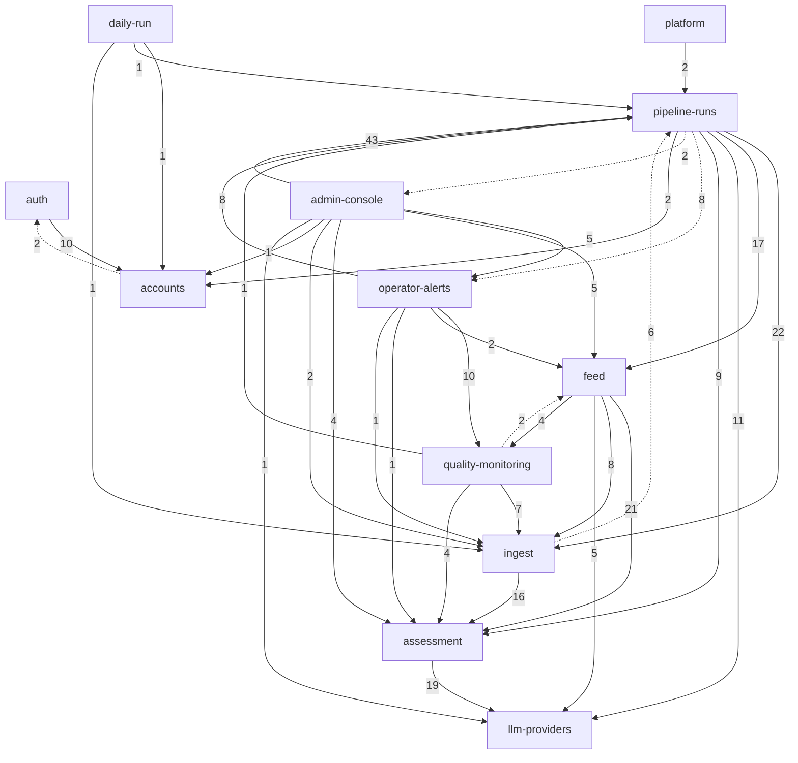

# Mapa projektu: szczur-radar

## TL;DR

Szczur Radar zbiera posty inwestycyjne z Wykopu i Reddita (archiwum Arctic Shift), ocenia je modelem LLM według zamkniętego kontraktu i pokazuje zaproszonym użytkownikom w feedzie z filtrem. Rdzeń to łańcuch: pozyskanie, silnik przebiegów, ocena, feed. Wokół niego stoją:
- konta zakładane przez CLI;
- panel admina;
- alarmy poza aplikacją (od M-4 zdarzenia API idą przez ntfy, a co noc przychodzi podsumowanie);
- kopie bazy;
- bramka wdrożeń.

M-4 dołożył dwie nowe możliwości. Pierwsza to sieć regresji: scenariusze PR env w CI, PIT na rdzeniu, kontrakt SPA ↔ API i atrapa zgodna z kontraktem. Druga to jakość ocen per źródło.

Szum M-4 nie przesunął się w stronę rdzenia oceny, tylko w utwardzanie i obserwowalność. 63% zmian kodu M-4 trafiło w sieć regresji, panel admina, silnik przebiegów, alarmy i jakość, a ponad połowa zmian to testy (55,5% wobec 34,8% wcześniej). Tempo zostało takie samo, około 34 zmian kodu na dzień.

Boli przede wszystkim stan postów w silniku przebiegów. Silnik zmienia się stale, ma największy zasięg wstecz, a stan zapisuje SQL-em poza encjami. M-4 dołożył tam wejście z pominięciem serwisu: przywracanie martwych postów. Kontrakt oceny i dostawcy LLM są krytyczni, a od M-2 prawie nikt ich nie dotyka.

Możliwości i ich zależności w backendzie:
- źródło: graf `jdeps`;
- etykieta: liczba krawędzi plik→plik;
- linia przerywana: słabsza strona 2-cyklu;
- pominięto 12 krawędzi do liścia `shared-foundations`.

Uwaga do diagramu: 10 z 43 krawędzi `admin-console → pipeline-runs` i 3 z 5 krawędzi `admin-console → operator-alerts` pochodzą z `InternalPipelineRunController`, który należy do `daily-run`. Wyjaśnienie jest w sekcji Ograniczenia.

## Teren

Buzz liczony względem innych możliwości: H, M, L. Kolumny:
- **zm**: zmiany i trend;
- **fix**: presja poprawek;
- **tar**: tarcie (przeglądy NEEDS ATTENTION, drugie podejścia, incydenty);
- **uwg**: uwaga planistyczna w M-4;
- **zas**: zasięg w runtime i cykle.

„mech” oznacza sygnał mechaniczny.

| Możliwość | Co robi | Krytyczność | zm | fix | tar | uwg | zas | Trend (M-1/M-2/M-3/M-4) | Gdzie żyje |
|---|---|---|---|---|---|---|---|---|---|
| **pipeline-runs** | kolejka przebiegów w tle, kroki, odzyskiwanie po starcie, watchdog, wynik per źródło, wyłącznik serii odmów (S-32), rozliczenie postów przy zapisie (S-38) | high (rdzeń, zapis danych, inni zależą) | **H** | mech | M | M | **H** | stały 57/74/48/41 | `api/pipeline/**` bez kontrolerów i `NightSummary`, V3, V5, V8, V10–V12, V14 |
| feed | `/api/posts` z filtrem, strona posta z oceną i surowymi danymi, typ posta słowami źródła | high (główna wartość) | M | L (jedna realna usterka, S-44) | L | M | M | stały 54/10/24/28 | `api/posts/**`, web `FeedView`, `PostDetailView`, `PostCard`, `PostAssessment`, `FeedFilter` |
| ingest | Wykop i Reddit, `HttpRetry`, mapowanie do wspólnego modelu, rejestr `Source` | high (rdzeń, integracje zewnętrzne) | L | mech | L | L | **H** | sezonowy 42/13/44/8 | `api/sources/**`, `api/raw/**`, `SourceIngest`, V4, V13 |
| assessment | kontrakt oceny V2 jako kod: model, schemat, prompt, parser, walidator D1–D15 | high (rdzeń, każdy widok czyta wynik) | L | L | L | L | **H** | zanikający 89/11/0/9 | `api/agents/**`, `resources/assessor/` |
| llm-providers | klienci OpenRouter, Gemini, DeepSeek, ponowienia, fail-fast `LLM_*` | high (integracja, koszt za wywołanie) | L | L | L | L | M | **0 w M-3 i M-4** | `api/llm/**` |
| platform | CI, IaC Railway, bramka wdrożeń, runnery, obrazy, Caddy | high (zły apply lub bramka kładzie produkcję) | L | mech | M (incydent `variable.delete`) | L | grep, **unknown** | zanikający 101/65/7/12 | `.github`, `.railway`, `tools/deploy-gate`, `tools/ci-runner` |
| auth | logowanie, Spring Session JDBC, limiter, filtr Origin, deny-by-default, guard SPA | high (tożsamość, publiczne wejście) | L | L | L | L | L | zanikający 87/3/2/8 | `api/auth/**`, `Security*`, web `LoginView`, `router/` |
| accounts | CLI operatora, linki aktywacyjne, `/activate`, konto systemowe | high (tożsamość) | L | L | L | L | M | zanikający 65/14/2/5 | `api/cli`, `api/auth/activation`, `api/user` |
| db-backup | codzienny `pg_dump`, restore check, bucket, retencja, NAS | high (jedyna kopia na Hobby) | L | L | L | L | grep | zanikający | `tools/db-backup` |
| **operator-alerts** | zdarzenia API przez ntfy, podsumowanie nocy, crony → healthchecks.io → Telegram | medium (jedyny sygnał złej nocy poza aplikacją) | **H** | mech | **H** | M | M–H (nowy 2-cykl) | sezonowy 0/29/5/38 | `api/alerts`, `pipeline/NightSummary`, `tools/healthchecks` |
| admin-console | `/admin`, strona przebiegu, dni bez danych, nieudane i martwe posty z przywracaniem (S-33), dzwonek | medium (tylko admin, uruchamia płatne przebiegi, zmienia stan postów) | **H** | mech | M | L | L | rosnący 39/29/29/48 | web `AdminView`, `RunDetailView`, `runs.ts`, `PipelineRunController`, `DeadPostController` |
| quality-monitoring | udział nieudanych prób wg klas i tez w innym języku per źródło, progi, sygnał (S-35, S-36) | medium (sygnał dla operatora) | H (nowa) | mech | M | M | M | nowa 0/0/0/31 | `posts/AssessmentQuality*`, `Quality*`, `Language*`, `Source*`, V15, V16 |
| regression-harness | scenariusze PR env (S-31), PIT (S-45), kontrakt i rejestr reguł SPA ↔ API, atrapa API, izolacja danych IT | medium (od niej zależy, czy CI zatrzyma zły merge) | H | mech | H | H | test-only | rosnący 7/4/13/55 | `src/test/.../{scenario,mutation,contract,web}`, web `src/contract/**`, `dev/mock-api.js` |
| daily-run | cron `pipeline-trigger`, `/internal/**` z tokenem, `/api/freshness` | medium (wejście z tokenem) | M | mech | L | L | L | rosnący przez `test.sh` 16/8/8/23 | `tools/pipeline-trigger`, `api/internal`, `InternalPipelineRunController` |
| model-evaluation | próbka złota, nagrania, miary (tylko testy) | low (poza jarem) | L | L | L | L | L | zanikający | `src/test/.../measurement` |

Pozostałe kubełki:
- **shared-foundations** (154 zmiany, 9,0%): `persistence`, `text`, `settings`, `config`, `MigrationsIT`, `JpaSchemaIT`. To czysty liść: Ce 0 bez sygnałów mechanicznych.
- **shared-ui** (72 zmiany, 4,2%): tokeny `style.css`, wspólne komponenty, `api/client.ts`, `labels.ts`, `KitchenSinkView`.
- **docs-planning** (1121 wierszy prozy, osobno): każda zmiana niesie plan, przeglądy i archiwum.

Pokrycie: wszystkie 1719 zmian kodu są przypisane do możliwości (0% nieprzypisanych), z tego kubełki mają 13,1%. Podział folderów nie odpowiada możliwościom w czterech miejscach:
- **`posts/`** mieści feed i jakość ocen. Repozytoria feedu zwracają projekcje jakości.
- **`pipeline/`** mieści silnik, podsumowanie nocy (`NightSummary`, alarmy), krok pozyskania (`SourceIngest`) i kontrolery admina oraz crona.
- **`posts/api`** mieści feed i trasy admina (nieudane i martwe posty).
- **Web `api/posts.ts`** niesie trasy admina, w tym nowe `/api/admin/posts/restore`.

## Realne powiązania

| Powiązanie | Skąd wiadomo | Mechaniczne? |
|---|---|---|
| admin-console → pipeline-runs, 43 krawędzie (10 z nich to w rzeczywistości `daily-run`); `DeadPostController → state/PostTransitions.restore` z pominięciem `PipelineRunService` (nowe w S-33); `PipelineRunController → RunRecorder`, `SourceIngest` (bez zmian) | graf runtime | nie |
| pipeline-runs → ingest 22, feed 17, llm-providers 11, assessment 9 (+2 z wyłącznika S-32) | graf runtime | nie |
| **NOWE** pipeline-runs ↔ operator-alerts 8/8: silnik woła `AlertEvent`/`OperatorAlertQueue`, a `NightSummary` (Ce 22, 620 linii, pakiet `pipeline/`) czyta przebiegi, posty i jakość. Bez tego jednego pliku cyklu nie ma | graf runtime + co-change daily-run/operator-alerts 4/1,00 w M-4 | nie |
| **NOWE** operator-alerts → quality-monitoring 10 (wszystko z `NightSummary`) | graf runtime | nie |
| **NOWE** feed ↔ quality-monitoring 4/2: zapytania jakości żyją w `PostRepository`, `AssessmentRepository` (JPQL `select new …SourceCount`) | graf runtime; konstruktory JPQL jako napisy, **unknown** dla reszty | nie, ale cykl wynika częściowo z podziału footprintu w jednym pakiecie |
| ingest: `sources/Source` niesie od M-4 język i progi jakości; Ca 29 → 39, bezpośrednich zależnych 18 → 28, zasięg 31 → 46 plików | graf runtime | częściowo: fan-in typu wartości (zasada 2), ale nowe źródło dopisuje teraz też progi |
| feed → assessment 21, ingest → assessment 16, assessment → llm-providers 19; `AssessmentInputV1` Ca 29, `ItemType` zasięg 62 | graf runtime | nie, kontrakt nośny |
| kształty JSON SPA ↔ API: 17 plików `src/contract/*.json`, `ContractRegistry` (15 tras) + `NOT_READ_BY_SPA` (9) = wszystkie 24 trasy `/api`, `ContractRoutesIT`, `shapes.test`, `responseTypes.test`, `vue-tsc` | grep + testy; 7 commitów kontraktu zmieniało obie strony | **tak**, korytarz ze strażnikiem (poprzednia mapa: 4 z 10 kształtów) |
| `rules.json` (values 27, limits 7, errorCodes 15) ↔ `SpaRulesTest`, `rules.test.ts` | grep + testy | **tak**, korytarz |
| `dev/mock-api.js` (701 linii, `page.route`) ↔ kontrakt, `mockApi.test.ts` (bez przeglądarki) | grep + testy; 20 commitów w historii, 6 w M-4 | **tak** od S-43; czy atrapa ma każdy tryb dla każdej z 20 tras: **unknown** |
| `trigger.sh` ↔ `/internal/pipeline-runs/{daily,{id},nightly-summary}` | grep + `pipeline-trigger-test` z atrapą `nightly-summary.json` | test przeciw atrapie; zgodność kształtu po stronie shella bez strażnika w buildzie API, **unknown** |
| `wait-safe.sh` → `/api/deploy-safety` → stany `pipeline_runs`; `tables.sh` ↔ migracje 12/12 | grep + `deploy-gate-test`, `db-backup-test` | tak dla tabel; bramka tylko na stubach |
| tabele `posts`, `assessments`, `pipeline_runs`, `users`, `spring_session`: `PostTransitions` (5× `UPDATE posts`), `RunRecorder` (18 zapisów `pipeline_run*`) | grep SQL; graf ich nie widzi | **unknown** poza znalezionymi miejscami |
| zmienne `NTFY_*`, `PIPELINE_TRIGGER_TOKEN`, `LLM_*`, `PG*`, `REDDIT_SUBREDDITS` między API, IaC, CI, cronami | grep | hub mechaniczny; brak jednego strażnika |
| `szczur-radar-monitor` → `/api/ready`, `/healthz`, `GET /`; odbiorcy ntfy i healthchecks.io | opis w `deploy-plan.md` | **unknown (external)** |
| web: widoki → `api/client.ts` (Ca 11), `labels.ts` (10), `AppButton`, `StatusMessage` (po 8); tokeny `style.css` przez `var(--…)` w 16 z 18 plików `.vue` | kompilator TS + grep tokenów | import tak; tokeny tekstowo (poziom 4) |

## Strefy ryzyka

### 1. pipeline-runs — stan postów i przebiegu

Rdzeń produktu: każda noc przechodzi przez tę możliwość. Zmienia się w każdym kamieniu, ma największy zasięg wstecz, a stan zapisuje SQL-em poza encjami. M-4 dołożył drugie wejście do zapisu stanu postów, które omija serwis.

- **Krytyczność:** high (rdzeń, zapis danych, inni zależą w runtime).
- **zm (H):**
  - najwięcej zmian w historii: 220, z tego 41 w M-4 (S-32, S-38, S-39);
  - trend stały we wszystkich czterech kamieniach (`evidence/1-history.md`, tabela aktywności i trend).
- **zas (H):** każda z tych liczb jest w `evidence/3-structure.md`:
  - wystawia 25 plików innym możliwościom;
  - 13 szerokich testów, najtrudniejsza izolacja;
  - `PostTransitions` ma 5× `UPDATE posts`, a `RunRecorder` 18 zapisów `pipeline_run*`, poza grafem;
  - nowa krawędź `DeadPostController → PostTransitions.restore` omija `PipelineRunService`;
  - PIT wyklucza `RunRecorder`, `PostTransitions` i kontrolery (`szczur-radar-api/pom.xml`, wykluczenia).
- **Niezależność:** zmiany wynikają z wycinków skierowanych w silnik, a zasięg z projektu warstw. To dwie różne przyczyny.
- **Tarcie M** (nie liczone do progu): przegląd S-38 dał NEEDS ATTENTION; ustalenia F1–F4 (tekst posta w logach Hibernate, ucięta przyczyna) naprawiono przed merge'em.
- **Pliki:**
  - `szczur-radar-api/src/main/java/pl/szczurradar/api/pipeline/state/PostTransitions.java`
  - `szczur-radar-api/src/main/java/pl/szczurradar/api/pipeline/state/RunRecorder.java`
  - `szczur-radar-api/src/main/java/pl/szczurradar/api/pipeline/assess/ConcurrentAssessmentDispatcher.java` (661 linii)
  - `szczur-radar-api/src/main/java/pl/szczurradar/api/posts/api/DeadPostController.java`
  - `szczur-radar-api/src/main/java/pl/szczurradar/api/pipeline/api/PipelineRunController.java`

### Watch: blisko progu, nie strefy ryzyka

- **operator-alerts, podsumowanie nocy.** Kandydat odpada jedną rodziną.
  - `NightSummary` to nowy hub: Ce 22, 620 linii, czyta trzy warstwy naraz (przebiegi, posty, jakość) i tworzy nowy 2-cykl z silnikiem.
  - S-34 był jedynym wycinkiem M-4 z dwoma PR-ami (#162, #164). Miał też incydent `variable.delete`: zmienne `NTFY_*` ustawione na produkcji przed merge'em zablokowały deploy innego PR.
  - Zmiany i tarcie mają wspólną przyczynę (budowa S-34), więc liczę je raz. Przy krytyczności medium do strefy potrzeba trzech rodzin H, a są dwie.
  - Ustalenia przeglądów o ścieżkach błędu są naprawione:
    - S-34 F1 i F2: podsumowanie po 202 i kod wyjścia crona;
    - S-35 F1: utrata `NIGHT_SUMMARY`.
- **ingest, rejestr `Source`.** Zasięg wzrósł (Ca 39, zasięg 58), bo `Source` niesie od M-4 język i progi jakości. Nowe źródło dopisuje więc progi S-35 i S-36, oprócz czterech `CHECK` i `rules.json`. Zmian w M-4 było mało (8), więc jest tylko jedna rodzina H.
- **admin-console, `AdminView.vue`.**
  - Widok ma 790 linii, z czego 261 doszło w M-4, i Ce 11.
  - Dni bez danych, jakość oraz nieudane i martwe posty są w nim wpisane bezpośrednio, bez własnych komponentów.
  - Zmiany są H, a zasięg L, bo od admina mało co zależy. Każda przebudowa UI admina zaczyna od tego pliku.

### Sprzeczności, czyli pytania do właściciela

- **assessment i llm-providers: krytyczne i dużego zasięgu, a od M-2 prawie nietykane.**
  - `system-prompt.md` nie zmienił się od F-02 (2026-10-06).
  - `llm-providers` ma 0 zmian w M-3 i M-4.
  - W M-4 żaden plan nie dotyczył tych możliwości.
  - Naprawy oceny Reddita są w `## Parked`, a od M-4 jakość mierzą S-35 i S-36.
  - Pytanie: czy zmierzony poziom jest akceptowany, czy to zamrożenie z braku czasu?
- **feed: główna wartość, a 0 testów `*Test`, tylko integracja.** Jedyna realna usterka M-4 (granica numeru strony, NUL w linku) wyszła dopiero z testów regresji S-44.
- **platform: 0 planów w M-4, a jedyny incydent wdrożeniowy M-4** (`variable.delete`) wydarzył się na styku IaC z nową zmienną.

### Wygląda gorąco, nie jest

- **regression-harness:**
  - 55 zmian w M-4, 50 z 98 ustaleń przeglądów i 4 z 8 werdyktów NEEDS ATTENTION;
  - wspólna przyczyna: kamień budował tę warstwę (zasada 4);
  - nie działa w runtime.
- **Udział commitów z poprawką 65% w M-4:** 10 z 11 to poprawki z przeglądu implementacji, czyli etap pracy, a nie usterki (zasady 5 i 12).
- **Co-change sieci regresji z feed, admin-console i auth:** jeden commit kontraktu dotyka z definicji trzech możliwości.
- **Huby `MigrationsIT`, `JpaSchemaIT`, `railway.ts`, `ci.yml`, `PostSeeds`:** lockstep ze strażnikiem albo fan-in z założenia (zasady 2–4).
- **quality-monitoring:** jest zajęta, bo jest nowa.
- **daily-run „rosnący”:** to `tools/pipeline-trigger/test.sh` i `nightly-summary.json` z S-34–S-36 oraz błąd przypisania kontrolera.
- **Ustalenia przeglądów o wycieku tekstu posta do logów i o ścieżkach błędu podsumowania:** sprawdzone w archiwach, mają status FIXED.

## Kogo zapytać

W oknie jest jedna osoba, operator (`kwmacioszek`). Koncentracja 100% jest więc bazą, nie ryzykiem. 91% commitów ma współautora Claude, a recenzje są agentowe i leżą w `context/archive/*/reviews/`. Zamiast pytania „kogo zapytać” działa „co przeczytać”.

| Strefa | Najpierw przeczytaj | O co zapytać operatora, bo repo tego nie powie |
|---|---|---|
| pipeline-runs | `szczur-radar-api/src/main/java/pl/szczurradar/api/pipeline/CLAUDE.md`; archiwa S-32, S-33, S-38 (`context/archive/2026-11-08-provider-refusal-breaker/`, `2026-11-08-restore-dead-posts/`, `2026-11-11-post-store-loss-visible/`) | Czy zapis stanu postów może mieć drugie wejście poza serwisem (przywracanie), czy to dług do zebrania |
| operator-alerts (watch) | archiwa S-34 i S-35 (`reviews/impl-review.md`), `context/deployment/deploy-plan.md` (S-34, S-35) | Kto czyta ntfy i Telegram, jak szybko reaguje, czy podsumowanie nocy przyszło każdej nocy od 10.11 |
| assessment, llm-providers (pytania) | `context/foundation/roadmap.md` (`## Parked`: naprawy oceny Reddita, dryf modelu), archiwum S-28 | Jaki wynik jakości per źródło uzna za zły i kiedy wrócić do kontraktu oceny |
| platform, db-backup | `context/deployment/deploy-plan.md`, `context/foundation/lessons.md` | Dostęp do Railway, NAS, healthchecks.io i repo monitora: czy ktokolwiek poza operatorem go ma |

## Pierwszy dzień

1. **`REPOSITORY_GUIDELINES.md` i `context/foundation/roadmap.md`** (`## Milestone History`, `## Parked`): co produkt robi i co świadomie odłożono.
2. **`szczur-radar-api/src/main/java/pl/szczurradar/api/pipeline/PipelineRunService.java` → `pipeline/flow/RunSequence.java` → `pipeline/assess/ConcurrentAssessmentDispatcher.java`**: wejście do przebiegu i miejsce, gdzie dzieje się ocena. Stan żyje w `pipeline/state/PostTransitions.java` i `RunRecorder.java`.
3. **`szczur-radar-api/src/main/java/pl/szczurradar/api/agents/assessor/Assessor.java` i `src/main/resources/assessor/system-prompt.md`**: kontrakt oceny V2, od którego zależy każdy widok.
4. **`szczur-radar-api/src/main/java/pl/szczurradar/api/sources/Source.java` i `pipeline/step/SourceIngest.java`**: rejestr źródeł (z progami jakości od M-4) i krok pozyskania.
5. **`szczur-radar-api/src/main/java/pl/szczurradar/api/posts/api/PostController.java` → `posts/PostRepository.java` → web `szczur-radar-web/src/views/FeedView.vue`**: główna wartość dla użytkownika, od API do widoku.
6. **`szczur-radar-api/src/main/java/pl/szczurradar/api/pipeline/NightSummary.java`, wołany z `pipeline/api/InternalPipelineRunController.java` przez `tools/pipeline-trigger/trigger.sh`**: noc od crona do podsumowania w ntfy.
7. **Web: `szczur-radar-web/src/router/index.ts`, `src/api/client.ts`, `src/style.css`, `src/labels.ts`, `src/views/AdminView.vue`**: trasy, jedyny klient API, tokeny, słownik etykiet i największy widok.
8. **Sieć regresji: `szczur-radar-api/src/test/java/pl/szczurradar/api/contract/ContractRegistry.java`, `szczur-radar-web/src/contract/rules.json`, `szczur-radar-web/dev/mock-api.js`, `szczur-radar-api/src/test/java/pl/szczurradar/api/scenario/PrEnvScenariosIT.java`**: co CI pilnuje między SPA a API i na czym stoi atrapa.

## Ograniczenia

**Okno i źródła danych:**
- Okno obejmuje całą historię: 7 tygodni, 112 commitów squash, bez merge commitów. Poprawki wewnątrz PR są widoczne tylko jako tematy pod-commitów w treści squasha.
- Źródła to git i `gh`. Forge nie ma ludzkich recenzji (0 na 107 PR), a recenzje agentowe leżą w `context/archive/*/reviews/`.
- W oknie jest jeden człowiek, więc żadna koncentracja nie jest ustaleniem.

**Graf zależności:**
- Java: `javac` i `jdeps` objęły 285 z 288 plików, pewność high.
- TS/Vue: 70 plików, pewność high. Kompilator wzięto z `node_modules` głównego checkoutu (lockfile identyczny).
- Shell, IaC, CI i powiązania między stosami: tylko grep, pewność low–medium.

**Pokrycie możliwości:**
- 0% nieprzypisanych plików, kubełki mają 13,1%.
- Footprinty różnią się od poprzedniej mapy (`context/archive/2026-11-01-repo-map/`): `regression-harness` i `quality-monitoring` są nowe, a `dev/mock-api.js` i `src/contract/**` przeszły z `shared-ui` do `regression-harness`. Liczby nie przenoszą się 1:1. Podagenci porównali okresy na tym samym `capabilities.tsv`, a struktura odtworzyła stan sprzed M-4 i dostała dokładnie 932 krawędzie, tyle co archiwum.

**Błąd przypisania (znany, nie przeliczony):**
- Glob `*PipelineRunController*` wygrał z `*InternalPipelineRun*`, więc `InternalPipelineRunController.java` trafił do `admin-console` zamiast do `daily-run`.
- Skutek dla zmian: 6 wierszy w 5 commitach. W M-4 to `f2ee5fa` i `2deaf39`, więc panel admina ma w M-4 46 zmian zamiast 48, a nocny cron 25 zamiast 23.
- Skutek dla grafu: 10 krawędzi `admin-console → pipeline-runs` i 3 krawędzie `admin-console → operator-alerts` należą do `daily-run`. Wtedy `daily-run → pipeline-runs` wynosi 11, jak w archiwum.
- Żaden ranking ani strefa ryzyka od tego nie zależy.

**Korekty dowodów:**
- `evidence/2-discussion.md` podaje, że `deploy-verification-hardening` jest nieśledzone. W rzeczywistości ta zmiana jest zarchiwizowana w `context/archive/2026-10-20-deploy-verification-hardening/`. Nieśledzona kopia folderu leży tylko w głównym checkoucie, jako lokalny ślad.
- `evidence/3-structure.md` (Unknowns, „Rozjazd dokumentacji”) podaje, że `REPOSITORY_GUIDELINES.md` opisuje `alerts/HealthchecksAlerts`. To nieprawda na `ef56ddc`: plik w repo opisuje `NtfyAlerts` i `NTFY_URL`/`NTFY_TOKEN` (zmieniony w S-34), a `HealthchecksAlerts` nie występuje w nim ani razu. Podagent czytał starszą kopię wytycznych z kontekstu sesji. Ustalenie wycofane.

**Czego mapa nie mówi:**
- Nie mówi, czy zanikające możliwości (llm-providers, auth, accounts, db-backup) są stabilne, czy tylko nietykane. To rozstrzygnęłyby logi produkcji, których tu nie ma.
- Nie mówi, czy strażnicy działają przy celowym rozjeździe. Potwierdzono tylko ich obecność i wpięcie w `ci.yml`.
- Nie mówi, który bean wygrywa w runtime (ntfy czy brak alarmów, dostawca LLM).
- Nie śledzi zapytań SQL i JPQL zapisanych jako napisy ani refleksji w strażnikach (`Class.forName` w `ContractRegistry`, `ClosedSetsGuard`, `RunEndingGuard`).

**Niewiadome warte osobnego zbadania:**
- Czy `dev/mock-api.js` ma każdy tryb (pusto, błąd, ładowanie) dla każdej z 20 tras czytanych przez SPA.
- Który widok renderuje który z 7 stanów UI. Zależność od tokenów CSS jest tekstowa.
- Czy kształt `nightly-summary` po stronie shella ma strażnika poza `pipeline-trigger/test.sh`.
- Konsumenci poza repo: `szczur-radar-monitor`, ntfy, healthchecks.io, czyli **unknown (external)**.
- Ile ze 98 ustaleń przeglądów M-4 odłożono. Trzy przeglądy sprawdzone ręcznie (S-34, S-35, S-38) mają wszystkie ustalenia FIXED poza S-34 F7 (SKIPPED).
- Fold nazw z ery Pythona i Embabel jest niepełny: następcy `PipelineAgentIT` i `AssessorAgent(IT)` nie zostali sprawdzeni.
- Pary, które powinny zmieniać się razem, a co-change ich nie pokazuje:
  - wejście modelu w `assessment` a `posts.language` i `QualityStatus` (S-36 zmienił drugą stronę, kontrakt oceny prawie nie);
  - proza `deploy-plan.md` a `.railway/railway.ts`.
- Gałęzie niezmergowane nie były listowane: drugie podejścia poza tematami PR są **unknown**.

**Narzędzia warte instalacji (nie instalowano):**
- ArchUnit albo Spring Modulith, żeby egzekwować granice pakietów. Dziś repo ma 0 reguł, a M-4 dodał trzy nowe przejścia przez warstwy.
- dependency-cruiser dla `szczur-radar-web`.
